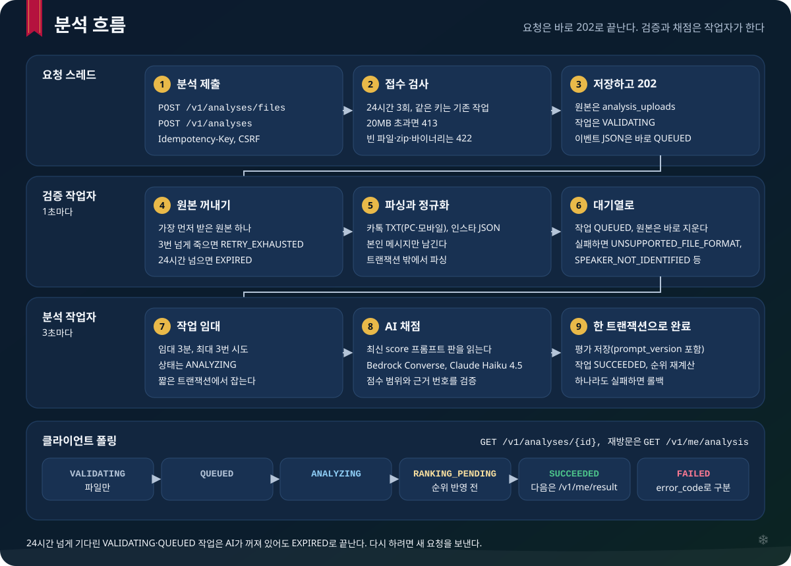
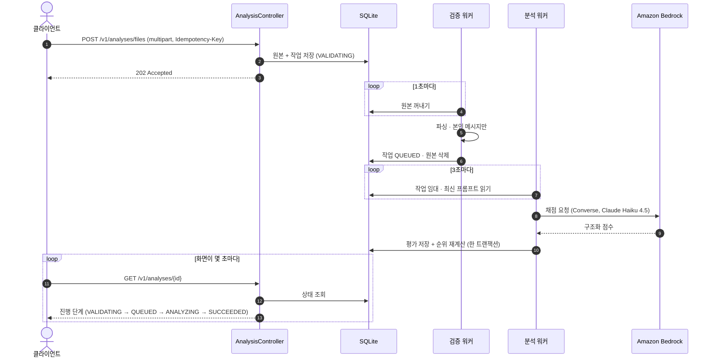

<p align="center">
  
</p>

<p align="center">
  <b>대화 기록으로 산타 순위를 매기는 API.</b><br>
  원본을 받아 AI가 채점하고, 순위와 선물 도착 시각은 서버가 계산한다.
</p>

<p align="center">
  
  
  
  
  
  
</p>

인프라는 [`santacut-infra`](https://github.com/yooni9ue/santacut-infra)에 있다.

<p align="center"></p>

## 한눈에 보기

<p align="center"></p>

## 할 수 있는 일

- 닉네임으로 참가한다. 세션은 HttpOnly 쿠키다.
- 지역은 두 단계로 고른다. 시·도 16개, 시·군·구 255개.
- 카카오톡 TXT나 인스타그램 JSON 원본을 그대로 올린다. 20MB까지 받는다.
- 서버가 원본을 파싱하고, 본인 메시지만 AI에 보낸다.
- AI가 점수를 매긴다. 순위와 선물 도착 시각은 서버가 계산한다.
- 진행 상태는 폴링으로 본다. 창을 닫았다가 다시 와도 이어서 본다.
- 순위표는 공개다. 50줄씩 cursor로 넘기고, 동점은 `공동 N위`로 보인다.
- 공유 링크는 그 순간의 결과를 고정한다. 취소한 링크는 안내 페이지로 바뀐다.
- 시즌 마감 전에는 지역을 바꿀 수 있다. 내 데이터는 언제든 지운다.

## 시즌 일정

산타컷은 크리스마스 시즌에만 연다. 2026-11-16 기준으로 마감까지 D-39다.

| 시각(KST) | 일어나는 일 |
| --- | --- |
| 지금 ~ 2026-12-25 0시 | 참가, 분석, 지역 변경을 받는다. 순위는 미리보기(`PREVIEW`)다 |
| 2026-12-25 0시 | 시즌 마감. 순위와 배송 계획이 확정(`FINAL`)되고, 새 분석과 지역 변경은 `409 SEASON_FROZEN`이다 |
| 12/25부터 매일 0~6시 | 산타가 순위대로 배송한다. 시속 100km, 한 명에 180초. 6시까지 못 끝내면 다음 날 0시에 잇는다 |

시즌 연도는 `app.season-year`(기본 `2026`)로 정한다.

## 아키텍처

<p align="center"></p>

- 분석은 큐에 넣는다. 화면은 진행 상태를 폴링한다.
- 작업자는 둘이다. 원본 검증은 1초, AI 채점은 3초 간격으로 돈다.
- AI 채점은 Spring AI와 Amazon Bedrock(Claude Haiku 4.5, Converse API)이다.
- 채점 프롬프트는 DB(`prompts`)에 판으로 쌓인다. AI를 부를 때마다 최신 판을 읽는다.
- 서버는 Lightsail `nano_3_0`(512MB) 한 대다. 지금은 도메인 없이 HTTP로 띄운다.

## 계층 구조

<p align="center"></p>

- 패키지는 계층 → 도메인 → 역할 순서로 나눈다.
- 자세한 규칙은 [코드 컨벤션](docs/backend-conventions.md)에 있다.

## 데이터 모델

<p align="center"></p>

- 기준은 [`schema.sql`](src/main/resources/schema.sql)이다.
- 원본 파일은 `analysis_uploads`에 잠깐 머물다가 검증이 끝나면 지워진다.
- 지역은 `parent_code`로 시·도와 시·군·구를 잇는다.
- `assessments.prompt_version`에는 채점에 쓴 프롬프트 판 번호가 남는다. 프롬프트를 DB로 옮기기 전 평가는 `NULL`이다.

## 분석 흐름

<p align="center"></p>

- 원본은 접수할 때 한 번 보고, 검증 작업자가 한 번 더 본다.
- 빈 파일, zip, 바이너리는 바로 `422`다. 20MB를 넘으면 `413`이다.
- 평가 저장과 순위 계산은 한 트랜잭션이다.
- 앱에는 AI 호출 수 한도가 없다. AI 비용은 AWS Bedrock 예산 차단(인프라)이 막는다.
- 24시간 넘게 기다린 작업은 만료된다. AI가 꺼져 있어도 마찬가지다.

<details>
<summary>시퀀스 다이어그램</summary>



</details>

## API

<p align="center"></p>

- 필드 정의는 Swagger(`/swagger-ui.html`)가 기준이다.
- 호출 순서는 [API 연동 가이드](../docs/frontend-api-guide.md)에 있다.

<details>
<summary>엔드포인트 표 (텍스트)</summary>

| 메서드 | 경로 | 하는 일 | 인증 |
| --- | --- | --- | --- |
| GET | `/v1/csrf` | CSRF 토큰 발급 | 공개 |
| GET | `/v1/regions` | 지역 목록(`?parent=`로 하위 지역) | 공개 |
| GET | `/v1/nicknames/availability` | 닉네임 가용성 확인 | 공개 |
| POST | `/v1/participants` | 참가 등록 (`201`) | 공개 · CSRF |
| GET | `/v1/me` | 내 참가 정보 | 세션 |
| PATCH | `/v1/me/region` | 내 지역 변경 (시즌 마감 전) | 세션 · CSRF |
| DELETE | `/v1/me` | 내 데이터 삭제 (`204`) | 세션 · CSRF |
| POST | `/v1/analyses` | 이벤트 JSON으로 분석 요청 (`202`) | 세션 · CSRF · `Idempotency-Key` |
| POST | `/v1/analyses/files` | 원본 파일로 분석 요청 (`202`, 20MB) | 세션 · CSRF · `Idempotency-Key` |
| GET | `/v1/analyses/{id}` | 분석 진행 상태 | 세션 |
| GET | `/v1/me/analysis` | 내 최근 분석 상태 | 세션 |
| GET | `/v1/me/result` | 내 점수·순위·도착 시각 | 세션 |
| GET | `/v1/rankings` | 랭킹 50명씩(cursor) | 공개 |
| POST | `/v1/shares` | 공유 링크 생성·재사용 | 세션 · CSRF |
| DELETE | `/v1/shares/{token}` | 공유 링크 폐기 (`204`) | 세션 · CSRF |
| GET | `/s/{token}` | 공개 공유 HTML | 공개 |
| GET | `/s/{token}/image.png` | 공개 공유 이미지 | 공개 |

dev 전용(`PROMPT_ADMIN_ENABLED=true`일 때만 있고, 운영은 404):

| 메서드 | 경로 | 하는 일 | 인증 |
| --- | --- | --- | --- |
| POST | `/v1/admin/prompts/{name}` | 프롬프트 다음 판 저장 (`201`) | 공개 · CSRF |
| GET | `/v1/admin/prompts/{name}` | 최신 판 | 공개 |
| GET | `/v1/admin/prompts/{name}/versions` | 판 목록(본문 없음) | 공개 |

프롬프트 이름은 영문 소문자, 숫자, 하이픈으로 된 1~40자다. 어기면 `400 INVALID_REQUEST`다.

</details>

## 품질 게이트

<p align="center"></p>

- 자동 검사를 통과한 뒤 리뷰어 9명이 판정한다.

## 기술 스택

<p align="center"></p>

## 실행

JDK 25가 필요하다. AI 채점에는 Bedrock을 부를 AWS 자격 증명(기본 체인)이 필요하다. 자격 증명이 없으면 분석 작업은 실패로 끝나고, 나머지 API는 그대로 돈다.

```powershell
cd backend
./gradlew.bat bootRun                      # 로컬 실행 (:8080)
./gradlew.bat --no-daemon check bootJar    # 커밋 전 검증
```

- 로컬 DB는 `./data/santacut.db`, 헬스 체크는 `/actuator/health`다.
- `bootRun`은 dev처럼 프롬프트 관리 API(`/v1/admin/prompts`)를 켠다.

## 데이터 출처

전국 시·도·시·군·구 지역과 대표 좌표([`regions.sql`](src/main/resources/regions.sql))는 2026-10-01 기준 행정동 경계로 만들었다. 생성 스크립트는 [`scripts/regions/generate_regions.py`](scripts/regions/generate_regions.py)다.

> 본 데이터는 통계청 통계지리정보서비스(SGIS, https://sgis.kostat.go.kr)에서 공공누리 제1유형으로 개방한 행정동 경계를 가공한 것이며(가공: vuski/admdongkor, https://github.com/vuski/admdongkor), CC BY 4.0으로 배포됩니다.

## 더 읽기

[시스템 아키텍처](docs/system-architecture.md) · [백엔드 설계](docs/backend-design.md) · [코드 컨벤션](docs/backend-conventions.md) · [배포](docs/deployment.md) · [API 연동 가이드](../docs/frontend-api-guide.md) · [작업 지침](CLAUDE.md)

<p align="center"></p>
