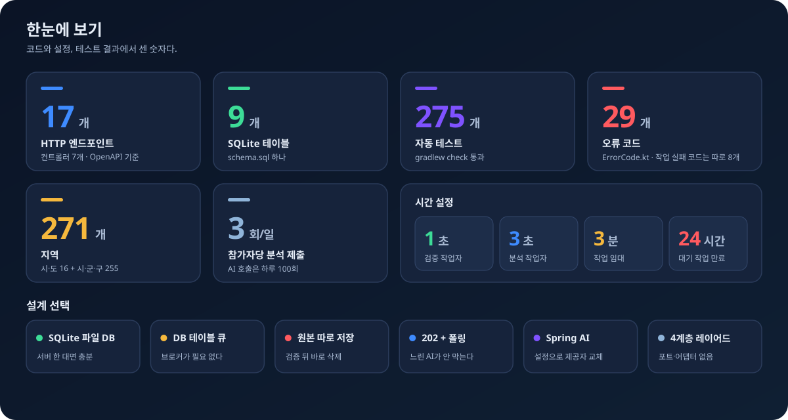
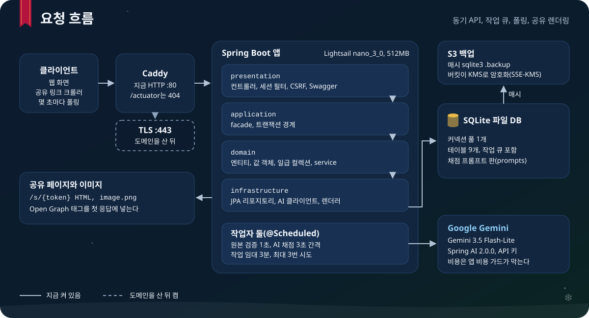
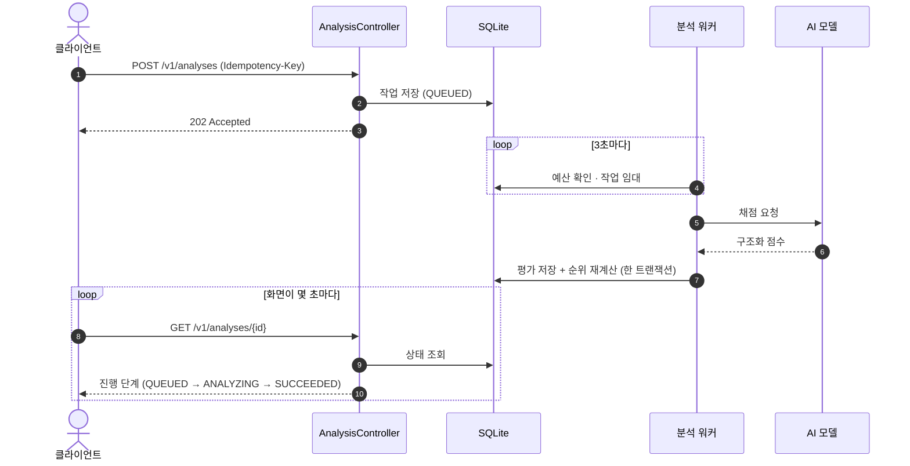

<p align="center">
  
</p>

<p align="center">
  <b>대화 기록으로 산타 순위를 매기는 API.</b><br>
  인프라는 <a href="https://github.com/yooni9ue/santacut-infra"><code>santacut-infra</code></a>에 있다.
</p>

## 한눈에 보기

<p align="center"></p>

## 아키텍처

<p align="center"></p>

- 분석은 큐에 넣고, 화면은 진행 상태를 폴링으로 조회한다.
- 지금 코드는 Spring AI + Ollama(`qwen2.5:3b`)다. 운영은 Bedrock을 계획한다.

## 계층 구조

<p align="center"></p>

- 패키지는 계층 → 도메인 → 역할 순서다.
- 자세한 규칙은 [코드 컨벤션](docs/backend-conventions.md)에 있다.

## 데이터 모델

<p align="center"></p>

- 기준은 [`schema.sql`](src/main/resources/schema.sql)이다.

## 분석 흐름

<p align="center"></p>

- 평가 저장과 순위 계산은 한 트랜잭션이다.
- 하루 예산을 넘으면 워커가 작업을 꺼내지 않는다.

<details>
<summary>시퀀스 다이어그램</summary>



</details>

## API

<p align="center"></p>

- 필드 정의는 Swagger(`/swagger-ui.html`)가 기준이다.
- 호출 순서는 [API 연동 가이드](../docs/frontend-api-guide.md)에 있다.

<details>
<summary>엔드포인트 표 (텍스트)</summary>

| 메서드 | 경로 | 하는 일 | 인증 |
| --- | --- | --- | --- |
| GET | `/v1/csrf` | CSRF 토큰 발급 | 공개 |
| GET | `/v1/regions` | 지역 목록 | 공개 |
| GET | `/v1/nicknames/availability` | 닉네임 가용성 확인 | 공개 |
| POST | `/v1/participants` | 참가 등록 (`201`) | 공개 · CSRF |
| GET | `/v1/me` | 내 참가 정보 | 세션 |
| POST | `/v1/analyses` | 분석 요청 (`202`) | 세션 · CSRF · `Idempotency-Key` |
| GET | `/v1/analyses/{id}` | 분석 진행 상태 | 세션 |
| GET | `/v1/me/analysis` | 내 최근 분석 상태 | 세션 |
| GET | `/v1/me/result` | 내 점수·순위·도착 시각 | 세션 |
| GET | `/v1/rankings` | 랭킹 50명씩(cursor) | 공개 |
| POST | `/v1/shares` | 공유 링크 생성·재사용 | 세션 · CSRF |
| DELETE | `/v1/shares/{token}` | 공유 링크 폐기 (`204`) | 세션 · CSRF |
| GET | `/s/{token}` | 공개 공유 HTML | 공개 |
| GET | `/s/{token}/image.png` | 공개 공유 이미지 | 공개 |

</details>

## 품질 게이트

<p align="center"></p>

- 자동 검사를 통과한 뒤 리뷰어 9명이 판정한다.

## 기술 스택

<p align="center"></p>

## 실행

JDK 25가 필요하다. AI 채점에는 Ollama(`localhost:11434`)가 필요하다.

```powershell
cd backend
./gradlew.bat bootRun                      # 로컬 실행 (:8080)
./gradlew.bat --no-daemon check bootJar    # 커밋 전 검증
```

- 로컬 DB는 `./data/santacut.db`, 헬스 체크는 `/actuator/health`다.

## 더 읽기

[시스템 아키텍처](docs/system-architecture.md) · [백엔드 설계](docs/backend-design.md) · [코드 컨벤션](docs/backend-conventions.md) · [배포](docs/deployment.md) · [API 연동 가이드](../docs/frontend-api-guide.md) · [작업 지침](CLAUDE.md)
