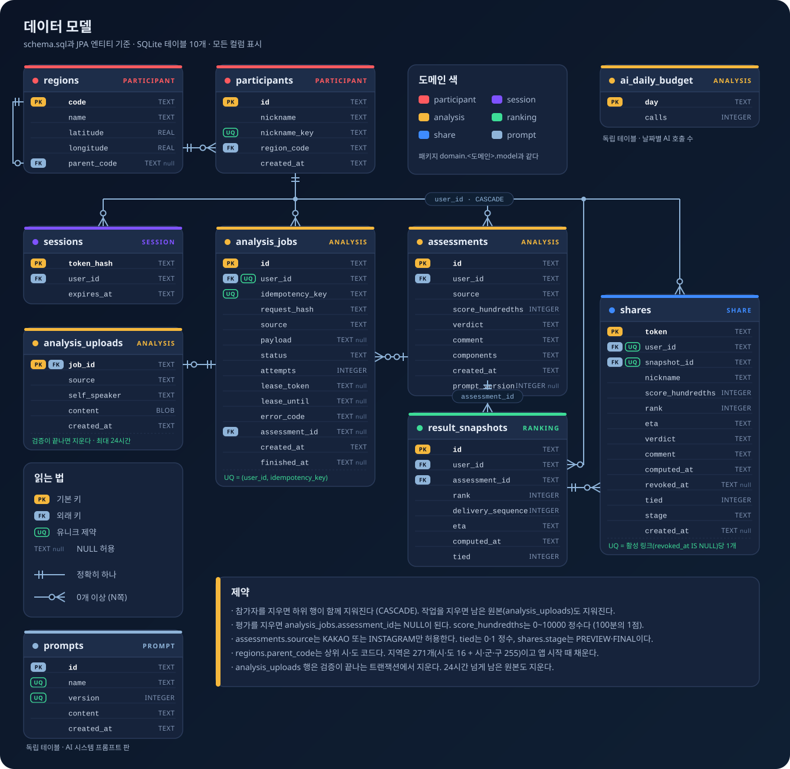
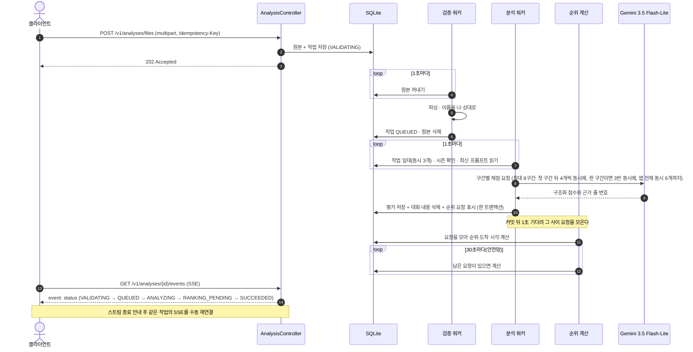
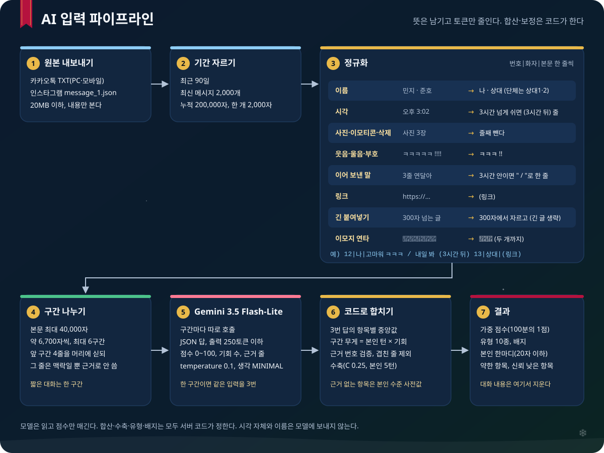
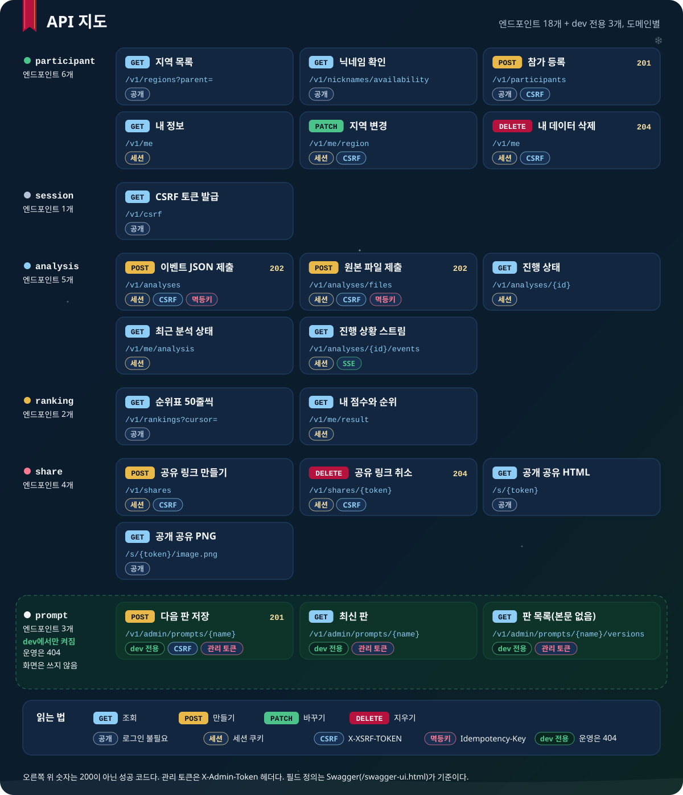

<p align="center">
  
</p>

<p align="center">
  <b>대화 기록으로 산타 순위를 매기는 API.</b><br>
  원본을 받아 AI가 채점하고, 순위와 선물 도착 시각은 서버가 계산한다.
</p>

<p align="center">
  
  
  
  
  
  
</p>

인프라는 [`santacut-infra`](https://github.com/yooni9ue/santacut-infra)에 있다.

| 환경 | API | 화면(Vercel) | 상태 |
| --- | --- | --- | --- |
| dev | `https://api-dev.santacut.me` | `https://dev.santacut.me` | `develop`이 자동 배포된다 |
| 운영 | `https://api.santacut.me` | `https://santacut.me`, `https://www.santacut.me` | 아직 켜지 않았다 |

Swagger는 [`api-dev.santacut.me/swagger-ui.html`](https://api-dev.santacut.me/swagger-ui.html)에서 본다.

<p align="center"></p>

## 문서 기준

현재 API 계약은 DTO·OpenAPI, 런타임 기본값은 `application.yml`, 배포는 워크플로·Compose를 기준으로 확인한다. 아래 그림의 시험 수·성능·비용·시즌 카운트다운은 작성 시점 기록이며 실시간 지표가 아니다. 그림에 남은 폴링 대안도 과거 설명으로, 현재 프론트는 SSE와 수동 재연결을 사용한다. 문서와 코드의 미완료 연결은 [전체 점검 기록](../docs/development/implementation-audit.md)을 참고한다. 그림(`stats.svg`, `api.svg`, `erd.svg` 등)은 2026-11-17 기록이라 그 뒤에 더한 `GET /v1/me/dossier`·`GET /v1/me/recap`(지금 엔드포인트 20개, dev 전용 3개 별도), `dossiers`·`roasts` 테이블(지금 15개), 「팩폭 산타」 작가 호출(`gemini-3.5-flash`)이 빠져 있다. 2026-11-20부터 분석 작업자는 1초마다 돌고 순위는 작업 성공 직후 다시 계산한다. 그림의 3초·30초는 그 전 값이다. 지금 기준은 아래 글과 표다.

## 한눈에 보기

<p align="center"></p>

## 할 수 있는 일

- 닉네임으로 참가한다. 세션은 HttpOnly 쿠키다.
- 지역은 두 단계로 고른다. 시·도 16개, 시·군·구 255개.
- 카카오톡 TXT나 인스타그램 JSON 원본을 그대로 올린다. 20MB, 100만 줄(인스타그램은 메시지 객체 100만 개)까지 받는다.
- 서버가 원본을 파싱해 참여자 이름을 `나`·`상대`로 바꾼 두 화자 대화로 정규화하고, 대화 전체를 Gemini에 보낸다. 점수는 본인 말만 매긴다.
- 상대 말이 담긴 대화 내용은 작업이 끝나면(성공·실패 모두) 지운다. 원본 파일은 검증이 끝나면 바로 지운다.
- AI가 네 항목(공감 30%, 응원 25%, 존중 25%, 협력 20%)을 채점한다. 순위와 선물 도착 시각은 서버가 계산한다.
- 결과는 「2026 산타 조서」로도 본다. 본인 메시지에서 센 숫자(입버릇, ㅋ 밀도, 시간대, 답장 간격 등)만 저장하고, 조회할 때 템플릿으로 장면(한마디, 입버릇 장부, 극값 3장, 3막, 칭호·죄목·공로, 판결)을 만든다(`GET /v1/me/dossier`, [설계 §14.17](docs/backend-design.md)).
- 결과는 「팩폭 산타」 리캡 카드 덱으로도 본다. 채점이 끝나면 AI 작가(기본 `gemini-3.5-flash`)가 칭호, 판결, 말버릇 놀림과 뒤집기, 산타 쪽지, 세 막 줄거리를 쓰고 서버가 검증해 `roasts`에 저장한다. 숫자는 모두 서버가 정하고 문장에는 숫자를 넣지 않는다. 선물 판정은 총점 65점 컷이고 재심은 없다(`GET /v1/me/recap`, [팩폭 산타 작가](#팩폭-산타-작가)).
- 결과에는 크리스마스 유형 10종, 배지, 본인 한마디(`quote`), 항목 막대 4개, 가장 약한 항목, 상위 %, 같은 유형 비율이 함께 나온다.
- 진행 상태 SSE와 단건 조회 API를 제공한다. 현재 프론트는 SSE 연결 종료 시 수동 재연결하며 폴링하지 않는다. 최근 작업 조회 API는 있지만 프론트 새로고침 복귀 동선은 보완이 필요하다.
- 순위표는 공개다. 50줄씩 cursor로 넘기고, 동점은 `공동 N위`로 보인다. 남에게는 도착 날짜(`eta_date`)만 보이고, 정확한 도착 시각은 본인 결과에만 있다.
- 공유 링크는 그 순간의 결과를 1200×630 카드와 HTML로 고정한다. 한마디는 본인이 고를 때만(`include_quote`) 싣고, 다시 공유하면 같은 링크에서 넣고 뺄 수 있다. 상대 말은 싣지 않는다. 취소한 링크는 안내 페이지로 바뀐다.
- 시즌 마감 전에는 지역을 24시간 2번, 시즌 5번까지 바꿀 수 있다. 내 데이터는 언제든 지운다.

## 시즌 일정

산타컷은 크리스마스 시즌에만 연다. 2026-11-17 기준으로 마감까지 D-38이다.

| 시각(KST) | 일어나는 일 |
| --- | --- |
| 지금 ~ 2026-12-25 0시 | 참가, 분석, 지역 변경을 받는다. 순위는 미리보기(`PREVIEW`)다 |
| 2026-12-25 0시 | 시즌 마감. 순위와 배송 계획이 확정(`FINAL`)되고, 새 분석과 지역 변경은 `409 SEASON_FROZEN`이다 |
| 12/25부터 매일 0~6시 | 산타가 순위대로 배송한다. 시속 100km, 한 명에 180초. 6시까지 못 끝내면 다음 날 0시에 잇는다 |
| 2026-12-31 6시 | 배송 마감. 참가자가 많아도 모든 도착이 이 안에 든다([순위와 도착 시각](#순위와-도착-시각)) |

시즌 연도는 `app.season-year`(기본 `2026`)로 정한다.

## 아키텍처

<p align="center"></p>

- 분석은 큐에 넣는다. 화면은 SSE(`/v1/analyses/{id}/events`)로 상태를 받는다. GET은 초기 확인·복구용이며 주기적인 브라우저 폴링은 하지 않는다.
- 작업자는 셋이다. 원본 검증과 AI 채점은 1초 간격으로 돌고, 채점은 작업 3개를 동시에 한다(`ANALYSIS_WORKER_CONCURRENCY`). 순위는 작업이 성공해 커밋되면 1초 기다려 그 사이 요청을 모아 바로 계산한다. 다만 지난 계산이 끝난 뒤 5초 안에는 다시 계산하지 않는다. 30초마다 도는 예약 작업이 놓친 요청을 처리한다.
- AI 채점은 Spring AI와 Google Gemini 3.5 Flash-Lite(Gemini Developer API)다. 채점 뒤 「팩폭 산타」 작가는 따로 설정한 모델(기본 `gemini-3.5-flash`)을 부른다.
- 채점 프롬프트(`score`)와 작가 프롬프트(`roast`)는 DB(`prompts`)에 판으로 쌓인다. AI를 부를 때마다 최신 판을 읽는다.
- 같은 입력을 다시 내면 AI를 부르지 않고 지난 결과를 쓴다.
- 입구에서 먼저 거른다. 원본 접수는 서버 전체에서 동시에 2개까지다(넘으면 `503 UPLOAD_BUSY`). 같은 IP는 참가 등록 1시간 10회, 분석 제출 24시간 20회까지다(넘으면 `429 CLIENT_RATE_LIMITED`). 파일이 아닌 요청 본문은 2MB까지 받는다.
- 운영 프로필은 `SESSION_SECURE=true`가 아니면 뜨지 않고 Swagger를 끈다. HTTPS에서는 CSRF 쿠키 이름이 `__Host-XSRF-TOKEN`이다.
- 서버는 환경마다 Lightsail `micro_3_0`(1GB) 한 대다. Caddy가 Let's Encrypt 인증서로 HTTPS를 맡고, HTTP는 HTTPS로 넘기며 HSTS를 붙인다.
- 브라우저는 Vercel 화면의 rewrite로 같은 출처처럼 API를 부른다. API를 바로 부르는 출처는 CORS 허용 목록으로 정한다(dev는 `dev.santacut.me`와 `localhost:3000` 포함).

### AI 채점

| 단계 | 하는 일 |
| --- | --- |
| 정규화 | 올해 1월 1일(한국 시각)부터 본인 2,000개, 상대 포함 6,000개, 200,000자까지 달마다 고르게 쓴다. 같은 사람이 3시간 안에 이어 보낸 메시지는 2,000자까지 한 턴으로 묶고, 보낼 대화는 최대 52,000자다 |
| 구간 나누기 | 약 6,700자씩, 최대 8구간. 구간 경계는 4턴씩 겹치되 겹친 줄은 맥락으로만 쓴다 |
| 채점 | 구간마다 Gemini 3.5 Flash-Lite에서 응답 스키마(`responseJsonSchema`)로 강제한 JSON 점수와 근거 줄 번호를 받는다. 한 구간짜리 대화는 세 번 따로 물어 항목별 중앙값을 낸다(틀린 답은 버리고 과반이면 나머지로) |
| 검증 | 서버가 점수 범위와 근거 번호를 확인한다. 본인 메시지가 8개 또는 300자보다 적으면 AI를 부르지 않고 `INSUFFICIENT_EVIDENCE`다 |
| 수축 | 항목마다 행동을 보일 기회가 적을수록 점수를 중립 점수 쪽으로 당긴다(사전 무게 0.25). 본인 턴이 5개보다 적은 대화는 더 당긴다. 근거가 없는 항목은 사전값(중립 55와 근거 있는 다른 항목 평균의 평균)을 주고 `low_confidence_dimensions`에 적는다 |
| 꾸밈 | 유형 10종, 배지, 20자 이하 한마디를 고른다. 순위에는 영향이 없다 |

- 점수 규칙은 `Score.RULE_VERSION` 7판이고, 채점 프롬프트는 DB `prompts`의 `score` 7판이다. 규칙 판과 반복 횟수는 재사용 해시에 들어가서 판이 바뀌면 다시 채점한다.

### 팩폭 산타 작가

채점이 끝난 작업마다 AI 작가를 한 번 불러 리캡 카드(`GET /v1/me/recap`)의 문장을 쓴다. 문장은 분석할 때 한 번만 쓰고, 조회할 때는 저장한 문장을 읽기만 한다.

| 단계 | 하는 일 |
| --- | --- |
| 입력 | 분석 기간(올해 1월 1일 0시, 한국 시각부터)의 본인 말풍선만 막(1~4월, 5~8월, 9~12월)마다 2,000자까지 보낸다. 상대 말은 보내지 않는다. 아래 가림 규칙을 먼저 적용한다. 조서 집계에서 고른 사실(서버가 센 숫자 칩), 입버릇, 화제, 선물 판정과 등급 온도(`grade_code`, `temperature`)도 함께 보낸다 |
| 쓰기 | `prompts`의 `roast` 최신 판과 응답 스키마로 칭호, 판결(`verdict`·`verdict_mild`), 놀림·뒤집기 짝(최대 5개, 화면에는 앞 3개), 산타 쪽지, 세 막 줄거리를 받는다 |
| 검증 | 숫자·셈말 표현, 금지어, 금지 말투(옛말투 어미, 목록 밖 유행어, 이모지, 느낌표, ㅋㅋ), 금지 유행어, 필드마다 하나를 넘은 허용 유행어, 판정과 어긋난 말(선물인데 석탄 등), 담백 판결의 석탄·탈락 낱말, "근데 "로 열지 않은 뒤집기, 가린 이름·낱말, 본인 말 8자 이상 베끼기를 막는다. 떨어진 필드만 최대 `max-rewrites`번 다시 쓰게 한다 |
| 채우기 | 그래도 빈 필드는 서버 대체 문장(`resources/roast/fallback.json`)으로 채운다. 대체 문장은 참가자·해 시드로 고르므로 다시 내도 같다 |
| 저장 | 채점 결과와 같은 트랜잭션에서 `roasts`에 저장한다 |

- 작가는 채점과 따로 돈다. 작가가 꺼져 있거나 실패해도(프롬프트 없음, 비용 한도, 제공자 오류, 예외) 채점 결과 저장과 작업 성공을 막지 않고 대체 문장만으로 저장한다. 로그에는 작업 ID와 실패 종류만 남긴다.
- 비용은 채점과 같은 비용 가드가 맡는다. 호출 전에 최대 호출 수(1 + `max-rewrites`)만큼 어림해 예약하고, 호출마다 토큰을 기록한다. 단가는 채점 단가(`santacut.ai.budget.*`)가 아니라 작가 모델 단가(`santacut.ai.roast.*-usd-per-million-tokens`)로 따로 세고, 토큰도 `ai_usage_days`의 작가 칸(`roast_*`)에 따로 쌓는다. 비용 가드나 제공자 차단으로 AI가 쉬는 동안에는 작가를 부르지 않고 대체 문장을 쓴다.
- 생각 토큰은 응답의 `thoughtsTokenCount`를 그대로 기록한다. `thinking-level: LOW`에서는 3.5 Flash가 이 값을 싣지 않아(실측) 로그에 0으로 남고, 청구도 없다.
- 작가 프롬프트는 4판이다(아래 [유행어 목록](#유행어-목록)). 4판은 리캡 덱 개편 전까지 쓰는 임시 판이다. 2판은 1판 실측에서 첫 응답이 자주 떨어진 까닭(글자 수 초과, "한 번"·"두 글자" 같은 수 세는 말, 목록 밖 웃음 인용)을 줄이려고 필드별 목표 길이와 길이 자, 수 세는 말 바꾸기, 인용 규칙을 더했다. 응답 스키마에도 필드마다 검증과 같은 `maxLength`를 싣는다. 웃음·울음 자모만 되풀이한 인용(`ㅋㅋㅋ`, `ㅠㅠ`)은 목록에 없어도 본인 말풍선에 글자 그대로 있으면 받는다. 스키마의 `maxLength`는 Gemini가 지키지 않을 수 있어 범위 문구(`description`)를 힌트로 함께 싣는다.
- 작업 임대 시간은 작가 호출 수만큼 늘어난다.

설정(`application.yml`의 `santacut.ai.roast.*`):

| 키 | 환경 변수 | 기본값 | 뜻 |
| --- | --- | --- | --- |
| `santacut.ai.roast.model` | `ROAST_MODEL` | `gemini-3.5-flash` | 작가 모델 ID. **비우면 작가를 부르지 않고 서버 대체 문장만 쓴다** |
| `santacut.ai.roast.temperature` | - | `1.0` | 같은 사람에게도 매번 다른 문장이 나오게 높게 둔다 |
| `santacut.ai.roast.max-output-tokens` | - | `8192` | 호출 한 번의 출력 상한. 생각 토큰도 이 한도를 함께 써서 넉넉히 둔다 |
| `santacut.ai.roast.thinking-level` | - | `LOW` | `MINIMAL`, `LOW`, `MEDIUM`, `HIGH` 중 하나. 비우면 모델 기본값 |
| `santacut.ai.roast.call-timeout` | - | `60s` | 호출 하나의 시간 상한 |
| `santacut.ai.roast.max-rewrites` | - | `2` | 떨어진 필드를 다시 쓰게 하는 최대 횟수 |
| `santacut.ai.roast.input-usd-per-million-tokens` | - | `1.5` | 작가 입력 토큰 100만 개 단가(달러). Gemini 3.5 Flash 표준 등급 정가(2026-11-20 확인) |
| `santacut.ai.roast.cached-input-usd-per-million-tokens` | - | `0.15` | 암묵적 캐시에서 읽은 작가 입력 토큰 단가 |
| `santacut.ai.roast.output-usd-per-million-tokens` | - | `9` | 작가 출력 토큰 단가 |
| `santacut.ai.roast.thinking-usd-per-million-tokens` | - | `9` | 작가 생각 토큰 단가. Gemini는 출력 단가로 청구한다 |

#### 선물 등급

총점 65점(`GiftVerdict.CUT_HUNDREDTHS` 6500) 이상이면 선물, 아래면 석탄이다. 등급 이름·도장·공유 문구는 `GiftGrade`에 있고 공유 문구의 `{점수}`에는 서버가 총점 표시를 넣는다.

| 등급 코드 | 총점 | 이름(`label`) | 도장(`stamp`) | 공유 문구(`share_text`) | 온도 |
| --- | --- | --- | --- | --- | --- |
| `PREMIUM` | 90 이상 | 굴뚝 프리패스 | 산타 최애 | 산타가 내 단톡방 다 읽고도 {점수}점 줌. 이게 인성이다. 너도 까봐. | 넉넉한 통과 |
| `GIFT_DEPARTED` | 75 이상 | 썰매 탑승 완료 | 선물 실었다 | 산타가 내 단톡방 다 읽음. {점수}점, 선물 실림. 넌 읽히면 석탄 각. | 넉넉한 통과 |
| `SCRAPED_THROUGH` | 65 이상 | 굴뚝에 걸쳐서 통과 | 겨우 실었다 | 산타가 내 단톡방 다 읽음. {점수}점, 굴뚝에 걸쳐서 겨우 통과. 넌 넘냐? | 아슬아슬 통과 |
| `ONE_STEP_SHORT` | 55 이상 | 굴뚝 앞 유턴 | 아깝다 진짜 | {점수}점. 굴뚝 앞에서 썰매가 유턴함. 억울해서 올린다. 너는 넘나 보자. | 아깝게 탈락 |
| `OFF_LIST` | 50 이상 | 명단에 없음 | 산타 읽씹 | 산타한테 읽씹당함. {점수}점. 나만 당할 수 없다. 너도 까봐. | 석탄 |
| `COAL` | 50 미만 | 석탄 당첨 | 반품 불가 | 산타가 내 단톡방 읽고 석탄 보냄. 반품도 안 된대. 혼자 받긴 억울하다. 너도 까봐. | 석탄 |

- 석탄 농담을 끄면 `*_mild` 값을 쓴다. 도장(`stamp_mild`)은 통과 등급이면 그대로이고 탈락 세 등급은 "내년 명단 예약"이다.
- 공유 문구(`share_text_mild`)는 점수와 놀림을 뺀다. 통과 등급은 "산타가 내 단톡방 다 읽음. 올해 선물 받음. 너도 까봐.", 탈락 등급은 "올해 선물은 내년으로 미뤄짐. 너는 받았는지 까봐."다.
- 온도는 작가 입력의 `temperature`로 가고 판결 문장의 온도가 이 값을 따른다.

#### 사실 고르기

작가에게 보낼 사실은 조서 지표와 입버릇에서 사람·방마다 다르게 고른다(`RoastFacts`). 화면 칩 이름 목록은 [API 연동 가이드 7절 `ROAST` 팩폭 카드](../docs/api/frontend-api-guide.md#리캡-카드-덱-get-v1merecap)에 있다.

- 사실마다 점수 S = 튀는 정도 × 편집 무게다. 튀는 정도는 `(50 − min(p, 100 − p)) / 50`(p는 백분위)이고 편집 무게는 `roast/facts.json`의 `weight`(기본 1)다. 백분위 35~65는 사실로 쓰지 않는다.
- 맨 앞은 S가 가장 큰 사실이다. 나머지는 아직 안 나온 계열에서 softmax(S / 0.2) 무게로 하나씩 뽑으므로, 앞의 세 장은 계열이 모두 다르다. 입버릇은 점수 상위 5개에서 2개까지 뽑는다. 작가에게는 8~9개를 넘긴다.
- 시드는 참가자 id와 서울 기준 해로 만들고 방 집계를 섞는다. 같은 사람이 같은 방을 다시 내면 같은 사실이 나오고 사람이나 방이 다르면 달라진다.
- 메시지 양에 따라 늘 튀는 지표는 무게를 낮췄다. `message_count`·`active_days`는 0.5, `burst_max`·`longest_message_length`·`laugh_max_run`·`messages_per_day`는 0.6, 입버릇은 0.8이다.
- `night_ratio`·`exclaim_ratio`·`morning_ratio`는 아래쪽을 놀리지 않는다(`metrics.json`의 `low_remarkable: false`). 심야 비율 p10이 0.01이라 심야 1%인 보통 사람이 "훨씬 적음"으로 튀던 것을 고쳤다. 중앙값 아래는 백분위 50으로 본다.
- 새 지표 일곱 개는 이미 저장한 집계에서 계산한다. 다시 세지 않으므로 옛 조서에도 나온다.

| key | 계산 | 칩 이름 |
| --- | --- | --- |
| `weekend_ratio` | 토·일 말풍선 ÷ 전체 | 주말 출몰률 |
| `morning_ratio` | 6~9시 말풍선 ÷ 전체 | 아침 출몰률 |
| `office_hours_ratio` | 9~18시 말풍선 ÷ 전체(요일 무관) | 근무시간 출몰률 |
| `peak_hour_share` | 가장 바쁜 시간대 ÷ 전체 | 피크타임 몰빵률 |
| `busiest_day_multiple` | 최다일 개수 ÷ 활동일 하루 평균 | 하루 폭주 배수 |
| `media_ratio` | (말풍선 수 − 글 메시지 수) ÷ 말풍선 수 | 사진·이모티콘 투척률 |
| `messages_per_day` | 말풍선 수 ÷ 활동일 | 하루 말풍선 살포량 |

#### 유행어 목록

작가가 써도 되는 유행어와 막는 유행어는 [`resources/roast/slang.json`](src/main/resources/roast/slang.json)에 있다(`updated`, `sources` 포함).

- `allowed`의 표기와 뜻이 작가 입력 `slang`으로 간다. 예문은 문장에 그대로 샐 수 있어 보내지 않는다. 프롬프트 4판은 이 목록만 쓰게 하고 필드 하나에 하나까지만 넣게 한다. 모든 필드에 넣지 않고 유행어를 빼도 웃겨야 한다.
- 서버는 `banned`·`banned_patterns`를 금지어로 막고 허용 유행어 줄기(`stem`)가 한 필드에 `max_per_field`(1)개를 넘으면 그 필드를 떨어뜨린다. "L을 가져가"의 L은 알파벳 검사에서 뺀다. 느낌표는 계속 막는다.
- 쌰갈·샤갈은 욕설을 돌려 말한 꼴이라, "장원영OO"은 실존 인물 이름이라 넣지 않고 금지어로 두었다. 성별·나이·사는 곳·외모·형편·마음 건강을 겨냥한 유행어도 막는다.
- 12월 초 갱신: 유행어만 바뀌면 `slang.json`만 고친다. 작가 입력과 서버 검증이 함께 바뀐다. 말투 지시를 바꿔야 하면 `prompts.sql`에 새 판을 더하고(1~4판은 고치지 않는다) `slang.json`도 같이 고친다.

#### 개인정보 가림

작가 입력 가림 범위는 2026-11-20 오너 결정을 따른다. 규칙과 낱말 목록은 [`resources/roast/rules.json`](src/main/resources/roast/rules.json)에 있다.

| 가린다 | 가리지 않는다 |
| --- | --- |
| 사람 이름(호칭이 붙은 이름, 호칭 없이 부른 이름, 대화 참여자 표시 이름) → `(이름)` | 지명, 가게, 행사 이름 |
| 아파트·빌라 같은 사는 곳 이름 → `(집)` | 돈, 직장, 건강, 가족 이야기(민감 줄을 따로 빼지 않는다) |
| 링크(채점 정규화 단계에서 가린다) | |
| 숫자열 → `(숫자)`(전화번호 포함), 영문 낱말 → `(영문)` | |

- 가린 원래 낱말과 이름 줄기는 그 요청의 출력 검증 차단 목록으로만 쓰고 저장하지 않는다. 출력에 나오면 그 필드는 떨어진다.
- 원본 파일 제출은 검증 작업자가 참여자 표시 이름을 작업 페이로드의 `speakerNames`에 담는다. 이름을 가리는 데만 쓰고 AI에는 보내지 않는다. 로그·응답·예외에는 넣지 않고, 작업이 끝나면 페이로드와 함께 지운다. 이벤트 JSON 제출에는 이 값이 없다.
- `roasts.content_json`에는 검증을 통과한 문장과 대체 문장, 필드별 출처만 담는다. 말풍선 원문은 담지 않는다.

## 계층 구조

<p align="center"></p>

- 패키지는 계층 → 도메인 → 역할 순서로 나눈다.
- facade는 유스케이스 흐름만 위에서 아래로 읽히게 쓴다. 스레드·슬롯·잠금·리스·트랜잭션 같은 실행 기법은 runner(`@Runner`)가 맡는다. `TransactionRunner`, `AnalysisWorkerRunner`(채점 자리 3개와 스레드), `HeldJobRunner`(작업 잡기·리스·결과 기록), `AiBudgetRunner`(비용 예약과 공유 멈춤)가 있다. 점수 계산과 실패 분류 같은 업무 규칙은 도메인으로 내린다.
- facade에 의존성이 6개 이상이거나 private 함수가 10개 이상이면 나눌 신호다. 그래서 진행 상태 조회는 `AnalysisStatusFacade`로 따로 나눴다. ArchUnit이 runner의 위치·이름과 주입 금지를 검사한다.
- 자세한 규칙은 [코드 컨벤션](docs/backend-conventions.md)에 있다.

## 데이터 모델

<p align="center"></p>

- 기준은 JPA 엔티티다. 테이블·컬럼·외래 키·인덱스는 `ddl-auto: update`가 엔티티대로 만들고, SQLite 방언이 만들지 않는 유일 인덱스와 처음 넣을 행은 [`seed.sql`](src/main/resources/seed.sql)이 넣는다. 규칙은 [컨벤션 §12](docs/backend-conventions.md#12-jpa-엔티티와-스키마)에 있다.
- 원본 파일은 `analysis_uploads`에 잠깐 머물다가 검증이 끝나면 지워진다.
- 지역은 `parent_code`로 시·도와 시·군·구를 잇는다.
- `assessments.prompt_version`에는 채점에 쓴 프롬프트 판 번호가 남는다. 프롬프트를 DB로 옮기기 전 평가는 `NULL`이다.
- `analysis_jobs.digest_hash`는 같은 채점 입력의 재제출을 알아보는 해시다. `ai_usage_days`는 날짜별 AI 토큰 합계다. `result_populations`는 순위를 계산할 때 다시 세는 유형별 인원이다.
- `dossiers`는 평가 하나의 산타 조서 집계값(JSON)이다. 원문은 담지 않고, 참가자나 평가를 지우면 함께 지워진다.
- `roasts`는 평가 하나의 「팩폭 산타」 작가 문장이다(평가당 하나). `content_json`은 검증을 통과한 문장·대체 문장·필드별 출처 JSON이고 말풍선 원문은 없다. `prompt_version`은 작가 프롬프트 판(작가를 부르지 않았으면 `NULL`), `model`은 작가 모델 ID(부르지 않았으면 빈 문자열)다. 참가자나 평가를 지우면 함께 지워진다. 이 기능 전 평가에는 행이 없어 `GET /v1/me/recap`이 `404 RECAP_NOT_FOUND`다.
- `ai_usage_days.cached_input_tokens`는 암묵적 캐시에서 읽은 입력 토큰 수다. `ranking_refresh`는 순위 계산 요청 판과 마지막으로 계산한 판을 한 줄에 둔다. `region_changes`는 지역 변경 한도를 세는 기록이다.

## 분석 흐름

<p align="center"></p>

- 원본은 접수할 때 한 번 보고, 검증 작업자가 한 번 더 본다.
- 빈 파일, zip, 바이너리는 바로 `422`다. 20MB를 넘으면 `413`이다. 카카오톡 TXT는 한 줄씩 읽고, 100만 줄을 넘으면 `UNSUPPORTED_FILE_FORMAT`이다.
- 평가 저장과 대화 내용 삭제는 한 트랜잭션이다. 순위는 계산 요청만 표시해 두고, 커밋되면 1초(`santacut.ranking.rebuild-debounce`) 기다려 그 사이 들어온 요청을 모아 한 번 계산한다. 지난 계산이 끝난 지 5초(`santacut.ranking.rebuild-min-interval`)가 안 됐으면 남은 시간만큼 더 기다린다. 그동안 상태는 `RANKING_PENDING`이고, 계산이 끝나면 SSE로 `SUCCEEDED`가 간다. 보통 1~2초, 작업이 몰리면 최대 약 6초다.
- 24시간 넘게 기다린 작업은 만료된다. AI가 꺼져 있어도 마찬가지다.
- Gemini가 호출을 막으면(선불 크레딧 소진 `429` 포함) 작업은 실패하지 않는다. `QUEUED`로 돌아가고 작업자가 15분 쉰 뒤 다시 잡는다. API 키 오류(401·403·404, 키 오류가 담긴 400)도 설정 오류로 보고 똑같이 쉰다.
- 앞 구간이 과금된 뒤 막힌 시도는 시도 횟수로 센다. 작업 하나의 최악 과금은 3번분이고, 다 쓰면 `RETRY_EXHAUSTED`다.
- 임대가 끝난 채 `ANALYZING`에 멈춘 작업은 AI가 꺼져 있어도 시도를 센 채 대기열 원래 자리로 돌아간다.
- 응답 형식·근거·점수 범위 오류처럼 입력 탓인 실패는 그 작업만 `ANALYSIS_FAILED`로 끝낸다. 연속 실패로 세지 않아 다른 참가자의 채점을 멈추지 않는다.
- 작업을 잡을 때 시즌 마감부터 본다. 마감 뒤에 밀린 작업은 AI를 부르지 않고 `SEASON_FROZEN`으로 끝낸다.

<details>
<summary>시퀀스 다이어그램</summary>



</details>

## 순위와 도착 시각

| 규칙 | 내용 |
| --- | --- |
| 계산 시점 | 심사 성공, 지역 변경, 삭제는 `ranking_refresh`의 요청 판만 올린다. 그 트랜잭션이 커밋되면 1초(`santacut.ranking.rebuild-debounce`) 기다려 그 사이 요청을 모아 한 번 계산한다. 지난 계산이 끝난 뒤 5초(`santacut.ranking.rebuild-min-interval`) 안에는 다시 계산하지 않는다. 계산은 겹치지 않는다. 30초마다(`RANKING_REBUILD_DELAY_MS`) 도는 예약 작업과 12/25 0시, 앱 시작 때도 남은 요청을 처리한다 |
| 동점 | 점수 → 공감·존중·응원·협력 항목 점수 → 시즌 첫 평가 시각 → 참가자 ID 순으로 가른다. `공동 N위`는 점수가 모두 같을 때만이다 |
| 도착 시각 | 순위대로 시속 100km, 한 명에 180초, 매일 0~6시에 배송한다. 누적 작업 시간이 7일 × 6시간을 넘으면 모든 작업 시간을 같은 비율로 줄여 12/25~12/31 안에 끝낸다. 순서는 그대로다 |
| 공개 범위 | 순위표와 공유 카드에는 서울 날짜(`eta_date`)만 싣고, 정확한 `eta`는 본인 결과에만 준다. 순위표 행의 `eta`는 늘 `null`이다 |
| 지역 변경 | 24시간 2번, 시즌 5번까지다(`429 REGION_CHANGE_LIMITED`, `429 REGION_CHANGE_SEASON_LIMIT`). 같은 지역은 세지 않는다. 도착 시각 차이로 남의 지역을 좁혀 가지 못하게 막는다 |
| 순위표 페이지 | 50줄씩 넘긴다. cursor에 계산 시각이 들어 있어, 페이지 사이에 다시 계산되면 `409 RANKING_SNAPSHOT_CHANGED`다. 첫 페이지는 30초 캐시한다 |
| 표본 통계 | `top_percent`(1~100)는 순위 계산 참가자가 100명 이상일 때만, `archetype_share_percent`는 점수를 받은 참가자가 30명 이상일 때만 나온다 |

## 토큰 최적화 / AI 입력 설계

숫자는 모두 `./gradlew eval`(합성 대화로 운영 채점 경로를 그대로 부르는 수동 평가)로 쟀다. 기록은 [백엔드 설계 §14](docs/backend-design.md)에 있다.

<p align="center"></p>

정규화는 뜻을 잃지 않는 것만 줄인다. 모델은 점수만 매기고, 합산과 보정은 코드가 한다.

<p align="center"></p>

정확도를 위해 토큰을 더 쓴 곳(3번 중앙값, 8구간, 응답 스키마, 1년치 대화문)을 다 합치면 긴 대화 분석 한 번이 약 2.1센트다. dev에서 1년치 대화로 잰 값이다(입력 63,268 + 출력 925 토큰). 캐시에서 읽은 입력 토큰(`cachedContentTokenCount`)은 따로 기록하고 100만 토큰당 0.03달러로 센다.

<p align="center"></p>

단계마다 바로 앞 상태와 비교했다. MAE는 양쪽 대화 전문을 넣은 평이한 프롬프트의 점수와의 차이다. 6단계(응답 스키마)는 출력이 호출당 약 94토큰에서 125토큰으로 늘었지만 상한 250 안이다.

모델끼리 비교한 MAE를 넘어 사람 판단과 맞는지는 골든셋으로 잰다. 사람 두 명 이상이 30~50개 대화에 따로 점수를 매기고, `EVAL_GOLDEN_DIR`을 가리켜 `./gradlew eval`을 돌리면 스피어만 순위 상관(목표 0.7 이상)과 항목 MAE가 나온다. 절차는 [설계 §4.6](docs/backend-design.md)에 있다. 라벨은 아직 모으지 않았다.

<p align="center"></p>

"측정" 카드는 평가에서 지표가 나빠져 되돌렸다. "판단" 카드는 재지 않고 설계 검토에서 뺐다.

<p align="center"></p>

호출 하나가 한도를 넘겨 쓰지 않게 미리 어림한다. 채점 스레드 셋이 동시에 확인을 통과해 한도를 넘지 않도록, 진행 중인 작업의 어림 비용은 예약해 함께 센다. 크레딧이 떨어져도 작업은 사라지지 않는다.

### 올해 대화를 달마다 고르게

분석 기간은 올해 1월 1일 0시(한국 시각)부터 지금까지다. 예전에는 최근 90일을 최신순으로 2,000개까지 썼다. 연말 산타 명단이니 올해 대화를 봐야 하는데, 많이 쓰는 대화방은 2,000개가 최근 몇 주 만에 다 차서 그 앞이 모두 빠졌다.

<p align="center"></p>

업로드한 대화는 늘 본인 메시지를 먼저 고르고 상대 메시지는 남은 예산으로 고른다. 개수는 본인 2,000개, 전체 6,000개까지, 글자 수는 전체 200,000자까지다. 그래서 상대가 길게 많이 말하는 단체방에서도 본인 말이 밀려나지 않는다. 단계마다 달마다 같은 몫을 주고, 대화가 적어 몫을 다 못 쓴 달의 남는 몫은 다른 달로 넘긴다. 한 달 안에서는 가장 최근의 이어진 대화를 남겨 맥락이 끊기지 않게 한다. AI에 보내는 대화문도 52,000자를 넘으면 본인 줄을 먼저(기본 70%) 남기고 같은 방식으로 달마다 고르게 줄을 뺀다. 상대 말은 점수에 들어가지 않고 맥락만 주므로 150자에서 자르고, 본인 말은 지금처럼 300자까지 둔다.

1월 1일~11월 17일 합성 대화(하루 5·20·60·200개)로 재 보니 대화문은 약 51,300~51,700자, 1,385~1,424줄이었고 11개월이 모두 들어갔으며 8번 호출했다. 대화문에서 본인 말은 약 55~63%였다. dev에서 1년치 대화(메시지 6,420개, 올해 1월 2일~11월 18일)를 실제로 채점하니 대화문 2,442줄 51,310자, 8구간, 입력 63,268토큰(캐시 0), 출력 925토큰으로 약 2.1센트였다. 처음 추정(약 56,000토큰, 약 1.9센트)보다 많았고, 6구간 때(약 46,100토큰, 약 1.56센트)보다 약 37% 많다. 짧은 대화는 그대로다.

## 결과 화면 API의 지금 상태

2026-11-20 `develop` 기준이다. 문구 v3(PR #81)까지 들어갔다. PR #82(사실 다양화, 새 지표, `slang.json`, 임시 작가 프롬프트 v4)는 아직 열려 있어 여기 넣지 않았다.

| 기능 | 지금 동작함 |
| --- | --- |
| 리캡 덱 `GET /v1/me/recap` | `VERDICT`, `ROAST` 3장, `LETTER`, `STORY`(있을 때만), `ARCHETYPE`, `DIMENSIONS` 순서로 7~8장이다. 선물·석탄은 총점 65점 컷이고 등급은 `grade_code` 6종이다. 숫자는 서버가, 문장은 분석 때 AI 작가가 써서 검증한 것이다. 리캡 전 결과는 `404 RECAP_NOT_FOUND`이고 결과의 `recap_available`이 `false`다 |
| 팩폭 문장(roast) | 작가가 칭호, 판결, 놀림·뒤집기(`flip`), 쪽지, 세 막 줄거리를 쓰고 `roasts`에 저장한다. 떨어진 필드는 `resources/roast/fallback.json` 대체 문장으로 채운다([팩폭 산타 작가](#팩폭-산타-작가)) |
| 순위 | 판정 카드의 `rank`·`delivery_eta`는 작업 성공 직후 순위 계산 전(`ranking_pending: true`)에는 `null`이다. `GET /v1/rankings`는 공개이고 50줄씩 cursor로 넘긴다 |
| 공유 | `POST /v1/shares`가 `{ token, url, imageUrl }`을 돌려준다. `/s/{token}`은 OG 메타가 붙은 공개 HTML이고 `/s/{token}/image.png`는 1200×630 PNG다. 카드 모양은 옛 결과 카드(유형·점수·판정·순위·막대)다. `DELETE /v1/shares/{token}`으로 끈다 |

### 다음 작업(예정)

방향은 2026-11-20 오너가 정했고 서버 코드는 아직 없다. 화면 쪽 설명은 [API 연동 가이드](../docs/api/frontend-api-guide.md)의 "리캡 덱 개편안"과 "공유 방식 나누기"에 있다.

- **리캡 덱 개편 「산타가 캡처해 간 내 말」**: 라벨·큰 글씨·보조 줄 한 틀의 7장(판정, 선물 받는 이유 3장, 점수 깎인 말 2장, 유형)으로 바꾼다. 석탄이면 석탄 받는 이유 3장과 그래도 건진 말 2장이다.
- **항목별 근거 줄 저장**: 채점 AI는 이미 항목마다 근거 줄 번호를 돌려주지만, 지금은 한마디(`quote`) 하나를 고를 때만 쓰고 버린다. 항목마다 인용할 본인 말을 저장한다.
- **고맙다·미안하다 횟수**를 센다("한 번도 안 한 말" 카드).
- **순위가 늘 오게** 한다. 지금은 `ranking_pending` 동안 `null`이다.
- **새 리캡 응답 모양**을 만들고, 칭찬 뒤집기 `flip` 필드는 나중에 없앤다.
- **유형 이름 바꾸기**: 새 후보 중 최종 이름은 오너가 고르는 중이다. 화면은 `archetype.name`만 읽으므로 서버만 바꾸면 된다.
- **OG 이미지·공개 페이지 새 판정 모양**: 착한 아이/나쁜 아이, 점수, 이유 인용 하나, 산타 일러스트로 다시 그린다. 일러스트 에셋은 오너 결정 대기이고, Next.js `next/og`로 프론트가 그리는 안도 프론트 팀과 논의한다.

인스타 스토리 이미지(9:16)와 카카오톡 공유 버튼은 프론트가 만든다. 서버 작업이 아니다.

## API

<p align="center"></p>

- 필드 정의는 Swagger(`/swagger-ui.html`)가 기준이다.
- 호출 순서는 [API 연동 가이드](../docs/api/frontend-api-guide.md)에 있다.

<details>
<summary>엔드포인트 표 (텍스트)</summary>

| 메서드 | 경로 | 하는 일 | 인증 |
| --- | --- | --- | --- |
| GET | `/v1/csrf` | CSRF 토큰 발급 | 공개 |
| GET | `/v1/regions` | 지역 목록(`?parent=`로 하위 지역) | 공개 |
| GET | `/v1/nicknames/availability` | 닉네임 가용성 확인 | 공개 |
| POST | `/v1/participants` | 참가 등록 (`201`) | 공개 · CSRF |
| GET | `/v1/me` | 내 참가 정보 | 세션 |
| PATCH | `/v1/me/region` | 내 지역 변경 (시즌 마감 전) | 세션 · CSRF |
| DELETE | `/v1/me` | 내 데이터 삭제 (`204`) | 세션 · CSRF |
| POST | `/v1/analyses` | 이벤트 JSON으로 분석 요청 (`202`) | 세션 · CSRF · `Idempotency-Key` |
| POST | `/v1/analyses/files` | 원본 파일로 분석 요청 (`202`, 20MB) | 세션 · CSRF · `Idempotency-Key` |
| GET | `/v1/analyses/{id}` | 분석 진행 상태 | 세션 |
| GET | `/v1/analyses/{id}/events` | 분석 진행 상황 스트림(SSE) | 세션 |
| GET | `/v1/me/analysis` | 내 최근 분석 상태 | 세션 |
| GET | `/v1/me/result` | 내 점수·순위·도착 시각 | 세션 |
| GET | `/v1/me/dossier` | 내 산타 조서 장면 목록 | 세션 |
| GET | `/v1/me/recap` | 내 팩폭 산타 리캡 카드 덱 | 세션 |
| GET | `/v1/rankings` | 랭킹 50명씩(cursor) | 공개 |
| POST | `/v1/shares` | 공유 링크 생성·재사용 | 세션 · CSRF |
| DELETE | `/v1/shares/{token}` | 공유 링크 폐기 (`204`) | 세션 · CSRF |
| GET | `/s/{token}` | 공개 공유 HTML | 공개 |
| GET | `/s/{token}/image.png` | 공개 공유 이미지 | 공개 |

dev 전용이다. `PROMPT_ADMIN_ENABLED=true`이고 `PROMPT_ADMIN_TOKEN`이 있을 때만 뜨고, 운영은 404다. 토큰이 없거나 틀리면 `401`이다. 운영 도구라 화면은 쓰지 않는다.

| 메서드 | 경로 | 하는 일 | 인증 |
| --- | --- | --- | --- |
| POST | `/v1/admin/prompts/{name}` | 프롬프트 다음 판 저장 (`201`) | `X-Admin-Token` · CSRF |
| GET | `/v1/admin/prompts/{name}` | 최신 판 | `X-Admin-Token` |
| GET | `/v1/admin/prompts/{name}/versions` | 판 목록(본문 없음) | `X-Admin-Token` |

프롬프트 이름은 영문 소문자, 숫자, 하이픈으로 된 1~40자다. 어기면 `400 INVALID_REQUEST`다.

</details>

## 품질 게이트

<p align="center"></p>

- 자동 검사를 통과한 뒤 리뷰어 9명이 판정한다.

## 부하와 메모리

<p align="center"></p>

- 작업자 하나가 작업을 하나씩 채점하던 때는 동시 15명부터 앱이 메타스페이스 OOM으로 죽었다. 채점 자리를 3개로 늘리고 작업 잡기와 비용 확인을 잠금으로 묶은 뒤에는 30명이 몰려도 p95 33초, 오류 0건이다.
- JVM은 이미지를 빌드할 때 AOT 캐시(`/app/app.aot`)를 만들어 띄운다. 힙은 `-Xms64m -Xmx256m -Xmn24m`, 메타스페이스 상한은 160MB, `MALLOC_ARENA_MAX=2`이고 앱 컨테이너 `mem_limit`은 512MB다. 캐시가 어긋나도 캐시 없이 뜬다.
- 측정 방법과 NMT 표는 [배포 운영서](docs/deployment.md)에 있다.

## 배포

- `develop` 푸시: 테스트 → GHCR 이미지 게시 → dev 자동 배포. GitHub OIDC로 AWS 배포 역할을 맡아 러너 IP에만 SSH를 잠깐 열고, 검증한 이미지 digest로 바꾼 뒤 닫는다. 늦게 끝난 옛 실행이 새 배포를 덮지 않도록, develop 머리에 더 새 백엔드 변경이 있거나 서버 릴리스가 이미 이 커밋을 품으면 배포를 건너뛴다.
- `main` 푸시: 테스트 → 이미지 게시까지만 한다. 운영 배포는 수동 실행(`workflow_dispatch`, `deploy=true`)이다.
- 앱 설정(`GEMINI_API_KEY`, 도메인, CORS 등)은 KMS로 암호화해 S3 `config/app.env`에 두고, 서버가 부팅 때 tmpfs로 받는다. 같은 파일의 `GHCR_USER`, `GHCR_TOKEN`으로 이미지를 받는다.
- SQLite는 매시 S3에 백업하고(SSE-KMS, 최대 21일), Lightsail 자동 스냅숏을 매일 뜬다. `.backup` 사본은 64MB tmpfs `/tmp`가 아니라 데이터 볼륨(`/app/data/backup-tmp`)에 떴다가 바로 지운다.
- 자세한 절차는 [배포 운영서](docs/deployment.md)에 있다.

## 비용

| 항목 | 월 비용(USD) | 메모 |
| --- | ---: | --- |
| Lightsail `micro_3_0`(dev) | 7 | 1GB, 고정 IP·전송량 포함 |
| 스냅숏, S3, KMS 키 2개, Route 53 | 약 3.5 | 인프라 레포 기준 |
| Gemini 3.5 Flash-Lite(채점) + 3.5 Flash(작가) | 합쳐서 최대 9 | 채점은 입력 100만 토큰 0.3달러(캐시 읽기 0.03달러)·출력 2.5달러, 작가는 입력 1.5달러(캐시 읽기 0.15달러)·출력과 생각 9달러로 따로 어림한다 |

- 앱 안의 비용 가드가 날짜별 토큰 합계로 한 달 9달러(`AI_BUDGET_MONTHLY_USD`)를 넘지 않게 막고, 호출 전에 그 호출의 어림 비용도 더해 본다.
- 작가 호출 한 번은 입력 약 7,300토큰, 출력 약 500토큰이라 약 1.5센트이고, 작업 하나가 2~3번 부른다. 전에는 작가도 채점 단가로 세어 한도가 이 비용을 약 5분의 1로 덜 셌다. 호출 전 예약은 (입력 어림 + 어림 출력 1,500토큰(`santacut.ai.roast.estimated-output-tokens`)) × 3번이라 작업 하나에 약 7센트를 잠깐 잡아 둔다. 실제 사용량은 응답 메타데이터로 기록한다.
- 하루 한도는 기본으로 없다(`AI_BUDGET_DAILY_USD=0`). Gemini는 선불 크레딧으로 써서 크레딧이 실제 상한이다.
- 참가자당 24시간 3회 제출 한도는 비용 장치가 아니라 점수를 거듭 다시 뽑지 못하게 하는 제품 규칙이다.

## 기술 스택

<p align="center"></p>

## 실행

JDK 25가 필요하다. 환경 변수 `GEMINI_API_KEY`에 Gemini API 키를 넣는다. 「팩폭 산타」 작가 모델은 `ROAST_MODEL`(기본 `gemini-3.5-flash`)이고, 비우면 작가 없이 대체 문장만 쓴다. 키가 틀리면 Gemini가 호출을 막아 분석 작업이 `QUEUED`에 머물고(15분 쉬고 다시 시도, 24시간 뒤 만료), 나머지 API는 그대로 돈다.

```powershell
cd backend
./gradlew.bat bootRun                      # 로컬 실행 (:8080)
./gradlew.bat --no-daemon check bootJar    # 커밋 전 검증
```

- 로컬 DB는 `./data/santacut.db`, 헬스 체크는 `/actuator/health`다.
- `bootRun`은 프롬프트 관리 API(`/v1/admin/prompts`) 스위치를 켠다. 실제로 뜨려면 환경 변수 `PROMPT_ADMIN_TOKEN`도 넣어야 하고, 요청은 `X-Admin-Token` 헤더에 그 값을 싣는다.

## 데이터 출처

전국 시·도·시·군·구 지역과 대표 좌표([`regions.sql`](src/main/resources/regions.sql))는 2026-10-01 기준 행정동 경계로 만들었다. 생성 스크립트는 [`scripts/regions/generate_regions.py`](scripts/regions/generate_regions.py)다.

> 본 데이터는 통계청 통계지리정보서비스(SGIS, https://sgis.kostat.go.kr)에서 공공누리 제1유형으로 개방한 행정동 경계를 가공한 것이며(가공: vuski/admdongkor, https://github.com/vuski/admdongkor), CC BY 4.0으로 배포됩니다.

## 더 읽기

[시스템 아키텍처](docs/system-architecture.md) · [백엔드 설계](docs/backend-design.md) · [코드 컨벤션](docs/backend-conventions.md) · [배포](docs/deployment.md) · [API 연동 가이드](../docs/api/frontend-api-guide.md) · [작업 지침](CLAUDE.md)

<p align="center"></p>
