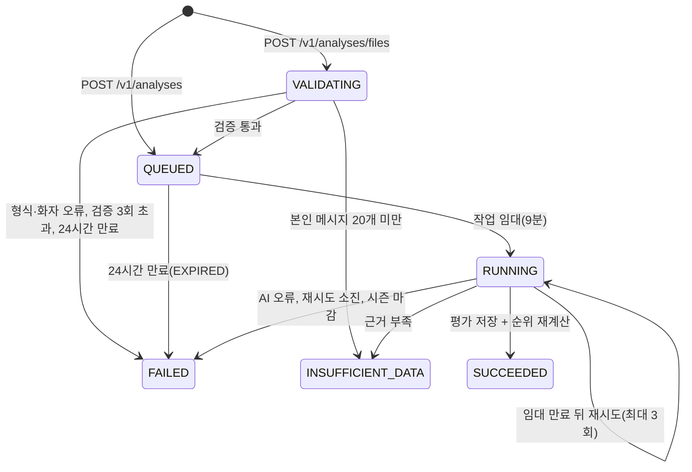

# 산타컷 백엔드 설계·기획

> 너 올해 산타컷 통과 가능?

문서 버전: 0.3 / 작성일: 2026-11-15 / 구현 대조: 2026-11-18

이 문서는 구현 전 설계에서 출발했다. 0.2부터는 현재 코드(`backend/src`)에 맞췄다. 구현과 달라진 설계는 지우지 않고 **[대체됨]** 표시를 붙여 남긴다. 그때 그렇게 정한 까닭도 기록으로 두기 위해서다. 현재 동작은 각 절의 "현재 구현"과 §9·§10·§14를 따르고, 필드 정의는 OpenAPI 명세(`/v3/api-docs`)를 따른다. 미확정 항목은 §12에 모았다.

## 1. 서비스 정의와 범위

현재 코드 확인 안내: 본문에는 초기 제안·과거 결정이 함께 남아 있다. 런타임 설정은 `application.yml`, DTO 계약은 `presentation/**/response`, 사용자 동선은 [프론트 화면 안내](../../frontend/docs/screens.md)가 기준이다. 특히 초안의 "AI가 판정명·심사평 생성", "원문 인용 없음", "모든 버전 컬럼 저장", "다음 해 도착"은 그대로 구현된 보장이 아니다. 현재 판정 문구는 도메인 규칙이 만들고, 본인 인용은 선택 공유하며, 배송은 7일 창으로 제한한다. [점검 기록](../../docs/development/implementation-audit.md)에 미반영 항목을 구분한다.

사용자가 카카오톡 대화 기반 JSON 또는 인스타그램 활동 JSON을 제출하면 AI가 유쾌한 산타 점수와 심사평을 생성한다. 모든 사용자는 하나의 랭킹에 참여한다. 산타는 점수 순서대로 지역 중심지에 방문하며, 실제 지역 간 거리와 활동 시간을 반영해 선물 도착 예정 날짜·시간을 계산한다.

핵심 기능:

1. DB에서 중복을 막는 유니크 닉네임 등록.
2. 거주 지역 선택: 시·도 및 시·군·구. 구가 없는 지역도 선택 가능해야 한다.
3. 데이터 받기 안내와 카카오톡·인스타그램 선택.
4. 파일 업로드, 형식 검증, 정규화, AI 채점.
5. 100점 만점 소수점 둘째 자리 점수와 단일 통합 랭킹.
6. 순위별 선물 도착 예정 일시 계산.
7. 결과 페이지와 공유 카드.

친구 익명 투표와 친구별 리그는 현재 MVP 범위에 포함하지 않는다. 결과는 오락용 해석이며 실제 선물 배송을 제공하는 서비스는 아니다.

## 2. 사용자 흐름

닉네임·지역 등록 → 내 데이터 가져오기 → 출처 선택 → 데이터 내보내기 안내 → 파일 업로드 → AI 심사 대기 → 점수·랭킹·도착 예정일 확인 → 공유.

닉네임은 식별용이며 인증 수단이 아니다. MVP 기본안은 서버 발급 익명 사용자 ID와 HttpOnly/Secure 세션 쿠키로 소유권을 확인하는 방식이다. 닉네임만 알아서 타인의 결과를 덮어쓸 수 없어야 한다. 쿠키 분실 시 복구와 기기 간 연결은 별도 계정 기능 도입 전 지원 범위를 안내한다.

## 3. 데이터 받기 및 업로드

### 3.1 안내 페이지

공통 진입 버튼은 `내 데이터 가져오기` 하나다. 이후 카카오톡과 인스타그램 중 하나를 선택한다. 입력 경로만 다르고 채점·랭킹·공유 기능은 공통이다.

- 카카오톡: 기기별 공식 내보내기 경로를 안내한다. 원본이 TXT인 경우 검증된 파서로 내부 JSON에 변환한다. 사용자가 자신의 화자를 선택해야 한다.
- **[대체됨]** 결정(2026-11-16): 본인 메시지만 분석한다. 다른 참여자의 메시지는 맥락으로도 쓰지 않고 버리며 AI에 보내지 않는다. → 지금은 이름을 `나`·`상대`로 바꾼 두 화자 대화 전체를 맥락으로 보내고, 점수는 본인 말만 매기며, 대화 내용은 작업이 끝나면 지운다(§3.2, §4). 인스타그램도 본인 이름을 고르는 것은 그대로다(`message_1.json`에 소유자 표시가 없다).
- 인스타그램: 데이터 형식 JSON, 기간, 필요한 항목을 설명하고 공식 계정 센터의 정보 내보내기로 연결한다. 외부 경로는 출시 전 실제 계정·모바일에서 확인한다.
- 안내 페이지에 `파일 준비됐어요 · 업로드하기`를 제공한다.
- 버튼 클릭만으로 파일이 즉시 다운로드된다고 약속하지 않는다. 외부 서비스의 생성 대기·로그인·내보내기 절차를 안내한다.
- ‘인스타 알고리즘 JSON’은 서비스 내 통칭이다. 추천 알고리즘 자체나 모든 추천 콘텐츠가 내보내기에 포함된다고 가정하지 않는다. 실제 샘플에서 지원 가능한 활동 필드를 먼저 확정한다.

### 3.2 검증·정규화 기본안

초기에는 JSON과 지원 확인된 카톡 TXT만 허용한다. ZIP을 지원할 경우 압축 해제 총량·파일 수·경로 탈출 검증을 별도로 구현한다.

- 원본 파일 최대 20MB, 분석 범위 최근 90일, 최대 2,000개 이벤트를 초기 제한값으로 제안했다. 지금 분석 범위는 올해 1월 1일부터이고, 업로드는 본인 2,000개·전체 6,000개까지 쓴다(§14.16).
- 파일 확장자뿐 아니라 실제 인코딩·내용·스키마·날짜를 검증한다.
- 본문 내 명령문은 분석 대상 데이터로 취급하며 AI 시스템 지시로 실행하지 않는다.
- 시간순·일자별 고정 샘플링으로 재실행 시 같은 이벤트를 선택한다. 토큰 제한 초과 시 같은 규칙으로 축소한다. 지금은 표본을 고르지 않고 분석 기간의 대화 전체를 정규화해 보낸다(§4.4).
- 내부 공통 이벤트: source, occurred_at, actor_role, event_type, text, context. 출처별 원본 구조는 어댑터에서 변환한다.
- 관련 없는 개인정보를 줄이고 원문은 공개 응답·로그·공유 카드에 포함하지 않는다.
- 샘플 부족과 미지원 스키마는 명시적 오류로 돌려준다. 빈 데이터를 낮은 점수로 채점하지 않는다.
- 판정 가능한 최소 데이터 기준은 출처별 샘플 검증 후 확정한다.

현재 구현:

- 입력 경로는 둘이다. 원본 파일 업로드(`POST /v1/analyses/files`, multipart)와, 브라우저가 정규화한 이벤트 JSON(`POST /v1/analyses`)이다.
- 원본 파일은 카카오톡 TXT(PC 형식, iOS·Android 모바일 형식)와 인스타그램 `message_1.json`만 받는다. ZIP, CSV, EUC-KR은 받지 않는다. 파일 이름·확장자·Content-Type은 보지 않고 내용만 본다.
- 접수 단계에서는 빈 파일, ZIP(첫 4바이트 `PK\x03\x04`), 앞 4,096바이트에 NUL이 있는 바이너리만 바로 `422 UNSUPPORTED_FILE_FORMAT`으로 거절한다. 엄격한 UTF-8 디코딩과 파싱은 검증 작업자 몫이다.
- 크기 한도는 20MB다. Spring multipart `max-file-size: 20MB`·`max-request-size: 21MB`, Tomcat `max-swallow-size: 21MB`, Caddy `request_body max_size 21MB`가 함께 막는다. 서버가 막으면 `413 FILE_TOO_LARGE`, 프록시가 막으면 `code` 없는 `413`이 간다.
- 정규화하면 본인과 상대 메시지를 담은 이벤트(`occurredAt`, `text`, 상대면 `partner`) 목록이 나온다. `partner`는 `상대`·`상대1` 같은 화자 표시이고 실제 이름은 남기지 않는다. 올해 1월 1일 0시(한국 시각)부터 지금(5분 뒤까지)의 메시지만 쓰고, 그 앞 메시지는 버린다. 메시지 하나는 2,000자에서 자른다. 그다음 세 번에 걸쳐 고른다(`AnalysisEvents.selectedAt`). 본인 메시지를 2,000개까지(상대 메시지는 그대로), 상대 메시지를 전체 6,000개가 되도록(본인 메시지는 그대로), 끝으로 전체 글자 수를 200,000자까지 줄인다. 단계마다 달(한국 시각)마다 같은 몫을 주고, 몫을 다 못 쓴 달의 남는 몫은 다른 달에 나눈다. 한 달 안에서는 가장 최근의 이어진 메시지를 남겨 맥락이 끊기지 않게 한다(`SpreadCandidates`). 본인 이벤트가 20개가 안 되면 `INSUFFICIENT_EVENTS`다.
- 상대 메시지는 작업 페이로드(`analysis_jobs.payload`)에만 있다. 작업이 성공하든 실패하든 끝나는 순간 페이로드를 지우므로 작업보다 오래 남지 않는다. 이벤트 JSON 제출(`POST /v1/analyses`)은 본인 메시지만 받는다.
- **[대체됨]** 위의 "내부 공통 이벤트: source, occurred_at, actor_role, event_type, text, context"는 구현하지 않았다. 화자는 상대 이벤트의 `partner` 필드 하나로 나타낸다. `source`는 작업마다 한 번만 저장한다.

## 4. AI 점수와 유쾌한 결과

### 4.1 점수 기본안

점수는 0.00~100.00이고 DB에는 0~10000 정수(score_hundredths)로 저장한다. API와 화면은 항상 소수점 둘째 자리로 표시한다. 항목별 소수점을 가중 합산하고 최종 단계에서 한 번 반올림한다. 랜덤 소수점을 붙여 순위를 조작하지 않는다.

아래 항목·가중치는 구현 검증용 초안이며 최종 확정된 평가척도가 아니다.

| 내부 평가 항목 | 가중치 | 공개 표현 예시 |
| --- | ---: | --- |
| 배려·공감 | 30% | 천사력 |
| 긍정·응원 | 25% | 분위기 살리기력 |
| 존중하는 소통 | 25% | 급발진 브레이크력 |
| 나눔·협력 | 20% | 선물 받을 명분 |

각 항목은 0~100 범위의 구조화된 값과 근거 이벤트 ID를 반환한다. 점수 합산은 AI가 아닌 서버가 수행한다. AI는 판정명과 짧은 심사평도 생성하되 원문·개인정보를 직접 인용하지 않는다.

카톡·인스타를 동일한 모델 버전·척도에 넣되, 근거 유형은 다르게 해석한다. 근거가 없는 항목을 자동 0점으로 처리하지 않는다. 근거 부족 시 순위 등록을 보류한다. 단순 관심사나 콘텐츠 취향만으로 인성을 추정하지 않으며, 인스타 내보내기에 평가 가능한 증거가 부족하면 지원 필드·평가척도를 재설계한다.

카톡과 인스타에서 대표 샘플을 모아 점수 편향을 검증해야 한다. 데이터 출처만으로 유리해지지 않는지 평가한 뒤 통합 랭킹을 출시한다. 데이터 양·팔로워 수·파일 개수로 가산점을 주지 않는다.

### 4.2 결과 톤

정색한 도덕 성적표가 아닌 친구끼리 공유할 수 있는 장난스러운 산타 판정이다.

- 97.82점: `산타 친자 의혹` / `이 정도면 선물 말고 상속을 기다려라.`
- 61.09점: `굴뚝 앞 배송 보류` / `산타가 주소를 다시 확인 중.`
- 늦은 배송: `크리스마스 선물인데 새해 복 많이 받아라.`

예시는 실제 점수 구간 확정안이 아니다. 성격·민감한 속성·정신건강을 단정하지 않고 기록에서 드러난 가벼운 행동을 소재로 삼는다. 도착 시각은 AI가 만들지 않고 배송 엔진의 계산값을 사용한다.

### 4.3 재현성과 재업로드

모델, 프롬프트, 파서, 점수 규칙 버전을 저장한다. 낮은 temperature만으로 결정성을 보장하지 않으며 검증된 결과 캐시를 사용한다.

현재 구현: 평가에 `prompt_version`과 `score_rule_version`이 남는다. `AnalysisScoringService.fingerprint`는 모델 클라이언트 캐시 키·프롬프트 판·`Score.RULE_VERSION`·반복 횟수로 재사용 해시를 만들고 `analysis_jobs.digest_hash`에 기록한다. 같은 참가자의 재사용 가능한 성공 또는 근거 부족 결과를 찾는다(§4.4). 모든 모델·파서 버전을 각각 평가 컬럼으로 기록하는 구조는 아니다.

캐시 키는 사용자 ID + 원본 해시 + 선택한 본인 화자 + 분석 범위 + 파서/모델/프롬프트/점수 버전이다. 원본이 같아도 화자가 다르면 같은 결과를 사용하지 않는다.

사용자·시즌당 활성 점수는 하나다. 실패 시 이전 정상 결과를 유지하며 두 출처를 제출해도 점수를 합산하지 않는다. 최신 제출의 결과를 유지하려는 설계 목표와 달리, 현재는 요청 순번 비교가 없고 완료 시각으로 저장한 평가를 `createdAt DESC, id DESC`로 고른다. 오래 걸린 이전 작업이 뒤늦게 완료될 때의 결과 역전 방지는 후속 구현·검증이 필요하다.

### 4.4 AI 입력, 응답 계약, 재사용, 비용 가드

채점 작업자는 저장한 이벤트로 분석 기간의 대화 전체(본인과 상대)를 정규화한 대화문을 만들어 그대로 보낸다. 표본을 고르지 않고, 낱말 신호도 보내지 않는다. 상대 말을 맥락으로 읽어야 같은 본인 말이 진심인지 비꼼인지 가릴 수 있기 때문이다(§14.8).

- 대화문은 도메인 모델(`ScoringMessages`, `TranscriptTurns`, `ScoringDigest`)이 만든다. AI 클라이언트(`ScoreModelInput`, `ScoreModelLines`)는 그것을 글로 옮기기만 한다.
- 시각은 한국 시각 기준이다.

사용자 메시지는 이렇게 생겼다.

```text
[대화]
1|상대|오늘 발표 망했어ㅠㅠ
2|나|헐 괜찮아? / 끝나고 밥 먹자
(5시간 뒤)
3|상대|고마워
(2일 뒤)
4|나|또 보자
```

정규화 규칙은 뜻을 잃지 않는 것만 줄인다.

1. 화자는 `나`와 `상대`로 바꾼다. 단체 대화면 처음 나온 순서대로 `상대1`, `상대2`다. 실제 이름은 저장하지도 보내지도 않는다.
2. 사진·동영상·이모티콘·파일·음성메시지 같은 첨부 안내와 삭제 안내는 뺀다. 입장·퇴장 같은 시스템 줄은 파싱할 때 이미 빠진다.
3. 링크(`http://`, `https://`, `www.`로 시작)는 `(링크)`로 바꾼다. 줄바꿈과 겹친 공백은 공백 하나로 바꾼다. ㅋ·ㅎ는 세 개, ㅠ·ㅜ와 `!?.~`, 잇단 이모지는 두 개까지만 남긴다. 그래도 본인 메시지가 300자, 상대 메시지가 150자를 넘으면 앞부분만 두고 `(긴 글 생략)`을 붙인다. 상대 말은 맥락만 주고 점수는 본인 말에만 매기므로, 상대를 짧게 잘라 본인 말이 더 들어가게 한다.
4. 같은 화자가 3시간 안에 잇달아 보낸 메시지는 ` / `로 이어 한 줄로 만든다.
5. 줄마다 1부터 번호를 붙인다(`번호|화자|본문`). 시각은 보내지 않고, 앞 줄과 3시간 이상 벌어지면 번호 없는 `(5시간 뒤)`, `(2일 뒤)` 간격 줄을 넣는다.
6. 본문 합이 52,000자를 넘으면 달마다 고르게 줄을 남기고(`TranscriptTurns.spreadWithin`) 머리에 `(길이 한도로 대화 곳곳에서 N줄을 뺐다)`를 적는다. 한 달 안에서는 가장 최근의 이어진 줄을 남긴다. 본인 줄을 먼저 고르고(기본 70%, 상대 줄이 짧아 남는 몫은 본인에게) 상대 줄은 남은 길이로 고른다. 줄 번호·화자 표시와 구간마다 붙는 시스템 프롬프트를 더해도 입력이 약 6만 토큰을 넘지 않게 잡았다(§14.16). 1년 가까이 쌓인 큰 대화는 여기에 닿는다.

- 본인 줄이 8줄보다 적거나 본인 본문이 300자보다 짧으면 AI를 부르지 않고 `INSUFFICIENT_EVIDENCE`로 끝낸다.
- 메시지 수는 AI에 보내지 않고 사용량 로그에만 남긴다(`ScoringDigest.messageCount`).
- 채점 프롬프트 6판이 이 형식과 구간 나누기를 설명한다(§4.5). 5판은 4판에 항목별 20·50·80 기준 문장, 비꼼을 가려 읽는 대비 지시, 평가 대화와 주제가 다른 진심·비꼼 예시 두 쌍을 더했다. 3판은 신호와 표본을 받던 형식, 1·2판은 그 앞 기록으로 남는다.

이벤트 2,000개짜리 합성 대화(본인과 상대가 번갈아 보냄)를 Gemini `countTokens`로 쟀더니 대화문 1,866줄, 시스템 프롬프트 포함 53,132자, 입력 37,838토큰이었다. 한국어 대화문은 약 1.4자가 토큰 하나다.

#### 응답 계약과 근거 부족 항목

- 6판 응답은 항목 키마다 `{"e":[근거 줄],"n":기회 수,"s":점수}`와 `playfulness`를 담는다(예: `{"sufficient":true,"care_empathy":{"e":[12],"n":2,"s":74},...,"playfulness":70}`). 근거는 본인 줄 번호 1~2개, 기회 수는 0(없음)·1(한두 번)·2(여러 번), 점수는 0~100 정수다. 서버는 소수 둘째 자리까지 받아들인다. 5판까지의 `scores`·`evidence` 형식도 읽고, 그때 기회 수는 2로 본다.
- 판단할 본인 말이 없는 항목은 evidence를 빈 배열로 받는다. 범위 밖 번호와 항목 안에서 겹친 번호는 지운다. 지운 뒤 근거가 남지 않은 항목은 근거 부족 항목으로 표시하고 모델 점수 대신 본인 수준 사전값(아래 합산과 수축 3)을 준다. 작업은 실패시키지 않는다.
- 근거 부족 항목은 `assessments.low_confidence`에 항목 키를 쉼표로 이어 남기고 `GET /v1/me/result`의 `low_confidence_dimensions`로 내보낸다.
- 네 항목 모두 근거가 없으면 점수를 매길 내용이 없다고 본다. 지운 번호가 있었으면 `AI_EVIDENCE_INVALID`, 처음부터 없었으면 `INSUFFICIENT_EVIDENCE`다. 모델이 `{"sufficient":false}`를 돌려줘도 `INSUFFICIENT_EVIDENCE`다. 프롬프트는 본인 말이 거의 없을 때만 이렇게 답하라고 한다.
- 응답 형태는 Gemini 구조화 출력으로 강제한다. `ScoreResponseSchema`의 JSON 스키마를 호출마다 `GoogleGenAiChatOptions.responseSchema`로 보내고, Spring AI가 이를 `responseJsonSchema`로 넘긴다. `sufficient`(불리언), 네 항목 객체(`e` 정수 배열 최대 2개, `n` 정수 0~2, `s` 정수 0~100), `playfulness`(정수 0~100)를 모두 필수로 둔다. 그래서 근거 부족 답도 다른 키를 채워 오지만, 서버는 `sufficient`만 보고 `INSUFFICIENT_EVIDENCE`로 처리한다.
- 스키마의 범위 값은 모델을 돕는 힌트다. 범위 검증(점수 0~100, 근거 번호, 기회 수)은 지금처럼 도메인 모델이 한다. 제약 디코딩이라 답이 코드 블록에 싸여 오지 않으므로 본문을 그대로 JSON으로 읽는다. 읽을 수 없는 본문(잘림, 깨짐, 코드 블록)은 `AI_RESPONSE_INVALID`다.
- 출력 토큰 상한(`max-output-tokens`)은 250이다. 구조화 출력은 JSON 사이에 공백·줄바꿈을 넣어, 정상 답이 호출당 약 95토큰에서 약 125토큰으로 늘었다(짧은 대화 45번 중 최대 약 190토큰, 모두 `STOP`, §14.14). 출력 한도에 걸려 잘린 JSON은 `AI_RESPONSE_INVALID`다.

#### 같은 입력 재사용

- 채점 입력 해시는 모델 ID, 프롬프트 판, 점수 규칙 판(`Score.RULE_VERSION`), 반복 호출 수(`santacut.score.sampling.samples`), 대화문 전체(상대 줄 포함)를 이은 값의 SHA-256이다. `analysis_jobs.digest_hash`에 남긴다. 그래서 본인 말이 같아도 상대 말이 다르면 다른 입력이다.
- 같은 참가자가 같은 해시로 다시 내면 AI를 부르지 않는다. 지난 작업이 성공했으면 그 점수를 새 평가로 옮겨 적고 순위를 다시 계산한다. 근거 부족이나 응답 오류(`AI_RESPONSE_*`, `AI_EVIDENCE_INVALID`, `AI_SCORE_OUT_OF_RANGE`)로 끝났으면 같은 이유로 끝낸다.
- 호출 오류, 시간 초과, 제공자 차단, 비용 한도로 되돌린 작업에는 해시를 남기지 않는다. 다시 내면 다시 부른다.
- 참가자끼리는 결과를 나누지 않는다.

#### 사용량 기록과 앱 안의 비용 가드

- 호출마다 응답 메타데이터의 입력·캐시 읽기(`cachedContentTokenCount`)·출력·생각 토큰과 종료 사유를 읽는다. 작업 ID, 프롬프트 판, 메시지 수, 대화문 줄 수·글자 수, 길이 한도로 뺀 줄 수, 근거 보정 수, 결과 코드와 함께 숫자만 로그에 남긴다.
- 토큰 수는 날짜(한국)별로 `ai_usage_days`에 더한다. 토큰 수에 설정 단가(Gemini 3.5 Flash-Lite 유료 등급, 입력 100만 토큰당 0.3달러, 출력 2.5달러)를 곱해 하루·한 달 비용을 어림한다. 입력 중 암묵적 캐시에서 읽은 토큰은 `ai_usage_days.cached_input_tokens`에 따로 더하고 캐시 단가 0.03달러로 센다. 이 값은 공식 단가표(2026-11-17 확인)의 context caching 가격이다. 암묵적 캐시는 저장 요금이 없다. 호출 전 어림에서는 캐시 읽기를 0으로 잡아 정가로 센다.
- 작가 호출은 모델이 달라(`gemini-3.5-flash`) 단가를 따로 센다(`santacut.ai.roast.*-usd-per-million-tokens`, 기본 입력 1.5달러, 캐시 읽기 0.15달러, 출력·생각 9달러, 2026-11-20 확인). 토큰도 `ai_usage_days`의 작가 칸(`roast_input_tokens`, `roast_cached_input_tokens`, `roast_output_tokens`, `roast_thought_tokens`, `roast_calls`)에 따로 더하고, 한도는 두 모델 비용의 합으로 본다. 그 전에는 작가도 채점 단가로 세어 작가 비용을 약 5분의 1로 덜 셌다. 작가 칸이 생기기 전 작가 사용량은 채점 칸에 섞여 있다.
- 한 달 9달러에 닿으면 작업을 잡지 않는다. 작업은 `QUEUED`로 남고, 24시간이 지나면 만료가 정리한다. 하루 한도(`daily-usd`)는 기본으로 끈다(0 또는 비움). Gemini를 선불 크레딧(약 7달러)으로 쓰고 모자라면 채우므로, 크레딧 잔액이 실제 상한이다. 한도와 단가는 설정(`santacut.ai.budget`)에 있다.
- 호출 전에도 확인한다. 구간마다 시스템 프롬프트와 사용자 메시지 글자 수 × 3/4(실측보다 조금 넉넉한 어림)을 입력 토큰으로, 출력 상한 250을 출력 토큰으로 잡고, 모든 호출(긴 대화는 모든 구간, 짧은 대화는 중앙값용 반복 3번)을 더한 비용을 한 번에 어림한다. 이것을 더하면 한 달 한도(켜 두었다면 하루 한도도)를 넘을 때는 부르지 않는다(`AI_BUDGET_EXCEEDED`). 작업은 `QUEUED`로 돌아가고 작업자는 15분 멈춘다. 호출 하나가 한도를 넘겨 쓰지 않게 하기 위해서다.
- 분석 한 번은 긴 대화가 8구간, 입력 6만 3,268토큰(구간마다 시스템 프롬프트를 다시 보냄), 약 2.1센트다(§14.16, dev 실측). 6구간일 때는 약 4만 6,100토큰, 약 1.56센트였다(4구간일 때 약 1.4센트, §14.13). 짧은 대화는 같은 구간을 3번 불러 약 0.25센트다(한 번만 부르던 때는 약 0.08센트, §14.11).
- 선불 크레딧이 떨어지면 Gemini는 `429 RESOURCE_EXHAUSTED`("Your prepayment credits are depleted")로 막는다. 아래 제공자 차단과 같은 길을 타므로 작업은 실패하지 않고 `QUEUED`에 남는다. 크레딧을 채우면 멈춤이 풀린 뒤 이어서 처리한다.
- 제공자가 권한 거부(403)·요청 한도와 크레딧 소진(429)·서버 오류(5xx)·시간 초과로 막으면 작업을 실패시키지 않는다. 리스를 풀어 `QUEUED`로 되돌리고 15분 동안 작업을 잡지 않는다. 근거 부족이 아닌 실패가 3번 연달아 나도 15분 멈춘다. 멈춤 상태는 앱 메모리에만 있다.
- Gemini 호출 하나는 60초(`ScoreModelProperties.callTimeout`)에서 끊고, SDK 재시도는 하지 않는다. 작업 리스는 이 시간 상한 × 구간 수 상한(8) + 1분 = 9분이다. 여덟 구간이 모두 상한까지 걸려도 리스가 남아 있어서, 다른 시도가 같은 작업을 또 부르지 않는다.
- 3.5 Flash-Lite는 생각(thinking)을 끌 수 없고 기본 수준이 `MINIMAL`이다. 기본값이 바뀌어도 그대로이도록 `thinking-level: MINIMAL`을 적어 둔다. `thinking-budget`은 이 모델이 거절하므로 쓰지 않는다.
- 생각 토큰은 출력 단가로 청구되고 `max-output-tokens`(250)를 함께 쓴다. 응답의 `thoughtsTokenCount`를 사용량 로그에 남기고 비용 가드의 출력 토큰에 더한다. 값이 응답에 없으면 0이다.
- 단가는 설정값이라 실제 청구와 다를 수 있다. Gemini 쪽에는 아직 앱 밖의 차단 장치가 없다.

### 4.5 구간 채점, 수축, 유형, 배지

**구간 채점.** 긴 대화의 가운데에 있는 행동이 묻히지 않게(lost-in-the-middle) 대화문을 이어진 구간으로 나눠 따로 묻는다(`ScoringChunks`).

- 본문 6,700자마다 한 구간, 최대 8구간이다(§14.13, §14.16). 경계는 본문 길이가 비슷하도록 잡는다. 6,700자 이하는 한 구간이지만 기본 설정에서는 아래 규칙대로 세 번 호출한다.
- 구간 둘째부터는 앞 구간 마지막 4줄을 머리에 함께 싣는다. 줄 번호는 대화 전체 기준이다. 겹쳐 실은 줄은 앞 구간 몫이라 근거로 쓸 수 있는 범위에서 뺀다. 그래서 한 줄이 두 구간의 근거로 두 번 세어지지 않는다.
- 첫 구간을 먼저 부르고, 끝나면 나머지를 `santacut.score.sampling.chunk-concurrency`개(기본 4)씩 동시에 부른다(`ScoreAnswerCalls.firstThenEach`). 모든 작업자를 합친 채점 호출은 `santacut.score.sampling.max-concurrent-calls`(기본 6)개까지만 동시에 나간다. 첫 구간을 먼저 보내야 뒤 호출이 시스템 프롬프트 캐시를 탄다(§14.14). 8구간 대화는 호출 8번 걸리던 시간이 3번 시간으로 준다. 답은 구간 순서대로 싣고, 제공자 차단이나 읽기 실패가 한 구간이라도 나면 구간 순서로 처음 나온 그 답 때문에 작업 전체가 끝나거나 대기열로 돌아간다(원자적). 첫 구간 답을 쓸 수 없으면 나머지는 부르지 않는다. 동시에 부르던 구간 하나가 쓸 수 없는 답이면 아직 자리를 못 잡은 구간도 부르지 않고 그 실패 답을 사용량 없이 대신 싣는다. 이미 불린 구간은 끝까지 기다려 사용량을 기록한다. 비용 예약은 호출 전에 모든 구간 호출의 합으로 한 번 하므로 동시 호출도 덮는다. 근거 부족이라고 답한 구간은 빼고 합치며, 모든 구간이 근거 부족이면 `INSUFFICIENT_EVIDENCE`다.
- 한 구간으로 끝나는 짧은 대화는 같은 구간을 `santacut.score.sampling.samples`번(기본 3) 동시에 따로 묻고, 점수(s)·기회 수(n)·장난기를 항목별 중앙값으로 합친다(self-consistency, `ScoreAnswers`). 근거 줄은 항목 점수가 중앙값에 가장 가까운 답의 것을 쓴다. 제공자 차단, 읽기 실패, 형식·범위 오류 답과 예외를 던진 호출은 그 답만 버리고, 남은 답이 과반(3번 중 2번)이면 그 답들의 중앙값을 쓴다. 남은 답이 과반이 못 되면 버린 답의 이유로 작업이 끝나거나 대기열로 돌아간다. 이때 제공자 차단 답이 하나라도 있으면 그 답을 골라 대기열로 돌려보내고(영구 실패로 만들지 않는다), 없으면 첫 버린 답의 이유(호출 예외는 `ANALYSIS_FAILED`)로 끝난다. 남은 답 가운데 근거 부족 답이 절반 이상이면 근거 부족이다. 여러 구간 대화는 구간을 합치는 과정에서 잡음이 이미 평균되므로 구간마다 한 번만 묻는다. `samples=1`이면 예전과 똑같이 돈다.
- 비용 가드는 모든 호출의 어림 비용을 합쳐 호출 전에 한 번 확인한다. 받은 사용량은 호출이 끝날 때마다 바로 기록한다. 동시에 부른 호출은 잠금을 걸어 하나씩 기록한다. 다른 호출이 실패해도 이미 과금된 호출은 한도 계산에 들어간다.

**합산과 수축.** 합산은 코드가 한다(`ScoringChunkAnswers`, `DimensionReadings`, `ScoreShrinkage`).

1. 항목마다 근거가 있는 구간 점수를 `본인 턴 수 × (n + 1)` 무게로 평균한다(x).
2. 근거 무게 w = 구간 중 가장 큰 n × min(1, 본인 턴 수 / 5)이다. 본인 턴이 5개보다 적은 아주 짧은 대화만 덜 믿는다.
3. x' = (C·m + w·x) / (C + w). m은 중립 점수 55(`DimensionScores.NEUTRAL_SCORE`), C = 0.25다(`santacut.score.shrinkage`). 기회가 없으면(n=0) m 그대로다. 어느 구간에도 근거가 없는 항목은 m과 근거 있는 항목들의 x를 함께 평균한 본인 수준 사전값을 주고 `low_confidence_dimensions`로 알린다(`santacut.score.shrinkage.personal-prior`, §14.12). 유형을 고르는 수축 전 평균도 같은 사전값을 쓴다(점수 규칙 7판). 모든 항목에 근거가 없으면 근거 부족 실패다.
4. 총점은 정밀 x'에 가중치(30/25/25/20)를 곱해 더한 뒤 한 번만 반올림한다. 저장·표시하는 항목 점수는 소수 둘째 자리로 반올림한다.

C와 본인 턴 기준은 같은 답에 여러 값을 적용해 비교해 골랐다(§14.10). C가 클수록 반복 표준편차와 위치 차이는 줄지만, 수축하지 않은 전체 맥락 기준과의 MAE는 커진다. C=0.25에 본인 턴 5는 위치 차이를 10점 안에 두면서 MAE가 가장 작은 조합이다. 점수 규칙 판은 7이다(`assessments.score_rule_version`, 1판 평가는 NULL, 2판은 C=0.5에 본인 턴 20, 3판은 C=0.25에 본인 턴 5, 4판은 짧은 대화 중앙값, 5판은 본인 수준 사전값, 6판은 구간 6,700자·최대 6구간, 7판은 유형 입력에도 본인 수준 사전값). 판이 바뀌면 같은 채점 입력도 AI를 다시 불러 채점한다.

**장난기와 유형.** 모델은 순위에 쓰지 않는 장난기(`playfulness`, 0~100)도 돌려준다. 구간 값은 본인 턴 수로 평균한다. 유형(`Archetype`)은 결과를 읽을 때 정한다.

| 가장 높은 항목 | 장난기 높음 | 장난기 낮음 |
| --- | --- | --- |
| 공감(care_empathy) | 핫초코 배달부 `HOT_COCOA_COURIER` | 벽난로 담당 `FIREPLACE_KEEPER` |
| 응원(positivity_support) | 캐럴 떼창 리더 `CAROL_LEADER` | 트리 꼭대기 별 `TREE_TOP_STAR` |
| 존중(respectful_communication) | 매너 눈사람 `MANNER_SNOWMAN` | 선물 포장 장인 `GIFT_WRAPPER` |
| 협력(cooperation_sharing) | 맨 앞에서 끄는 루돌프 `RUDOLPH_DRIVER` | 일 벌이는 공방 엘프 `WORKSHOP_ELF` |

- 위 두 항목 차이가 작으면 균형형이다. 항목 평균이 60 이상이면 산타 후보생(`SANTA_CANDIDATE`), 아래면 그린치 견습생(`GRINCH_APPRENTICE`)이다.
- 경계에는 띠를 둔다. 저장한 항목 점수의 위 두 항목 차이가 3점 미만이면 균형형, 7점 이상이면 가장 높은 항목의 유형이다. 3점 이상 7점 미만이면 수축 전 평균(`assessments.raw_components`)의 위 두 항목 차이가 6점 미만일 때 균형형이고, 아니면 수축 전 평균이 가장 높은 항목의 유형이다. 모델 점수는 5점 단위에 몰려 수축 전 차이도 5·7·10점이 잦으므로 경계를 흔한 값 5가 아니라 5와 7 사이에 둔다(수축 전 5점 차이는 수축 뒤 약 4.4점이라 예전 규칙에서도 균형형이었다). 처음 5점으로 둔 안은 두 번째 평가에서 5개 대화 중 2개가 반복마다 유형이 바뀌었다. 수축 무게는 모델이 답한 기회 수(0~2)에 따라 흔들려, 같은 파일이 응원 1위·차이 5점 근처에서 트리 꼭대기 별과 산타 후보생으로 갈린 일이 있었다. 띠 안에서는 그 흔들림이 유형을 바꾸지 않는다. `raw_components`가 없는 예전 평가는 저장한 항목 점수로 가르므로 예전 규칙(5점)과 같다.
- 띠를 3점으로 내리기만 하는 안은 고르지 않았다. 평가 대화 5개의 반복 채점에서 균형형 대화의 차이가 1.8~2.8점에 몰려 있어, 경계를 3점으로 옮기면 오히려 흔들림 민감도(각 항목 ±2.5점 조합 중 유형이 바뀌는 비율)가 15.1%에서 19.0%로 늘었다. 띠를 둔 지금 규칙은 두 번의 평가 답에서 11.9%·9.1%로 예전 규칙(15.1%·13.3%)보다 낮다. 새로 돌린 검증 평가(대화 5개 × 3회)에서는 예전·지금 규칙 모두 5개 중 1개가 바뀌었다(chat-3, 모델의 공감 점수 자체가 72~80으로 흔들려 수축 전 차이가 13점에서 5점까지 움직인 경우). 이런 흔들림은 상태 없는 규칙으로는 막을 수 없다.
- 같은 사용자가 같은 채점 입력을 다시 내면 지난 평가를 그대로 다시 쓰므로 유형도 같다. 다른 사용자 사이의 재사용은 개인정보·공정성 문제라 하지 않는다.
- 장난기 높음은 참가자 중앙값보다 클 때다. 장난기를 아는 참가자가 30명보다 적으면 기준값 50을 쓴다. 장난기가 없는 예전 평가는 낮음으로 본다.
- 장난기 기준값과 유형별 참가자 수는 순위를 다시 계산할 때 같은 평가로 세어 `result_populations`(행 하나)에 저장한다. 결과 화면은 저장한 값으로 같은 유형 비율(`archetype_share_percent`)을 내므로 요청마다 평가 전체를 읽지 않는다. 시즌 마감 뒤에도 참가자 삭제로 분포가 바뀌므로 분포만은 다시 세고, 앱이 뜰 때도 한 번 다시 세어 행이 늘 있게 한다. 점수를 받은 참가자가 30명(장난기 중앙값을 쓰기 시작하는 수)보다 적으면 유형 비율은 `null`이다. 1명뿐인데 100%라고 보여 주지 않기 위해서다.
- 상위 비율(`top_percent`)은 순위 계산 참가자가 100명 이상일 때만 그 순위 계산의 참가자 수로 낸다.

**배지와 한마디.** 둘 다 점수에 영향을 주지 않고, 본인 줄만 본다.

- 배지(`BadgeRule`)는 낱말 횟수 규칙표다. 고마워·고맙·감사 5회 이상 `감사 자판기`, 화이팅·파이팅·힘내 3회 이상 `응원 단장`, 미안·죄송 3회 이상 `사과 장인`, 0회 `사과 품절`, ㅋㅋ·ㅎㅎ 20회 이상 `웃음 제조기`다. 채점할 때 세어 `assessments.badges`에 `코드:횟수`로 남긴다.
- 한마디(`quote`)는 점수가 높은 항목부터 근거 줄을 보며 본인 줄의 ` / ` 토막 가운데 4~20자인 첫 토막이다. 상대 줄은 고르지 않는다. 본인 결과에만 보이고, 공유 카드에는 공유를 만들 때 `include_quote=true`일 때만 싣는다.

### 4.6 사람이 매긴 골든셋

지금 평가의 MAE는 "양쪽 대화 전문을 넣은 평이한 프롬프트"와의 차이라서 모델끼리 비교한 값이다. 사람 판단과 맞는지는 30~50개 대화에 사람이 매긴 점수(골든셋)로 잰다. 라벨 파일은 실제 대화라 저장소에 넣지 않는다.

**대화 고르기.** 30~50개를 고른다. 비꼼, 용건 위주, 다정함, 단체 대화, 짧은 대화(30줄 안팎)와 긴 대화(수백 줄)를 고루 섞는다. 점수가 한쪽(70점대 등)에 몰리지 않게 낮은 대화도 넣는다. 본인(나) 말이 거의 없는 대화는 뺀다.

**라벨 매기기.** 두 사람 이상이 서로의 점수를 보지 않고 매긴다. 기준은 채점 프롬프트 최신 판의 `[항목과 기준 문장]`과 같다.

- 항목마다 0~100 정수다. 10·30·50·70·90 기준 문장을 눈금으로 쓰고, 두 문장 사이면 그 사이 값을 준다.
- `care_empathy`: 10 힘들다는 말을 깎아내리거나 무시한다 / 50 형식적인 확인만 한다 / 90 구체적으로 묻고 받아 주며 챙긴다.
- `positivity_support`: 10 비꼬거나 김을 뺀다 / 50 짧은 축하나 감사 정도다 / 90 진심 어린 격려와 감사가 되풀이된다.
- `respectful_communication`: 10 비하, 욕설, 면박 / 50 무난하다 / 90 늘 존중하고 사과와 부탁이 분명하다.
- `cooperation_sharing`: 10 도움 요청을 거절하거나 약속을 어긴다 / 50 가끔 돕거나 약속을 잡는다 / 90 먼저 돕고 나누며 약속을 지킨다.
- 나의 행동만 본다. 상대 말은 맥락이다. 비꼼은 반대 행동이다. 그 행동을 보일 계기가 없던 항목은 50을 준다.
- 매긴 사람끼리 항목 점수가 20점 넘게 갈리면 기준 문장을 다시 읽고 합의한다. 파일에는 평균을 적는다.

**파일 형식과 위치.** 대화 하나가 `.txt` 파일 하나다. 저장소 밖 폴더(예: `~/santacut-golden/`)에 두고 `EVAL_GOLDEN_DIR`로 가리킨다.

```text
#labels care_empathy=72 positivity_support=65 respectful_communication=80 cooperation_sharing=60
2026-09-02 19:00|상대|이번 주 금요일에 만날 수 있어?
2026-09-02 19:30|나|금요일은 못 만나 일이 너무 많아
```

- 첫 `#labels` 줄에 네 항목 점수를 `키=점수`로 띄어 적는다. 나머지 줄은 평가 대화(`src/test/resources/eval/chat-*.txt`)와 같은 `시각|화자|본문` 형식이고, 본인 화자는 `나`다. `#`로 시작하는 다른 줄은 주석이다.

**지표와 실행.**

```bash
EVAL_GOLDEN_DIR=~/santacut-golden EVAL_SAMPLES=3 GEMINI_API_KEY=... ./gradlew eval --tests '*골든셋*'
```

- `ScoringContextEvalTest`가 폴더의 파일마다 운영 채점 경로(구간 나누기, 중앙값, 수축)로 점수를 내고 `build/eval/golden.txt`에 남긴다. 폴더가 없거나 비면 건너뛴다.
- 주 지표는 사람 가중 총점과 모델 총점의 스피어만 순위 상관이다. 목표는 0.7 이상이다. 순위 게임이라 절대값보다 순서가 맞는지가 중요하다.
- 보조 지표는 항목 점수 MAE(사람 평균 대비)다. 프롬프트·수축을 바꾸면 이 두 값이 나빠지지 않는지 함께 본다.
- 비용은 대화 50개 × 3번 호출에 약 0.15달러(짧은 대화 기준)다.

## 5. 랭킹과 동점 처리

정렬 기준 초안:

1. 최종 표시 점수 내림차순.
2. 배려·공감 점수 내림차순.
3. 존중하는 소통 점수 내림차순.
4. 긍정·응원 점수 내림차순.
5. 나눔·협력 점수 내림차순.

모든 항목까지 같은 경우 공개 순위는 공동 순위로 표기한다. 예: 1, 2, 2, 4. 배송은 순차 처리해야 하므로 공동 순위 안에서는 시즌 최초 심사 성공 시각, 사용자 UUID 순으로 안정적인 배송 순번을 정한다. 공동 순위여도 도착 시간이 다를 수 있음을 결과 도움말에 안내한다.

공개 rank와 고유 delivery_sequence를 분리한다. 참가자가 늘어도 기존 참가자의 점수 자체를 백분위로 바꾸지 않는다. 랭킹은 cursor 페이지네이션으로 제공하고 별도로 내 순위를 조회한다.

현재 구현:

- `GET /v1/rankings`는 로그인 없이 보는 공개 API다. 응답은 `{ stage, rows[], season_year, participant_count, computed_at, next_cursor }` 봉투이고, 한 페이지에 50줄이 온다.
- `next_cursor`는 그 페이지의 순위 계산 시각(`computed_at`, 밀리초)과 마지막 줄의 `delivery_sequence`를 이어 Base64URL로 감싼 불투명 문자열이다. 이전 응답이 준 값이 아니면 `400 INVALID_CURSOR`다. 페이지 사이에 순위가 다시 계산되면 `409 RANKING_SNAPSHOT_CHANGED`로 거절하고, 화면은 첫 페이지부터 다시 읽는다(§14.15).
- 첫 페이지는 `santacut.ranking.first-page-ttl`(30초) 동안 메모리에 한 장만 둔다. 순위 계산 시각이 바뀌면 바로 버린다.
- 행의 도착 예정은 `eta_date`(서울 날짜)만 준다. `eta`는 늘 null이다. 정확한 시각은 본인 결과에만 있다(§14.15).
- 정렬은 위 1~5번 그대로다. 공동 순위(`tied`)는 점수와 네 항목 점수가 모두 같을 때만이다. 공동 순위 안의 배송 순서는 참가자의 시즌 첫 평가 시각, 그다음 참가자 ID다. 재심사로 점수가 같게 나와도 뒤로 밀리지 않는다.
- 같은 순위인 참가자가 또 있으면 행과 내 결과에 `tied: true`가 붙는다. 화면에는 `공동 N위`로 쓴다. 값은 `result_snapshots.tied`에 저장한다.
- `stage`는 `PREVIEW`(시즌 마감 전 미리보기)나 `FINAL`(마감 뒤 확정)이다.

## 6. 지역과 비공개 출발지

**운영 출발지는 서울 여의도 IFC몰이다.** 사용자 요청에 따라 이 문서에는 명시한다. 다만 서비스 화면·클라이언트 번들·공개 API·공유 카드에는 출발지와 정확한 좌표를 포함하지 않는다.

이 문서가 공개 저장소에 올라가면 저장소 독자는 출발지를 알 수 있다. 따라서 출발지는 ‘서비스 화면에서 비공개’이며, 공개 문서에 적으면서 실제 비밀로 보장할 수는 없다.

정확한 출발 좌표는 구현 시 검증하여 서버 운영 설정 SANTA_ORIGIN_LAT/SANTA_ORIGIN_LON으로 주입한다. 클라이언트 공개 환경변수 접두사를 사용하지 않는다. 운영 API 응답에는 설정을 직렬화하지 않는다. 도착 시간 자체로 위치를 추정할 가능성까지 차단한다고 보장하지 않는다.

지역은 자유 입력 대신 행정구역 코드로 선택한다. regions 테이블에는 시·도, 시·군·구, 대표 좌표, 좌표 출처·버전을 보관한다. 대표 좌표는 시·군·구청 소재지를 기본안으로 하고, 없는 지역의 대체 기준을 명시한다. 상세 집 주소는 받지 않는다.

**[대체됨]** 대표 좌표는 청사 소재지가 아니라 행정동 경계의 면적 중심이다. 좌표 출처·버전은 컬럼이 아니라 `regions.sql` 머리 주석에 적는다. 결정 이유는 §14.2에 있다.

현재 구현:

- `regions` 컬럼은 `code`, `name`, `latitude`, `longitude`, `parent_code`다. 시·도 16개와 시·군·구 255개, 합쳐서 271개다.
- 코드는 `KR-{시·도}`와 `KR-{시·도}-{시·군·구 뒤 3자리}`다. 서울 코드만 비공식 번호이고, 서울 26행은 `seed.sql`에 있다. 나머지는 `regions.sql`이 넣는다.
- 일반구는 시·도 바로 아래에 두고 `수원시 장안구`처럼 이름을 붙인다. 하위 지역이 없는 세종특별자치시(`KR-36`)는 시·도를 그대로 고른다.
- `GET /v1/regions`는 시·도를, `GET /v1/regions?parent={code}`는 그 하위 지역을 준다. 등록과 변경에는 `selectable: true`인 코드만 쓴다. 하위 지역이 있는 시·도를 보내면 `400 UNSUPPORTED_REGION`이다.
- 시즌 마감 전에는 `PATCH /v1/me/region`으로 지역을 바꿀 수 있다. 순위와 ETA는 다시 계산을 요청해 모아서 계산한다(§7.5). 마감 뒤에는 `409 SEASON_FROZEN`이다.
- 지역 변경은 참가자당 24시간 2번, 시즌 5번까지다(`santacut.region-change`). 넘으면 `429 REGION_CHANGE_LIMITED`(retry_at 있음)나 `429 REGION_CHANGE_SEASON_LIMIT`이다. 같은 지역은 세지 않는다. 기록은 `region_changes`(바꾼 지역은 남기지 않음)에 둔다.

## 7. 배송 시뮬레이션

### 7.1 MVP 운영 파라미터

마지막 논의의 저속 산타 설정을 초기 기본안으로 채택한다. 아래 수치는 실제 산타 연구 결과가 아니라 서비스 자체 설정이다.

| 설정 | 기본값 |
| --- | --- |
| 최초 출발 | 시즌 연도 12월 25일 00:00:00, Asia/Seoul |
| 출발 장소 | 여의도 IFC몰, 서버 좌표 설정 |
| 루돌프 비행 속도 | 100km/h |
| 1명당 배송 작업 | 180초 |
| 일일 활동 | 00:00~06:00 KST, 하루 6시간 |
| 휴식 | 06:00~다음 날 00:00, 18시간 |
| 이동 방식 | 지역 대표 좌표 간 대권거리, 도로 경로 사용 안 함 |
| 순서 | 배송 순번 오름차순, 거리 최적화하지 않음 |
| 다음 날 위치 | 전날 이동·배송을 중단한 지점에서 재개 |
| 수령 시각 | 해당 사용자의 배송 작업 완료 시각 |

**배송 기간 상한(§14.15):** 누적 작업 시간이 `santacut.ranking.delivery-window-days`(7일, 12/25~12/31) × 6시간을 넘으면 모든 작업 시간을 같은 비율로 줄인다. 썰매가 빨라지고 정거장 시간도 줄어든다고 본다. 배송 순서는 그대로이고 결정적이다. 넘지 않으면 아래 계산이 그대로다.

하루 600km는 배송을 전혀 하지 않고 이동만 할 때의 상한이다. 하루 120명은 이동 시간이 전혀 없을 때의 상한이다. 두 상한을 동시에 보장하지 않는다.

### 7.2 거리·시간 계산

구면 Haversine 공식을 사용하고 지구 평균 반지름은 6371.0088km로 고정한다. 같은 지역의 연속 배송은 이동 거리 0이지만 인당 180초는 누적한다.

각 배송의 작업량:

    travel_seconds = distance_km / 100 * 3600
    work_seconds = travel_seconds + 180

첫 번째 거리는 출발 좌표→1위 지역, 이후에는 직전 수령자 지역→현재 수령자 지역이다. 서울→부산→서울 순위라면 그 순서대로 왕복한다. 낮은 순위의 가까운 지역을 먼저 방문하지 않는다.

이동·배송 작업은 휴식 시간에 멈추며 남은 작업을 다음 날 재개하는 선점형 모델이다. 날짜가 바뀌어도 귀환 이동은 추가하지 않는다. 순수 ETA 계산에는 누적 작업 시간만 필요하고, 지도상 실시간 위치를 제공하려면 별도의 경로 보간이 필요하다.

### 7.3 누적 작업 시간에서 도착 일시 계산

내부 누적 시간은 반올림하지 않은 값으로 유지하고, 최종 완료 시각만 초 단위 올림한다. API는 ISO 8601 시간대 포함 값을 반환한다. 화면은 분 단위 올림으로 표시하여 실제 계산보다 먼저 도착했다고 표시하지 않는다.

start = 시즌 12월 25일 00:00 KST
B = 21600초 (하루 활동 시간)
W = 현재 사용자 배송까지의 총 작업 시간을 초 단위 올림한 양의 정수

    day_index = floor((W - 1) / B)
    seconds_in_day = W - day_index * B
    eta = start + day_index calendar days + seconds_in_day seconds

W가 정확히 21600초면 첫날 06:00에 완료한다. 다음 작업은 다음 날 00:00부터 시작한다. 날짜 덧셈은 Asia/Seoul 달력 기준으로 수행하고 DB에는 UTC timestamptz로 저장한다. 연도 경계를 자동 처리한다.

### 7.4 검증용 예제

거리 값은 설명용 고정 입력이며 특정 실제 지역 좌표로 계산한 결과가 아니다.

| 순서 | 이전 지점부터 거리 | 누적 작업 시간 | 도착 시각 |
| --- | ---: | ---: | --- |
| 1 | 100km | 1시간 3분 | 12/25 01:03 |
| 2 | 500km | 6시간 6분 | 12/26 00:06 |
| 3 | 0km | 6시간 9분 | 12/26 00:09 |

출발지와 모든 배송지가 같다는 경계 조건에서는 120번째가 12/25 06:00, 121번째가 12/26 00:03에 받는다.

### 7.5 랭킹 갱신과 시즌 확정

초기 운영안은 12/25 00:00 이전에 새 심사·지역 변경이 생기면 미리보기 배송 일정을 재계산하고 출발 시점에 시즌을 동결하는 방식이다. 확정 시점 이전에 커밋된 정상 결과만 포함한다. 진행 중 심사는 동결된 배송 순서를 변경하지 않는다.

점수, 지역, 정렬 규칙, 좌표 버전, 배송 설정을 같은 스냅샷에 고정한다. 계산 작업은 중복 요청을 합쳐 처리하고, 완성된 스냅샷으로 한 번에 교체한다. 계산 도중 구버전 순위와 신버전 ETA를 섞어서 응답하지 않는다. 계산 중에는 이전 완료 스냅샷과 계산 시각을 보여준다.

출발 이후 가입자와 재심사 결과는 다음 시즌 대기 또는 랭킹 외 체험으로 처리하는 정책을 출시 전에 확정한다. 도착일이 다음 해로 넘어가도 기존 시즌의 배송 계획에 속한다.

현재 구현(§14.15):

- 심사 성공, 지역 변경, 시즌 마감 전 참가자 삭제는 `ranking_refresh` 행의 요청 판만 올린다. 요청한 트랜잭션이 커밋되면(`RankingRebuildRequested`, `AFTER_COMMIT`) `RankingRebuildFacade`가 `santacut.ranking.rebuild-debounce`(기본 1초)만큼, 지난 계산이 끝난 뒤 `santacut.ranking.rebuild-min-interval`(기본 5초)이 안 됐으면 남은 시간만큼 기다린 뒤 한 번 다시 계산하고, 시작할 때 읽은 판까지 반영했다고 표시한다(`RankingRebuildDebounceRunner`). 기다리는 동안 들어온 요청은 그 한 번에 모은다. 예약 표시는 계산이 잠금을 잡은 직후 내리므로, 잠금을 기다리는 동안 들어온 요청도 그 한 번에 들고 계산 도중 들어온 요청은 다음 한 번을 새로 예약한다. 앱이 꺼지는 중이면 기다리던 계산을 건너뛴다. 모든 계산은 같은 잠금으로 하나씩만 돈다. 계산은 가상 스레드에서 돈다. 실패해도 로그만 남기므로 작업 결과는 그대로이고, 요청 표시가 남아 다음에 다시 시도한다.
- `santacut.ranking.rebuild-delay-ms`(30초)마다 도는 예약 작업은 커밋 뒤 예약을 놓친 요청(앱 재시작, 계산 실패)을 처리하는 안전망으로 남긴다. 남은 요청이 없으면 표시 행 하나만 읽으므로 간격은 줄이지 않았다.
- 12월 25일 0시(Asia/Seoul)에 한 번 더 돌려 마감 직전 변경까지 넣는다. 마감 뒤에 만든 스냅숏이 있으면 확정 순위이므로 더 바꾸지 않는다. 앱이 뜰 때도 남은 요청을 처리한다.
- 작업 진행 단계는 참가자의 최신 스냅숏이 담은 평가 시각이 작업 완료 시각 이후일 때만 `SUCCEEDED`다. 그 전은 `RANKING_PENDING`이다. 다시 계산한 뒤 직전 계산 시각 이후 성공한 작업을 다시 알려 SSE가 `SUCCEEDED`를 보낸다.
- 마감 뒤 참가자 삭제는 확정 순위를 그대로 두고 분포만 다시 센다.

## 8. 저장 구조

### 8.1 구현 전 제안 [대체됨]

아래는 구현 전에 낸 제안이다. 실제로는 SQLite 파일 DB 하나, DB 테이블 작업 큐, 같은 JVM 안의 작업자 둘로 줄였다(§8.2). 시즌·스냅숏 테이블은 따로 두지 않고 `result_snapshots.computed_at`으로 최신 계산을 고른다.

관계형 DB(PostgreSQL 권장), 비공개 객체 저장소, 비동기 작업 큐, AI 작업자, 배송 계산 작업자로 구성한다. 특정 웹 프레임워크·AI 공급자는 아직 확정하지 않는다.

| 테이블 | 주요 필드·제약 |
| --- | --- |
| users | id, nickname, nickname_key UNIQUE, region_id, created_at |
| sessions | user_id, token_hash, expires_at; 원본 세션 토큰 저장 금지 |
| regions | code PK, parent_code, name, latitude, longitude, coordinate_version |
| uploads | id, user_id, source, private_object_key, file_hash, status, expires_at |
| analysis_jobs | id, upload_id, request_sequence, status, attempts, error_code, version_set |
| assessments | id, user_id, season_id, score_hundredths CHECK 0..10000, component_scores, verdict, version_set |
| season_entries | season_id, user_id, active_assessment_id; UNIQUE(season_id,user_id) |
| seasons | id, starts_at, freezes_at, status, delivery_config_version |
| ranking_snapshots | id, season_id, computed_at, status, rule_versions |
| ranking_entries | snapshot_id, user_id, rank, delivery_sequence, score_hundredths, region_id, eta; UNIQUE(snapshot_id,user_id) |
| share_cards | public_token UNIQUE, user_id, snapshot_id, asset_key, created_at, revoked_at |

### 8.2 현재 구현

JPA 엔티티가 기준이다. Hibernate `ddl-auto: update`가 엔티티대로 테이블과 컬럼, 외래 키, 인덱스를 만들고 유일 인덱스와 첫 행은 [`seed.sql`](../src/main/resources/seed.sql)이 넣는다([컨벤션 §12](backend-conventions.md#12-jpa-엔티티와-스키마)). 시각은 모두 UTC 텍스트로 저장한다.

| 테이블 | 필드·제약 |
| --- | --- |
| regions | code PK, name, latitude, longitude, parent_code FK→regions(code) NULL |
| participants | id PK, nickname, nickname_key UNIQUE, region_code FK→regions, created_at |
| sessions | token_hash PK, user_id FK→participants CASCADE, expires_at; 원본 세션 토큰은 저장하지 않음 |
| analysis_jobs | id PK, user_id FK CASCADE, idempotency_key, request_hash, source, payload NULL, status, attempts, lease_token, lease_until, error_code, assessment_id FK→assessments SET NULL, created_at, finished_at; UNIQUE(user_id, idempotency_key) |
| analysis_uploads | job_id PK FK→analysis_jobs CASCADE, source, self_speaker, content BLOB, created_at; created_at 색인 |
| assessments | id PK, user_id FK CASCADE, source CHECK(KAKAO, INSTAGRAM), score_hundredths CHECK 0..10000, verdict, comment, components, created_at, prompt_version NULL |
| result_snapshots | id PK, user_id FK CASCADE, assessment_id FK CASCADE, rank, delivery_sequence, eta, computed_at, tied |
| result_populations | id PK(항상 1), playfulness_split, archetype_counts(`유형:인원` 쉼표 목록). 순위를 다시 계산할 때 덮어쓴다 |
| prompts | id PK, name, version CHECK ≥ 1, content, created_at; UNIQUE(name, version) |
| dossiers | id PK, assessment_id FK→assessments CASCADE, user_id FK CASCADE, stats_json, tone(NORMAL·MILD), stats_version, created_at; UNIQUE(assessment_id), user_id 색인 |
| shares | token PK, user_id FK CASCADE, snapshot_id FK→result_snapshots CASCADE, nickname, score_hundredths, rank, eta, verdict, comment, computed_at, revoked_at NULL, tied, stage, created_at NULL; 활성 링크는 (user_id, snapshot_id)당 하나 |

- 원본은 객체 저장소가 아니라 `analysis_uploads`에 둔다. 상태 폴링이 `analysis_jobs` 행을 자주 읽으므로 원본을 작업 행에 넣지 않는다.
- `regions.parent_code`는 앱이 뜰 때 `RegionFacade`가 코드 접두어를 보고 채운다. 시드 SQL은 지역 행만 넣는다.
- `prompts`는 AI 시스템 프롬프트의 판이다. 저장한 판은 바꾸지 않고 새 판을 더한다. `score` 1판, 2판, 3판은 `prompts.sql`이 앱 시작 때 넣는다(`INSERT OR IGNORE`라 다시 돌아도 그대로다).
- `analysis_jobs.digest_hash`는 같은 채점 입력의 재제출에 지난 결과를 다시 쓰기 위한 해시다(§4.4). 기존 DB에는 Hibernate가 컬럼을 더한다.
- `ai_usage_days`는 날짜(한국)별 AI 토큰 사용량 합계다(§4.4). 본문은 담지 않는다.
- `assessments.prompt_version`은 그 평가에 쓴 `score` 판 번호다. 기존 DB에는 Hibernate가 컬럼을 더하고, 그 전 평가는 NULL이다.
- `dossiers`는 평가 하나의 「2026 산타 조서」 집계값과 문구 톤 플래그(`tone`: `NORMAL`·`MILD`)다(§14.17). 원문, 위기 표현의 낱말과 횟수는 담지 않는다.
- `shares`는 링크를 만든 순간의 닉네임·점수·순위·공동 순위·확정 상태·계산 시각을 복사해 둔다. 나중에 순위가 바뀌어도 링크 내용은 그대로다.

닉네임은 NFKC 정규화·앞뒤 공백 제거·영문 대소문자 통일 후 nickname_key를 만든다. 기본안은 2~16자, 한글·영문·숫자·밑줄 허용이다. 정규화 후 검증하며 보이지 않는 문자와 중간 공백은 거부한다. 가용성 조회는 참고용이고 최종 등록은 UNIQUE 제약으로 동시 요청을 처리한다. 중복 충돌은 409를 반환한다.

## 9. API

### 9.1 구현 전 초안 [대체됨]

아래 초안의 `GET /v1/data-guides/{source}`와 `POST /v1/uploads`(서명 업로드 URL)는 만들지 않았다. 내보내기 안내는 프론트엔드가 맡고, 업로드는 앱이 `POST /v1/analyses/files`로 직접 받는다. `DELETE /v1/shares/{id}`는 `{token}`으로 바뀌었다.

| 메서드·경로 | 역할 |
| --- | --- |
| GET /v1/nicknames/availability?nickname= | 닉네임 사용 가능 여부 |
| POST /v1/participants | 닉네임·지역 등록 및 소유자 세션 발급 |
| GET /v1/me | 내 프로필·작업 상태·현재 결과 |
| PATCH /v1/me/region | 동결 전 지역 변경 및 ETA 재계산 요청 |
| GET /v1/regions?parent= | 지역 선택 목록 |
| GET /v1/data-guides/{source} | 내보내기 안내·검증된 외부 링크 |
| POST /v1/uploads | 제한된 업로드 URL 발급 |
| POST /v1/analyses | 업로드 검증 후 AI 작업 생성, 202 반환 |
| GET /v1/analyses/{id} | 소유자만 작업 상태 확인 |
| GET /v1/rankings?season=&cursor= | 완료 스냅샷의 통합 순위 |
| GET /v1/me/result | 점수·순위·배송 순번·ETA·스냅샷 시각 |
| POST /v1/shares | 현재 결과의 공개 공유 카드 생성 |
| GET /s/{public_token} | 공유 페이지·OG 이미지 |
| DELETE /v1/shares/{id} | 소유자의 공유 링크 비활성화 |
| DELETE /v1/me | 계정·원본·공유 결과 삭제 요청 |

### 9.2 현재 API (19개 + dev 전용 3개)

OpenAPI 명세와 같다. 세션은 HttpOnly 쿠키로, CSRF 토큰은 `X-XSRF-TOKEN` 헤더로 보낸다.

| 메서드 | 경로 | 역할 | 인증 |
| --- | --- | --- | --- |
| GET | `/v1/csrf` | CSRF 토큰 발급 | 공개 |
| GET | `/v1/regions` | 지역 목록(`?parent=`로 하위 지역) | 공개 |
| GET | `/v1/nicknames/availability` | 닉네임 가용성 확인(예약 아님) | 공개 |
| POST | `/v1/participants` | 참가 등록, 세션 발급 (`201`) | 공개 · CSRF |
| GET | `/v1/me` | 내 참가 정보 | 세션 |
| PATCH | `/v1/me/region` | 시즌 마감 전 지역 변경, 순위 재계산 | 세션 · CSRF |
| DELETE | `/v1/me` | 내 데이터 삭제, 세션 쿠키 만료 (`204`) | 세션 · CSRF |
| POST | `/v1/analyses` | 정규화한 이벤트로 분석 제출 (`202`) | 세션 · CSRF · `Idempotency-Key` |
| POST | `/v1/analyses/files` | 원본 파일로 분석 제출 (`202`, multipart) | 세션 · CSRF · `Idempotency-Key` |
| GET | `/v1/analyses/{id}` | 분석 작업 진행 단계(소유자만) | 세션 |
| GET | `/v1/analyses/{id}/events` | 분석 작업 진행 단계 스트림(SSE, 소유자만) | 세션 |
| GET | `/v1/me/analysis` | 내 가장 최근 작업의 진행 단계 | 세션 |
| GET | `/v1/me/result` | 내 점수·순위·공동 순위·ETA·확정 상태, 조서 유무(`dossier_available`), 리캡 유무(`recap_available`) | 세션 |
| GET | `/v1/me/dossier` | 내 결과의 「2026 산타 조서」 장면 목록(§14.17) | 세션 |
| GET | `/v1/me/recap` | 내 최신 결과의 「팩폭 산타」 리캡 카드 덱(9:16 카드, 선물 판정 컷 65점, §14.18) | 세션 |
| GET | `/v1/rankings` | 순위표 50줄씩(cursor) | 공개 |
| POST | `/v1/shares` | 공유 링크 생성·재사용 | 세션 · CSRF |
| DELETE | `/v1/shares/{token}` | 공유 링크 취소 (`204`) | 세션 · CSRF |
| GET | `/s/{token}` | 공개 공유 HTML(Open Graph) | 공개 |
| GET | `/s/{token}/image.png` | 공개 공유 PNG(1200×630) | 공개 |

dev 전용 프롬프트 관리 API다. `santacut.prompt-admin.enabled=true`(`PROMPT_ADMIN_ENABLED`)일 때만 컨트롤러가 뜬다. 운영은 이 값을 두지 않으므로 세 경로 모두 `404`(code 없음)다. 로컬 `bootRun`과 테스트는 켠다. 인증은 없다. 프론트엔드용이 아니라 연동 가이드에는 넣지 않는다.

| 메서드 | 경로 | 역할 | 인증 |
| --- | --- | --- | --- |
| POST | `/v1/admin/prompts/{name}` | 다음 판 저장 (`201`, `{name, version, created_at}`) | 공개 · CSRF |
| GET | `/v1/admin/prompts/{name}` | 최신 판(본문 포함) | 공개 |
| GET | `/v1/admin/prompts/{name}/versions` | 판 목록(본문 없음, 높은 판부터) | 공개 |

- `name`은 `[a-z0-9-]{1,40}`, `content`는 1~20,000자다. 어기면 `400 INVALID_REQUEST`다.
- 판 번호는 가장 높은 판 + 1이다. 커넥션 풀이 하나라 읽기와 쓰기 사이에 다른 트랜잭션이 끼지 못하고, `UNIQUE(name, version)`이 한 번 더 막는다.
- 분석 작업자는 AI를 부를 때마다 `score`의 최신 판을 DB에서 읽는다. 캐시하지 않는다. 로그에는 이름과 판 번호만 남긴다. 판이 하나도 없으면 작업은 `ANALYSIS_FAILED`로 끝나고 로그 사유는 `PROMPT_NOT_FOUND`다.

- 진행 상태는 폴링이나 SSE 스트림으로 읽는다. 상태 응답에는 결과가 없고, 결과는 `GET /v1/me/result` 하나로만 읽는다.
- 스트림 흐름은 이렇다. `AnalysisJobService`가 작업 행을 저장할 때마다 `AnalysisJobChange`를 알린다. `AnalysisFacade`가 트랜잭션 커밋 뒤(`TransactionalEventListener`) 폴링과 같은 상태를 만들어 `AnalysisStatusChangeResult`로 다시 알린다. `AnalysisStreamController`가 그 참가자의 스트림으로 보낸다. 스트림마다 DB를 다시 읽지 않는다.
- 열린 스트림은 이 인스턴스 메모리(`AnalysisStatusStreams`)에만 있다. 참가자당 하나이며, 새로 열면 이전 것을 닫는다. 완료·시간 초과(5분)·오류 때 목록에서 빠진다.
- 앱 전체 스트림은 `santacut.stream.max-open-streams`(기본 200)까지다. 넘으면 `503 ANALYSIS_STREAM_LIMIT`과 `Retry-After`(30초)다.
- 15초마다 주석 줄을 보낸다. 작업자와 같은 스케줄러 스레드를 쓰지만 AI 채점은 채점 스레드에서 하므로 AI 호출 때문에 늦지 않는다.
- Caddy는 이 경로를 압축하지 않고(`encode` 제외) 버퍼 없이 흘려보낸다(`flush_interval -1`).
- 없거나 취소된 공유 링크를 `Accept: text/html`로 열면 `/s/{token}`과 `/s/{token}/image.png` 모두 `404`와 함께 시작 링크가 있는 안내 HTML을 준다. 그 밖의 요청에는 `404` JSON(`SHARE_NOT_FOUND`)을 준다.
- `{id}`가 UUID 형식이 아니면 `400 INVALID_REQUEST`다.

분석 시작에는 Idempotency-Key를 사용한다. 사용자별 원본·분석 상태에 소유권 검사를 적용하고 쿠키 인증 변경 요청에는 CSRF 방어를 적용한다. 랭킹과 공유에는 닉네임·점수·순위·ETA·유쾌한 판정만 기본 공개한다. 원본과 출발 좌표는 반환하지 않는다.

공유 카드는 생성 당시 스냅샷을 고정하고 계산 시각을 표시한다. 최신 결과와 달라질 수 있음을 안내하며 링크 페이지에서 최신 결과를 따로 조회할 수 있다. 실제 출발지·앞사람의 지역을 드러내는 카피는 공개하지 않는다.

## 10. 작업 처리·보관·장애 대응

분석 상태 초안: uploaded → validating → queued → analyzing → succeeded / insufficient_data / failed. **[대체됨]** `uploaded`는 따로 두지 않는다. 접수하는 순간 `VALIDATING`이다.

### 10.1 상태 기계

저장하는 상태(`analysis_jobs.status`)와 응답하는 진행 단계(`status` 필드)는 이름이 다르다. 저장 상태는 작업 규칙에 맞춘 이름이고, 응답 단계는 화면 문구(기획 §4.7)에 맞춘 이름이다.



| 저장 상태 | 응답 진행 단계 |
| --- | --- |
| `VALIDATING` | `VALIDATING` |
| `QUEUED` | `QUEUED` |
| `RUNNING` | `ANALYZING` |
| `SUCCEEDED`(참가자의 최신 순위 계산이 완료 시각 이후) | `SUCCEEDED` |
| `SUCCEEDED`(아직 순위에 반영되지 않음) | `RANKING_PENDING` |
| `FAILED`, `INSUFFICIENT_DATA` | `FAILED`(이유는 `error_code`) |

현재 구현의 작업 상태(`analysis_jobs.status`):

- 원본 파일 제출(`POST /v1/analyses/files`): `VALIDATING` → `QUEUED` → `RUNNING` → `SUCCEEDED` / `INSUFFICIENT_DATA` / `FAILED`. 검증 실패는 `VALIDATING`에서 바로 끝난다.
- 이벤트 제출(`POST /v1/analyses`): `QUEUED`부터 시작한다.
- 작업자는 둘이고 같은 JVM에서 `@Scheduled`로 돈다. 검증 작업자(`santacut.upload.poll-delay-ms`, 기본 1초)와 분석 작업자(`santacut.ai.poll-delay-ms`, 기본 1초, 2026-11-20 전에는 3초)다.
- 분석 작업자의 폴링은 빈 채점 스레드마다 작업을 하나씩 잡아 넘긴다. 채점 스레드는 `santacut.ai.worker.concurrency`개(기본 3)이고, 작업을 끝내면 쉬지 않고 다음 작업을 잡다가 대기열이 비면 물러난다. 검증 작업자는 지금처럼 한 번에 원본 하나만 다룬다.
- 작업 잡기(찾기와 리스 기록)는 한 트랜잭션에서 하고, 커밋까지 앱 안 잠금으로 묶는다. 비용 확인은 진행 중인 작업의 어림 비용까지 예약해 함께 더한다. 확인·예약과 사용량 기록도 커밋까지 한 잠금 안에서 한다. 동시에 확인을 통과한 작업들이 함께 한도를 넘지 않게 하려는 것이다(§4.4). 제공자 멈춤 상태는 모든 채점 스레드가 함께 쓴다.
- 24시간 넘게 기다린 `VALIDATING`·`QUEUED` 작업은 `EXPIRED`로 끝낸다. 분석 작업자는 AI 모델이 꺼져 있어도 만료 정리부터 하고 쉰다. 검증 작업자도 돌 때마다 같은 정리를 한다.
- 참가자 한 명은 최근 24시간 동안 3번까지 제출할 수 있다. 두 제출 API를 합쳐서 센다. 넘으면 `429 DAILY_USER_LIMIT`이고, 본문 `retry_at`과 `Retry-After` 헤더로 다시 낼 수 있는 시각을 알린다.
- 앱에는 AI 호출 수 한도가 없다. 대신 토큰 비용 가드(한 달 9달러, 하루 한도는 기본으로 끔)와 호출 전 어림 비용 확인이 있다(§4.4). 참가자별 24시간 3회 제출 한도는 비용 장치가 아니라 제품 규칙이라 남긴다(점수를 거듭 다시 뽑지 못하게).
- 검증 작업자는 만료 정리, 원본 꺼내기, 결과 기록을 트랜잭션 셋으로 나눈다. 파싱은 트랜잭션 밖에서 하므로 그동안 DB 커넥션을 쥐지 않는다.
- 검증을 세 번 넘게 시작하면 `RETRY_EXHAUSTED`로 끝낸다. 통과하면 점수 산정 시도 횟수를 0부터 센다.
- 원본과 본인 이름은 검증이 끝나는 트랜잭션에서 지운다. 24시간 넘게 남은 원본은 지우고 그 작업은 `EXPIRED`로 끝낸다.
- 검증 실패 코드: `UNSUPPORTED_FILE_FORMAT`, `SPEAKER_NOT_IDENTIFIED`(`FAILED`), `INSUFFICIENT_EVENTS`(`INSUFFICIENT_DATA`).
- 참여자 이름은 응답, 로그, 예외 detail에 넣지 않는다. 로그에는 작업 ID와 오류 코드만 남긴다.

### 10.2 오류 코드

HTTP 오류 본문은 `{ timestamp, status, error, path, code, message, retry_at }`이다. `code`는 [`ErrorCode.kt`](../src/main/kotlin/com/santacut/domain/global/exception/ErrorCode.kt)의 상수 이름이고 API 계약이다. CSRF 오류(`403`)나 없는 경로처럼 프레임워크가 만든 오류에는 `code`가 없다. `retry_at`은 기다리면 풀리는 한도 오류(`DAILY_USER_LIMIT`, `CLIENT_RATE_LIMITED`, `REGION_CHANGE_LIMITED`, `UPLOAD_BUSY`, `ANALYSIS_STREAM_LIMIT`)에만 붙는다.

| 코드 | 상태 | 뜻 |
| --- | --- | --- |
| `INVALID_REQUEST` | 400 | 본문·필드·헤더·ID 형식 오류 |
| `INVALID_IDEMPOTENCY_KEY` | 400 | Idempotency-Key가 영문·숫자·`_`·`-` 16~100자가 아님 |
| `INVALID_EVENT_RANGE` | 400 | 이벤트 시각이 올해 1월 1일 0시(한국 시각)~5분 뒤 범위를 벗어나거나 전체가 200,000자 초과 |
| `INSUFFICIENT_EVENTS` | 400 | 이벤트 20개 미만 |
| `TOO_MANY_EVENTS` | 400 | 본인 이벤트 2,000개 또는 전체 이벤트 6,000개 초과(이벤트 JSON 제출은 요청 형식상 2,000개까지) |
| `INVALID_NICKNAME` | 400 | 닉네임 형식 오류 |
| `UNSUPPORTED_REGION` | 400 | 없는 지역이거나 하위 지역을 골라야 하는 시·도 |
| `INVALID_CURSOR` | 400 | 이전 응답이 준 값이 아닌 cursor |
| `NOT_AUTHENTICATED` | 401 | 세션이 없거나 만료됨 |
| `NOT_FOUND` | 404 | 분석 작업이 없거나 다른 참가자의 작업 |
| `PARTICIPANT_NOT_FOUND` | 404 | 세션의 참가자가 더 이상 없음 |
| `RESULT_NOT_FOUND` | 404 | 점수가 나온 결과가 없음 |
| `DOSSIER_NOT_FOUND` | 404 | 최신 결과에 산타 조서가 없음(이 기능 전 평가, 집계 실패, 예전 집계 규칙 판). 시즌 마감 전이면 재업로드 안내 |
| `RECAP_NOT_FOUND` | 404 | 최신 결과에 팩폭 카드 문장이 없음(이 기능 전 평가) |
| `SHARE_NOT_FOUND` | 404 | 공유 링크가 없거나 취소됨 |
| `PROMPT_NOT_FOUND` | 404 | 이 이름의 프롬프트 판이 없음(dev 전용 API, 작업자는 `ANALYSIS_FAILED`로 기록) |
| `SEASON_FROZEN` | 409 | 시즌 마감 뒤 제출·지역 변경 |
| `IDEMPOTENCY_CONFLICT` | 409 | 같은 Idempotency-Key로 다른 요청 |
| `NICKNAME_TAKEN` | 409 | 이미 쓰는 닉네임 |
| `NO_RANKED_RESULT` | 409 | 공유할 순위 결과가 없음 |
| `RANKING_SNAPSHOT_CHANGED` | 409 | 순위표 cursor를 만든 뒤 순위가 다시 계산됨 |
| `FILE_TOO_LARGE` | 413 | 파일 20MB 초과 |
| `INSUFFICIENT_EVIDENCE` | 422 | 점수를 매길 근거 부족(작업자 내부, 응답에는 `error_code`로) |
| `UNSUPPORTED_FILE_FORMAT` | 422 | 지원하지 않는 파일 형식 |
| `SPEAKER_NOT_IDENTIFIED` | 422 | 고른 본인 이름이 대화에 없음(작업자 내부, 응답에는 `error_code`로) |
| `DAILY_USER_LIMIT` | 429 | 24시간 제출 한도 초과 |
| `REGION_CHANGE_LIMITED` | 429 | 24시간 지역 변경 한도 초과(`retry_at` 있음) |
| `REGION_CHANGE_SEASON_LIMIT` | 429 | 시즌 지역 변경 한도 초과 |
| `ANALYSIS_PAYLOAD_MISSING` | 500 | 대기 작업에 입력이 없음(내부) |
| `ANALYSIS_JOB_STATE_INVALID` | 500 | 허용하지 않는 상태 변경(내부) |
| `AI_RESPONSE_INVALID` | 502 | AI 응답이 비었거나 너무 김(작업자 내부) |
| `AI_RESPONSE_SCHEMA_INVALID` | 502 | AI 응답 형식 오류(작업자 내부) |
| `AI_EVIDENCE_INVALID` | 502 | 범위 밖·겹친 근거 번호를 지우고 나니 근거가 없는 항목이 있음(작업자 내부) |
| `AI_SCORE_OUT_OF_RANGE` | 502 | AI 점수가 0~100 밖이거나 소수 셋째 자리 이하 값이 있음(작업자 내부) |
| `AI_NOT_CONFIGURED` | 503 | AI 모델이 설정되지 않아 제출을 받지 않음 |
| `ANALYSIS_STREAM_LIMIT` | 503 | 앱 전체 진행 상황 스트림 수가 상한에 닿음. `retry_at`과 `Retry-After`가 붙는다 |
| `AI_PROVIDER_UNAVAILABLE` | 503 | AI 제공자가 권한 거부·요청 한도로 호출을 막음(작업자 내부, 작업은 대기열로 돌아감) |

작업이 실패하면 상태 조회의 `error_code`가 이유를 알려 준다. 값은 [`AnalysisFailureCode`](../src/main/kotlin/com/santacut/domain/analysis/model/AnalysisFailureCode.kt)의 8개다. `SEASON_FROZEN`, `EXPIRED`, `RETRY_EXHAUSTED`, `ANALYSIS_FAILED`, `UNSUPPORTED_FILE_FORMAT`, `SPEAKER_NOT_IDENTIFIED`는 `FAILED`로, `INSUFFICIENT_EVIDENCE`와 `INSUFFICIENT_EVENTS`는 `INSUFFICIENT_DATA`로 저장한다. 작업자 내부 오류(`AI_*` 등)는 `ANALYSIS_FAILED`로 바꿔 기록한다.

### 10.3 보관·장애 대응 원칙

- AI 구조화 응답 스키마·값 범위를 검증한다. 모델이 반환한 최종 합계나 도착 시각을 신뢰하지 않는다.
- 일시적 실패는 지수 백오프로 최대 3회 시도하고, 형식 오류·근거 부족은 무한 재시도하지 않는다.
- 사용자·IP별 업로드/분석 제한과 동시 실행 제한을 두어 비용을 제어한다.
- 객체 저장소는 비공개이며 짧은 수명의 서명 URL만 사용한다. **[대체됨]** 객체 저장소는 쓰지 않는다. 원본은 `analysis_uploads` BLOB으로 받고 검증이 끝나면 지운다.
- 원본은 성공·실패 종료 후 삭제하고, 중단 작업의 원본도 업로드 후 최대 24시간 TTL로 정리하는 기본안을 적용한다.
- 공개 심사평에는 원문 발췌를 저장하지 않는다. 분석 로그는 작업 ID·시간·오류 코드·토큰 사용량 중심으로 남긴다.
- AI(Google Gemini)에는 올해(1월 1일부터) 대화를 달마다 고르게 골라 보낸다. 본인 메시지와 함께 상대(다른 참여자) 메시지도 가고, 참여자 이름은 `나`·`상대`로 바꿔 보낸다. 상대 메시지는 작업 페이로드에만 두고 채점이 끝나면(성공·실패 모두) 지운다. 원본 파일 제출은 팩폭 작가 입력과 출력에서 사람 이름을 가리려고 참여자 표시 이름(본인 포함)도 작업 페이로드에만 두고 함께 지운다. 이 이름은 AI에 보내지 않고 로그에 남기지 않는다. 프롬프트, 사용자 메시지, 모델 응답은 로그에 남기지 않는다.
- 산타 조서(§14.17)는 평가마다 집계값과 문구 톤 플래그(`NORMAL`·`MILD`)를 `dossiers`에 저장한다. 톤 플래그는 위기 표현이 기준보다 많았는지만 뜻하고, 위기 표현의 낱말·횟수·원문은 저장하지 않는다. 개인정보 처리방침의 보관 항목에 "조서 집계값과 문구 톤 플래그"를 적는다. 원본 파일 제출은 정규화할 때 센 조서 집계를 작업 페이로드에도 잠깐 담고, 채점이 끝나면 페이로드와 함께 지운다.
- 삭제 시 세션·공유 링크를 무효화하고 개인 결과를 제거한다. 지금 `DELETE /v1/me`는 참가자 행을 지우고 CASCADE로 세션·작업·원본·평가·스냅숏·공유를 함께 지운다. 시즌 마감 전이면 남은 참가자로 순위를 다시 계산한다. 이미 출발한 배송의 타인 ETA를 바꾸지 않도록 동결 일정에는 비식별 작업 슬롯만 남기는 정책을 검토한다.
- 사용자가 편집한 파일의 진위를 완전히 보증할 수는 없다. 중복·비정상 형식 제한은 제공하되 공식 플랫폼 인증 데이터라고 표현하지 않는다.

## 11. 구현 시 필수 검증

- 동시 닉네임 등록, 정규화 충돌, 타인 결과 수정 차단.
- 파서별 실제 샘플·본인 화자 선택·빈 데이터·과대 파일·본문 프롬프트 주입.
- 점수 범위와 반올림, 출처별 채점 편향, 캐시 버전 변경, 오래된 작업의 덮어쓰기 방지.
- 동점 공개 순위와 고유 배송 순번의 안정성.
- 동일 지역 거리 0, 이동과 배송 합산, 06:00 정확히 완료, 다음 날 재개, 연도 이월.
- 스냅샷 원자적 교체, 동결 직전 경쟁 조건, 동결 후 지역·점수 수정 차단.
- 공유 응답·OG 이미지·번들에서 원문과 출발 좌표가 노출되지 않는지 확인.
- 원본 TTL 삭제 및 실패한 작업 정리.

## 12. 구현 순서와 미확정 사항

구현 순서:

1. 실제 카톡·인스타 샘플 확보 및 지원 스키마·공통 채점 가능성 검증.
2. 닉네임·세션·지역 DB와 업로드 처리.
3. AI 구조화 채점·재현성 캐시·오류 처리.
4. 통합 랭킹·배송 엔진·스냅샷·시즌 동결.
5. 결과 페이지용 API·공유 카드·내보내기 안내.

출시 전 확정할 항목:

- 실제 인스타 JSON에서 평가에 사용할 수 있는 필드와 근거 부족 기준.
- 점수 항목·가중치·판정 구간, 출처 간 검증 결과.
- AI 모델·인프라·분석 단가와 요청 한도.
- 정확한 운영 출발 좌표. 전국 지역 대표 좌표 데이터 출처는 정했다(§14.2).
- 익명 세션 복구, 닉네임 변경·재사용, 시즌 동결 후 참가 정책.

## 13. 참고 자료와 설정의 구분

- [NSAI Santa Equation](https://www.nsai.ie/about/news/scientists-crack-the-code-to-reveal-how-santa-delivers-presents-to-the-worl/): 약 시속 4,500만 km 및 시차를 이용한 31시간이라는 사고실험.
- [레스터대학교 산타 썰매 연구 소개](https://le.ac.uk/news/2015/december/cleared-for-take-off-how-santa2019s-sleigh-takes-to-the-skies): 광속의 0.76%, 연간 하루 12시간 비행 가정.
- [NORAD FAQ](https://www.noradsanta.org/en/noradhq): 산타 추적 세계관과 방문 시간 설명.
- [Meta 정보 다운로드 안내](https://about.fb.com/news/2023/10/manage-your-information-across-apps/): 계정 센터에서 정보 다운로드 제공.

연구 속 속도를 적용하면 국내 지역 간 차이가 거의 사라지므로 산타컷은 시속 100km·인당 3분·하루 6시간을 별도로 설정한다. 연구가 이 서비스 수치를 입증했다고 표현하지 않는다.

## 14. 구현 결정 기록

### 14.1 진행 상태: SSE에서 폴링으로 (2026-11-16, 과거 결정)

- 기록: 처음 구현은 `GET /v1/analyses/{id}/events` SSE 스트림이었다. 1초마다 상태를 보내고, 성공하면 결과를 실은 뒤 스트림을 닫았다. 스트림은 최대 150초까지 열렸다.
- 지금은 `GET /v1/analyses/{id}`와 `GET /v1/me/analysis`를 폴링한다(커밋 `9bb9c39`). 화면 기획(`docs/planning/ui-ux-plan.md`)이 상태 폴링을 전제로 하고, 창을 닫았다 다시 와도 같은 API로 상태를 읽을 수 있다. 스트림용 스케줄러 스레드와 재연결 규칙도 함께 없어졌다.
- 응답 단계 이름을 기획 §4.7의 어휘로 바꿨다. 성공했지만 아직 순위가 없으면 오류 대신 `RANKING_PENDING`을 준다.
- 상태 응답에는 결과를 넣지 않는다. 점수와 순위는 `GET /v1/me/result` 한 곳에서만 읽어서 두 곳 값이 어긋날 일을 없앤다.

### 14.2 지역 계층과 좌표 (2026-11-16)

- 서울 25개 자치구만 있던 목록을 전국 시·도 16개, 시·군·구 255개로 넓혔다. 두 단계 선택은 `regions.parent_code`로 만든다.
- 좌표 출처는 vuski/admdongkor `ver20261001` 행정동 경계다(통계청 SGIS 공공누리 제1유형을 가공, CC BY 4.0). 행정동 폴리곤의 면적 중심을 시·군·구와 시·도 단위로 면적 가중 평균했다.
- 청사 좌표 대신 면적 중심을 쓴 까닭: 공개 라이선스 데이터 하나로 전국을 만들 수 있고, 생성 스크립트(`scripts/regions/generate_regions.py`)로 언제든 다시 만들 수 있다. 섬 지역은 좌표가 바다 위에 찍힐 수 있다.
- 시드는 `spring.sql.init.data-locations: classpath:regions.sql`로 앱이 뜰 때마다 돈다. `INSERT OR IGNORE`라 기존 DB에는 새 지역만 들어간다.

### 14.3 원본 파일 업로드 (2026-11-16)

- 브라우저 정규화만 믿지 않고 서버가 원본을 받아 직접 파싱한다. 파서를 서버 한 곳에 두면 출처별 규칙과 테스트가 한데 모인다.
- 원본은 작업 행이 아니라 `analysis_uploads` 테이블에 둔다. 폴링이 작업 행을 자주 읽는데, 같은 행에 20MB BLOB을 둘 수는 없다.
- 검증 작업자는 만료 정리, 원본 꺼내기, 결과 기록을 트랜잭션 셋으로 나누고 파싱은 트랜잭션 밖에서 한다. 커넥션 풀이 1개라서, 파싱하는 동안 DB 커넥션과 SQLite 쓰기 잠금을 쥐면 안 된다.
- 원본과 본인 이름은 검증이 끝나는 트랜잭션에서 지운다. 남아 있는 원본도 24시간 뒤에는 지운다. 파일 이름은 저장하지 않는다.
- 하루 제출 한도와 Idempotency-Key는 이벤트 제출과 함께 쓴다. 같은 키를 두 API에 쓰면 `409 IDEMPOTENCY_CONFLICT`다.

### 14.4 공유 카드와 비활성 링크 (2026-11-16)

- 공유 행에 `tied`, `stage`, `created_at`을 더했다. 카드와 페이지에 `공동 N위`, `미리보기`·`시즌 확정`, 계산 시각, 공유 시각이 나온다.
- 취소됐거나 없는 링크를 브라우저로 열면 JSON 대신 시작 링크가 있는 안내 HTML(`share-inactive.html`)을 준다.

### 14.5 프롬프트를 DB로 (2026-11-16)

- 채점 프롬프트를 `resources/prompts/score-v1.txt`에서 `prompts` 테이블로 옮겼다. 1판은 같은 본문을 `prompts.sql`로 넣는다.
- 시드를 앱 시작 이벤트가 아니라 SQL 초기화로 넣은 까닭은 순서다. SQL 초기화는 분석 작업자 스케줄보다 먼저 끝난다.
- 새 판은 dev에서만 관리자 API로 만든다. 처음에는 헤더 토큰 인증을 검토했으나, 운영에서 아예 끄는 쪽으로 정했다(설정 `santacut.prompt-admin.enabled`).
- 평가에 판 번호를 남겼다. 작업 행보다 결과(평가) 행이 자연스러운 자리라서 `assessments.prompt_version`에 둔다.

### 14.6 AI 입력 줄이기와 비용 가드 (2026-11-16)

- 이벤트를 JSON 객체로 하나씩 보내면 큰 내보내기에서 사용자 메시지가 20만 자 안팎이었다. 항목별 신호와 표본만 보내도록 바꿨다(§4.4).
- 신호 계산과 표본 고르기는 infrastructure가 아니라 도메인에 둔다. 채점 규칙에 가까운 판단이고, 단위 테스트로 고정하기 쉽다.
- 표본은 무작위 대신 주별 라운드 로빈으로 고른다. 결과를 다시 만들 수 있어야 하고, 시드를 따로 관리할 필요도 없다.
- 업로드와 분석 한도(20MB, 90일, 2,000개, 200,000자)는 그대로 둔다. 바뀐 것은 AI에 가는 내용뿐이다. 기간과 개수 한도는 뒤에 §14.16에서 올해 1월 1일부터, 본인 2,000개·전체 6,000개로 바뀌었다.
- 시각, 메시지 양, 시간대 같은 통계는 보내지 않는다. 프롬프트가 점수에 쓰지 못하게 하는 값이라 토큰만 들고 판단을 끌어당긴다.
- 크리스마스 낱말은 점수 항목이 아니라서 신호와 표본 우선순위에서 뺐다.
- 재사용 해시는 페이로드가 아니라 AI 입력으로 만든다. 파일이 조금 달라도 표본이 같으면 다시 쓸 수 있다. 성공과 실패를 한 컬럼(`analysis_jobs.digest_hash`)으로 다루려고 평가가 아니라 작업 행에 둔다.
- 앱 안의 비용 가드는 날짜별 토큰 합계로 판단한다. 호출 수로 세던 예전 `ai_daily_budget`은 비용과 맞지 않아 지웠던 것이다.
- 전문가 검토에서 미룬 것: 항목별 표본 칸 나누기, 본문 정규화와 중복 접기, 저신호 기준 4자로 올리기, 부정 신호 칸, 표본 크기 실험.

### 14.7 진행 상황 스트림(SSE)을 다시 더하기 (2026-11-16)

2026-11-18 프론트 정책 갱신: SSE 오류 때 폴링으로 바꾸는 정책은 폐기했다. 현재는 연결 종료 안내 후 같은 작업을 수동 재연결한다. 상태 GET은 초기 확인·복구용으로 유지한다. 아래는 당시 도입 기록이다.

- §14.1에서 걷어 낸 SSE를 다른 방식으로 다시 더했다. 폴링은 대체 수단으로 그대로 둔다.
- 예전 구현은 1초마다 상태를 보냈다. 지금은 작업 저장 알림을 커밋 뒤에 받아, 바뀐 작업의 참가자에게만 보낸다. 스트림마다 DB를 읽지 않는다.
- 열린 스트림은 메모리에만 둔다. 서버가 한 대라 다른 인스턴스로 퍼뜨릴 필요가 없다.
- 당시 512MB 서버(지금은 1GB)를 지키려고 참가자당 하나, 앱 전체 200개로 막는다. 넘으면 화면이 폴링으로 바꾼다.
- 이벤트 `id`는 진행 단계 순번이다. 다시 연결하면 현재 단계를 처음부터 보내므로, 놓친 이벤트를 되돌려 보낼 저장소가 필요 없다.

### 14.8 표본 대신 대화 전체, 근거 부족 항목은 중립 점수 (2026-11-16)

- 수동 평가(`ScoringContextEvalTest`)에서 본인 말 표본만 보내면 상대 맥락만 다른 짝 대화 8쌍이 모두 같은 입력이었다. 비꼬는 대화와 용건 위주 대화는 "모든 항목에 근거가 있어야 한다"는 규칙 때문에 15번 중 6번 근거 부족으로 실패했다.
- 그래서 표본과 낱말 신호(`SampleCandidates`, `DimensionSignals`, `ScoreTheme`)를 걷어 내고, 분석 기간의 대화 전체(본인과 상대)를 정규화해 보낸다. 정규화는 뜻을 잃지 않는 것만 줄인다(§4.4).
- 상대 메시지는 작업 페이로드에만 둔다. 페이로드는 작업이 끝날 때 지우므로 상대 메시지가 작업보다 오래 남지 않는다. 별도 테이블이나 TTL이 필요 없다.
- 근거가 약한 항목은 작업을 실패시키지 않고 중립 점수 55점을 준 뒤 `low_confidence_dimensions`로 알린다. 근거 부족 실패는 본인 말이 거의 없을 때만 남는다.
- 입력이 4만 토큰 가까이로 커져 분석 한 번이 약 1센트가 됐다. 호출 전 어림 비용 확인을 더해 호출 하나가 한도를 넘지 않게 했다. 하루 한도는 선불 크레딧을 쓰므로 기본으로 끄고 한 달 한도만 둔다.

### 14.9 구간 채점, 6판 응답, 수축, 유형 (2026-11-17)

- 5판 한 번 호출은 이벤트 2,000개 대화의 가운데에 심은 비꼼을 거의 반영하지 못했다(처음 39.0, 가운데 78.8, 끝 36.4, 위치 차이 42.3). 그래서 최대 4구간으로 나눠 따로 묻고 코드로 합친다(§4.5).
- 6판은 처음에 항목마다 10·30·50·70·90 다섯 단계 중 하나만 고르게 했다. 위치 차이는 15.3으로 줄었지만 전체 맥락 기준 MAE가 7.72로 5판(3.71)보다 나빠 채택하지 않았다. 지금 6판은 다섯 기준 문장을 눈금으로 쓰는 0~100 점수에 기회 수 n, 장난기, "처음·가운데·끝을 똑같이 본다"는 지시를 더한 것이다.
- 6판(수축 전) 결과: 위치 차이 7.7, 반복 표준편차 평균 1.57·최대 2.55, MAE 5.49, 유형 3번 중 2번 이상 같음 5/5. MAE는 5판보다 높다. chat-3·4가 기준보다 7~9점 후했다.
- 수축 세기 C는 0.5로 정했다. C=0.5에서 위치 차이 6.1, 표준편차 1.02·1.65, MAE 6.60이다.
- 길이 불변성은 2배로 이은 대화(평균 차이 2.2)와 단체 대화로 감싼 대화(1.3)는 3점 안이지만, 반으로 자른 대화는 평균 8.8점 달랐다. 반으로 자르면 행동 자체가 빠지는 대화가 있어서다. 남은 과제로 둔다.
- 평가 기록은 `.omc/research/context-eval.md`와 `.omc/research/eval-runs/step6*/`에 있다.
- 사람 확인(30분, 아직 하지 않음): 두 사람이 합성 대화 12개를 점수를 보지 않고 각자 순위를 매기고, 각 순위와 서버 총점 순위의 스피어만 상관이 0.7 이상인지 본다. 대화 12개는 공감·응원·존중·협력이 두드러진 대화 각 2개, 비꼼 2개, 용건 위주 2개로 고른다.

### 14.10 수축 약화와 프롬프트 7판 후보 (2026-11-17)

같은 하네스(`./gradlew eval`, 짧은 대화 5개 × 3번, 긴 대화 위치 × 2번, 길이·단체 변형 × 2번)로 6판과 7판 후보를 한 번씩 쟀다. 수축 조합은 같은 답에 모두 적용했으므로 조합끼리는 같은 표본 위에서 비교한 것이다. 두 번 실행에 어림 0.33달러를 썼다.

| 지표 | 6판, C=0.5·턴 20(전) | 6판, C=0.25·턴 5(채택) | 7판 후보, C=0.25·턴 5 | 6판, C=0(참고) |
| --- | --- | --- | --- | --- |
| MAE(전체 맥락 기준 대비) | 7.01 | 4.37 | 6.16 | 4.26 |
| chat-2 차이 | +5.53 | +1.13 | +2.58 | -2.77 |
| 표준편차 평균/최대 | 1.82 / 3.99 | 2.43 / 5.80 | 1.23 / 2.83 | 2.88 / 6.90 |
| 긴 대화 위치 차이 | 8.25 | 9.16 | 7.15 | 10.31 |
| 반 길이(모델 변화 평균) | 8.69 | 6.75 | 4.97 | 7.60 |
| 반 길이(기준 변화 대비 평균) | 7.46 | 7.28 | 4.43 | 7.77 |
| 2배 길이 | 1.90 | 2.47 | 2.00 | 2.51 |

- 7판 후보는 5판 본문에 6판의 n·장난기 필드와 "처음·가운데·끝을 똑같이 본다" 한 줄만 더한 것이다. 위치 차이, 표준편차, 반 길이 불변성은 6판보다 나았다. 하지만 높은 점수를 낮게 매겨(chat-1 원점수 약 85) MAE가 6판보다 나빴다. 목표는 MAE를 되찾는 것이었으므로 7판 후보는 채택하지 않고 6판을 유지한다.
- MAE를 가장 크게 움직인 것은 수축이었다. 짧은 대화도 본인 턴이 20개에 못 미쳐 근거 무게가 깎이고, 그만큼 55점 쪽으로 크게 당겨졌다. 본인 턴 기준을 5로 낮추면 짧은 대화는 거의 깎이지 않고 본인 턴이 더 적은 반 길이 대화만 조금 더 당겨진다. C=0은 MAE가 조금 더 낮지만 위치 차이가 10을 넘어 고르지 않았다. 표준편차는 늘었어도 5판(1.50 / 2.51)과 비슷한 수준이다.
- 반 길이 불변성 목표(3점 이하)의 잣대를 바꿨다. 반으로 자른 대화에서는 그 행동이 실제로 빠질 수 있어 기준 프롬프트의 점수도 달라진다(chat-3 63.5 → 48.0, chat-5 84.9 → 77.1). 그래서 이제는 모델의 길이별 변화가 기준의 길이별 변화와 얼마나 다른지를 잰다. 이 값도 6판에서는 7.3이라 3점 목표에 못 미친다. 수축 조합으로는 0.5점 안팎밖에 줄지 않았고, 프롬프트를 바꿨을 때(7판 후보 4.4) 더 크게 움직였다. 남은 과제로 둔다.
- 평가 기록은 `.omc/research/context-eval.md`에 있다.

### 14.11 짧은 대화는 세 번 채점해 중앙값을 쓴다 (2026-11-17)

같은 입력을 다시 채점해도 모델 점수가 흔들렸고(care_empathy 72~80), 그 탓에 유형이 바뀌곤 했다. 그래서 한 구간으로 끝나는 짧은 대화는 같은 구간을 N번 따로 묻고 항목별 중앙값을 쓰기로 했다(self-consistency). `./gradlew eval`(7판 프롬프트, C=0.25·턴 5, 짧은 대화 5개를 3번씩 재채점, 재채점 한 번에 N번 호출)로 N=1과 N=3을 비교했다. 두 번 실행하는 데 어림 0.05달러가 들었다.

| 지표 | N=1 | N=3(채택) |
| --- | --- | --- |
| 표준편차 평균/최대 | 2.05 / 3.76 | 1.07 / 1.98 |
| MAE(전체 맥락 기준 대비) | 5.44 | 5.18 |
| chat-2 차이 | -4.45 | -4.27 |
| 유형이 바뀐 대화(3번 재채점) | 2/5 (쌍 4/15) | 0/5 (쌍 0/15) |
| 분석 한 번 비용 | 0.085센트 | 0.254센트 |

- 채택 조건은 세 가지였다. 표준편차가 줄 것, 유형이 바뀌는 비율이 줄 것, MAE가 0.5 넘게 나빠지지 않을 것. 셋 다 맞아 기본값을 3으로 둔다. 비용은 짧은 대화만 3배가 되는데, 한 달 한도 9달러에 견주면 작다.
- 두 구간 대화에도 2번 중앙값을 쓰는 안은 재 보지 못했다. 평가 대화가 모두 한 구간이기 때문이다. 근거 없이 비용만 늘릴 수는 없어 넣지 않았다.

### 14.12 근거 없는 항목은 본인 수준 사전값을 준다 (2026-11-17)

반으로 자른 대화의 차이를 항목별 원점수로 뜯어 보니 가장 큰 원인은 근거 없는 항목이었다. chat-1 원래 대화의 respectful_communication은 85~90점(n=1)인데, 반으로 자르면 그 계기가 빠져 n=0이 되고 중립 점수 55를 받았다. 기준 프롬프트는 반 길이에서도 92.45점으로 거의 그대로였다. 행동이 드러날 계기가 없었을 뿐인데 중간 점수로 떨어진 셈이다.

후보 두 가지를 같은 답에 적용해 비교했다(`./gradlew eval`, 7판, N=3, C=0.25·턴 5).

- (가) 근거 무게를 본인 턴 수보다 기회 수 n에 더 기대게 하기(w = n², C 0.25~1, n=1만 약하게 믿기 등): 반 길이 지표가 5.20에서 5.11~5.18로 거의 움직이지 않았다. n=0 항목은 원래도 사전 평균 그대로라 이 방식으로는 닿지 않는다. 채택하지 않았다.
- (나) 근거 없는 항목에 중립 점수 대신 "중립 점수 55와 근거 있는 항목 평균들을 함께 평균한 값"을 주기(`santacut.score.shrinkage.personal-prior`): 채택했다. 근거 있는 항목은 그대로라 원래 길이 대화의 점수는 바뀌지 않는다.

| 지표 | 지금(4판 규칙) | 본인 수준 사전값(5판 규칙, 채택) |
| --- | --- | --- |
| 반 길이(기준 변화 대비), 실행 A(답을 다시 계산) | 5.20 | 3.57 |
| 반 길이(기준 변화 대비), 실행 C | 5.54 | 4.99 |
| MAE | 5.62 | 5.62 |
| 표준편차 평균/최대 | 0.76 / 1.22 | 0.76 / 1.22 |
| 긴 대화 위치 차이(위치당 1번) | 16.85 | 16.85 |
| 유형이 바뀐 대화(3번 재채점) | 1/5 | 1/5 |

- 짧은 대화와 긴 대화는 모든 항목에 근거가 있어 두 규칙의 점수가 똑같았다. 그래서 MAE·표준편차·위치 차이·유형은 같은 값이다.
- 3점 목표는 아직 못 맞췄다. 남은 차이는 근거가 있지만 n=1로 낮게 매긴 항목(chat-4 반 길이 care_empathy·positivity_support 50점)과, 기준은 반 길이에서 내려가는데 모델은 그대로인 chat-5(기준 84.9 → 77.1, 모델 80.5 → 79.9)에서 나온다.
- 위치 차이(16.85)와 유형 바뀜(1/5)은 이번 실행의 지금 규칙에서도 기준(10 이하, 0/5)을 넘는다. 위치당 1번만 잰 값이라 흔들림이 크고, 두 규칙 사이 차이는 0이다.
- 프롬프트 지시로 "계기가 적어도 깎지 않는다"를 넣는 8판 후보는 예산(0.25달러) 안에서 위치 평가까지 잴 수 없어 돌리지 않았다. 세 번 실행에 어림 0.21달러를 썼다. 기록은 `.omc/research/eval-runs/step9-*/`에 있다.

### 14.13 긴 대화는 더 잘게 나눈다 (2026-11-17)

§14.12에서 잰 긴 대화 위치 차이 16.85는 위치당 1번만 잰 값이었다. 같은 코드(7판, N=3, C=0.25·턴 5, 점수 규칙 5판)로 위치당 3번 다시 쟀다(`./gradlew eval --tests '*위치*'`, `EVAL_LONG_REPETITIONS=3`).

| 지표 | 4구간·10,000자(전) | 6구간·6,700자(채택) |
| --- | --- | --- |
| 처음(3번) | 77.57 / 76.56 / 75.91 (평균 76.68) | 74.31 / 74.67 / 72.32 (평균 73.77) |
| 가운데(3번) | 61.91 / 59.32 / 62.55 (평균 61.26) | 70.89 / 70.87 / 68.28 (평균 70.01) |
| 끝(3번) | 62.75 / 61.93 / 63.13 (평균 62.60) | 70.72 / 71.38 / 69.87 (평균 70.66) |
| 위치 차이 | 15.42 | 3.75 |
| 비꼼 없는 대조군 | 77.28 (1번) | 재지 않음 |
| 분석 한 번 비용 | 약 1.40센트 | 약 1.56센트 |

- 위치마다 반복 차이는 3점 안팎이라 15.42는 잡음이 아니었다. 4구간에서는 처음에 심은 비꼼을 첫 구간이 거의 놓쳤다(첫 구간 응원 점수 75~85, 대조군과 비슷). 가운데와 끝은 그 구간이 10~15점을 받았다.
- 구간을 6,700자(시스템 프롬프트 포함 약 7천 토큰)로 줄이고 최대 6구간으로 늘리자 처음의 비꼼도 첫 구간에서 50~65점으로 잡혔고, 위치 차이가 10 아래로 내려왔다.
- 짧은 대화는 본문이 6,700자보다 훨씬 짧아(입력 약 2천 토큰) 여전히 한 구간이다. 그래서 짧은 대화 지표(MAE, 표준편차, 유형)는 이 변경과 무관하다. 반 길이·2배 길이·단체 대화 변형도 한 구간 그대로다.
- 비용 가드 어림은 구간마다 더하므로 그대로 맞는다. 작업 리스는 구간 수 상한을 따라 5분에서 7분이 된다.
- 점수 규칙 판을 6으로 올렸다. 같은 긴 대화도 다시 채점한다. 두 번 실행에 어림 0.28달러를 썼다.

### 14.14 구조화 출력과 캐시 토큰 기록 (2026-11-17)

`response-mime-type: application/json`만 켜 두고 코드 블록은 손으로 벗기던 것을 Gemini 구조화 출력(`responseJsonSchema`)으로 바꿨다(§4.4). 3.5 Flash-Lite가 스키마를 받아 스키마대로 답하는 것을 실제 호출로 확인했다. 같은 하네스(`./gradlew eval`, 7판, N=3, 짧은 대화 5개 × 3번, 긴 대화 위치당 1번)로 전후를 쟀다.

| 지표 | 전(JSON 모드) | 후(스키마, 채택) |
| --- | --- | --- |
| MAE(C=0.25·턴 5·사전값) | 5.82 | 4.76 |
| 반복 표준편차 평균/최대 | 1.34 / 2.71 | 0.59 / 1.38 |
| 짝 대화 구분 | 8/8 | 8/8 |
| 실패(점수 없음) | 0/15 | 0/15 |
| 긴 대화 위치 차이(위치당 1번) | 7.75 | 3.77 |
| 유형이 바뀐 대화 | 2/5 | 2/5 |
| 호출당 출력 토큰(짧은 대화 평균) | 약 94 | 약 125 |
| 짧은 대화 분석 한 번 비용 | 0.258센트 | 0.281센트 |

- 채택 조건(MAE, 표준편차, 짝 대화 8/8, 실패 0, 위치 차이가 나빠지지 않을 것)을 모두 맞췄다. 위치당 1번만 잰 값이라 위치 차이와 MAE의 개선 폭은 흔들릴 수 있다. 유형 바뀜은 그대로다.
- 출력 토큰이 늘어난 까닭은 구조화 출력이 JSON에 공백·줄바꿈을 넣기 때문이다. 짧은 대화 45번 호출의 최대가 약 190토큰이라 상한 250 안이고, 종료 사유는 모두 `STOP`이었다. 잘림이 보이면 상한을 올린다.
- 코드 블록 벗기기는 지웠다. 제약 디코딩이라 코드 블록이 올 수 없고, 와도 `AI_RESPONSE_INVALID`로 끝난다.

**캐시 토큰.** 응답의 `cachedContentTokenCount`(암묵적 캐시 읽기)를 사용량 로그, `ai_usage_days.cached_input_tokens`, 비용 가드에 넣었다. 캐시 단가는 공식 단가표의 0.03달러(정가 입력의 10%)다.

- 짧은 대화(입력 2,088토큰)에서 중앙값용 3번을 한꺼번에 보낼 때와, 첫 번째를 보내고 나머지 2번을 동시에 보낼 때를 실제 호출로 두 번씩 비교했다. 두 경우 모두 캐시 읽기는 0이었다. 차례로 보내면 첫 호출 시간(약 1.4초)만큼 늦어진다. 그래서 지금처럼 3번을 동시에 보낸다.
- 긴 대화는 구간을 차례로 보내므로 시스템 프롬프트 앞부분이 캐시에 걸렸다. 위치 평가에서 6구간 4만 6천 입력 토큰 중 1만 1천~2만 8천 토큰이 캐시 읽기였고, 분석 한 번 비용이 1.57센트에서 0.82~1.28센트로 내려갔다. 캐시가 걸리는지는 그때그때 달라 호출 전 어림에는 넣지 않는다.
- 2026-11-20부터 구간을 동시에 부르되 첫 구간은 먼저 혼자 보낸다(§4.5). 모두 한꺼번에 보내면 아무 호출도 이 캐시를 못 탄다.
- 두 번 평가와 확인 호출에 어림 0.21달러를 썼다.

### 14.15 순위 계산 모으기, 도착일 공개 범위, 배송 기간 상한 (2026-11-17)

- 변경마다 같은 트랜잭션에서 전체 순위를 다시 쓰면 시즌 동안 쓰는 행 수가 변경 횟수 × 참가자 수로 는다. 요청 표시만 남기고 30초마다 모아서 한 번 계산한다. 그 사이 결과 화면은 `ranking_pending`, SSE는 `RANKING_PENDING`을 보인다. 2026-11-20부터는 커밋 직후 1초 모아 계산한다(§14.19).
- 공개 도착 예정 시각의 간격은 `거리 ÷ 100km/h + 3분`이라 이웃한 참가자 사이 거리가 드러났다. 지역은 마음대로 바꿀 수 있어 상대 지역과 출발지를 좁혀 갈 수 있었다. 기획(ui-ux-plan §4.9, 공유 카드)이 공개 화면에 "도착일"만 쓰므로 공개 값은 서울 날짜로 줄이고, 정확한 시각은 본인 결과에만 둔다. 지역 변경도 24시간 2번, 시즌 5번으로 막는다.
- 하루 6시간에 약 120명이라 참가자가 1,000명이면 약 9개월, 10,000명이면 몇 년 뒤에 도착했다. 배송 기간을 12/25~12/31로 묶고, 넘치면 작업 시간을 같은 비율로 줄인다. 날짜로만 공개해도 1위와 꼴찌의 도착일이 달라 재미는 남는다. 순위에 비례해 시간 칸을 나눠 주는 안은 이동 거리가 사라져 산타 이동 설정과 맞지 않으므로 버렸다.
- 동점 처리는 §5대로 네 항목 점수, 그다음 시즌 첫 평가 시각이다. 예전 구현은 최신 평가 시각을 써서 같은 점수로 재심사하면 뒤로 밀렸다.
- 페이지 사이에 순위가 바뀌면 줄이 겹치거나 빠지므로 cursor에 계산 시각을 넣고, 바뀌었으면 `409`로 거절한다. 이전 스냅숏을 남겨 두면 저장 공간이 두 배로 는다. 그래서 남기지 않고, 거절한 뒤 첫 페이지부터 다시 읽게 했다.

### 14.16 올해 기간과 달마다 고른 대화문 (2026-11-18)

연말 산타 명단은 올해 대화로 정하는 게 맞다는 요청이 있었다. 예전 규칙(최근 90일, 2,000개, 최신순)으로는 90일보다 앞선 대화를 아예 보지 못했고, 많이 쓰는 대화방은 2,000개가 최근 몇 주 만에 다 차서 사실상 그 몇 주만 채점했다.

- 분석 기간을 올해 1월 1일 0시(한국 시각)부터 지금(5분 뒤까지)으로 바꿨다(`AnalysisEvent.periodStart`). 업로드는 그 앞 메시지를 버리고, 이벤트 JSON 제출은 `INVALID_EVENT_RANGE`로 거절한다.
- 업로드 대화는 최신순으로 자르지 않고 달마다 고르게 고른다(`AnalysisEvents.selectedAt`, `SpreadCandidates`). 늘 본인 메시지를 먼저 고르고 상대 메시지는 남은 예산으로 고른다. 개수는 본인 2,000개, 상대를 더해 전체 6,000개까지다. 글자 수는 본인 140,000자(상대 말이 짧아 남는 몫은 본인에게), 전체 200,000자까지다. 단계마다 달마다 같은 몫을 주고, 덜 필요한 달이 남긴 몫은 나머지 달에 다시 나눈다. 한 달 안에서는 가장 최근의 이어진 구간을 남겨 맥락이 끊기지 않게 한다.
- 검증은 본인 이벤트가 2,000개를 넘거나 전체가 6,000개를 넘으면 `TOO_MANY_EVENTS`다. 이벤트 JSON 제출(`POST /v1/analyses`)은 요청 형식이 그대로 20~2,000개라 기간만 바뀐다.
- AI 대화문 상한을 40,000자에서 52,000자로 올리고, 넘으면 최근 줄만 남기던 것을 달마다 고르게 남기도록 바꿨다(`TranscriptTurns.spreadWithin`). 이때도 본인 줄을 먼저 고르고(기본 52,000자의 70%) 상대 줄은 남은 길이로 고른다. 모델 입력 머리말도 `(앞선 N줄은 길이 한도로 뺐다)`에서 `(길이 한도로 대화 곳곳에서 N줄을 뺐다)`로 바꿨다. 7판 프롬프트는 90일을 말한 적이 없어서 판을 올리지 않았다.
- 상대 메시지 본문은 150자에서 자른다(본인은 그대로 300자, 뒤에 ` (긴 글 생략)`). 상대 말은 맥락일 뿐이고 점수는 본인 말에 매기므로, 같은 길이에 본인 말이 더 들어간다.
- 구간 수 상한(`MAX_CHUNKS`)을 6에서 8로 올렸다. 구간 크기는 그대로 약 6,700자다. 작업 리스는 호출 시간 상한 × 8 + 1분 = 9분이다.

1월 1일~11월 17일(321일)에 하루 5·20·60·200개씩 보낸 합성 대화로 쟀다.

| 지표 | 결과 |
| --- | --- |
| 대화문 글자 수 | 약 51,300~51,700자 |
| 대화문 줄 수 | 1,385~1,424줄 |
| 들어간 달 | 11개월 모두 |
| 호출 수 | 8번(8구간) |
| 대화문에서 본인 말 비율 | 약 55~63% |

- 처음에는 긴 대화 한 번을 약 5만 6,000토큰, 약 1.9센트로 추정했다. 배포 뒤 dev에서 1년치 대화(메시지 6,420개, 1월 2일~11월 18일, 하루 20개)를 실제로 채점하니 대화문 2,442줄 51,310자(뺀 줄 1,671), 8구간, 입력 6만 3,268토큰(캐시 0), 출력 925토큰, 약 2.1센트였다. 6구간 때(약 4만 6,100토큰, 약 1.56센트)보다 약 37% 많다. 추정이 낮았던 것은 짧은 메시지가 많아 줄 수(줄 번호·화자 표시)가 합성 측정보다 많았기 때문이다. 짧은 대화는 한 구간 그대로라 비용이 같다.
- 대가는 긴 대화 비용 약 37%(실측)와 9분으로 늘어난 작업 리스다. 그 대신 한 해 대화를 한 달도 빼지 않고 본다.
- 코드 리뷰에서 첫 구현의 글자 수 단계가 본인과 상대를 가리지 않아, 상대가 긴 메시지를 많이 보내는 단체방이면 본인 메시지가 밀려나 `INSUFFICIENT_EVENTS`가 나는 것을 찾았다. 그래서 글자 수 단계와 대화문 단계 모두 본인을 먼저 고르게 고쳤다. 본인과 상대는 달마다 따로 최신 구간을 남기므로 두 구간의 시작이 조금 어긋날 수 있고, 한 달 안에서 다 못 쓴 자투리는 다른 달로 넘기지 않는다.
- 시즌은 12월 25일에 마감(`SEASON_FROZEN`)하고 서비스는 12월 31일에 끝나므로, 해가 바뀌어 기간이 1월 1일부터 다시 시작되는 경우는 없다.

### 14.17 「2026 산타 조서」 1차: 서버 통계만으로 조서를 만든다 (2026-11-20)

점수표만 주던 결과를 "올해 내 엄지가 남긴 말버릇과 기록"을 한 장씩 넘겨 보는 조서로 바꾼다. 1차는 AI 호출을 더하지 않고 서버가 센 숫자와 템플릿만으로 만든다. 관찰·작가·판정 호출, 변호 요정 증언, 소유자 토큰은 2차 이후다.

- **왜 집계만 저장하나.** 대화 원문은 작업이 끝나면 지운다는 규칙(§10.3)을 그대로 지킨다. 집계는 채점이 끝나는 트랜잭션(`HeldJobRunner.complete`)에서 평가와 함께 `dossiers.stats_json`에 저장한다. 집계와 JSON 직렬화는 CPU만 쓰므로 쓰기 트랜잭션 밖에서 미리 만든다(`DossierDraft`). 집계가 실패해도 검증·채점 결과 저장은 막지 않는다. 누적 실패 수와 예외 클래스 이름만 로그에 남기고 조서 없이 저장한다.
- **어느 메시지로 세나.** 채점 입력은 본인 2,000개·14만 자를 달마다 고르게 고른 표본이라, 표본으로 세면 헤비 유저의 메시지 수가 2,000에 묶이고 월별 분포가 평평해진다. 그래서 원본 파일 제출은 검증 작업자가 정규화할 때(`AnalysisUpload.normalize`) 고르기 전의 분석 기간 이벤트 전체로 세어 작업 페이로드의 `dossier` 필드에 담고, 채점을 마칠 때 그 값을 쓴다. 1년치 단체방(수십만 개)도 메시지를 하나씩 받아 집계값만 더하며 한 번만 훑는다(`DossierCounter`). 이벤트 JSON 제출은 클라이언트가 보낸 이벤트가 전체이므로 채점을 마칠 때 그 이벤트로 센다. `dossier`는 값이 없으면 JSON에 쓰지 않아 이벤트 JSON 제출의 페이로드와 요청 해시가 그대로이고, 원본 파일의 요청 해시는 파일 해시라 영향이 없다. 페이로드의 집계가 예전 집계 규칙 판이면 버리고 페이로드 이벤트로 센다.
- **무엇을 세나.** 본인 메시지만 센다. 상대 메시지는 두 가지에만 시각을 쓴다. 카카오톡 1:1 대화의 답장 간격(상대 말 뒤 10분 넘게 조용했다가 온 본인 첫 메시지, 표본 10개 이상. 인스타그램 DM은 재지 않는다)과 연속 메시지 묶음의 경계다. 사진·이모티콘 같은 자리표시는 메시지 수·활동일·시각 분포에는 세고, 글자 수와 밀도·비율의 분모(`text_count`)에서는 뺀다. 글자 수는 코드 포인트로 센다. 하루 경계는 05:00이지만 1월 1일 0~5시는 지난해가 아니라 1월 1일로 센다. 위기 표현은 300자로 자르지 않은 본문으로 센다. 세는 값은 메시지 수·글자 수·활동일·가장 바쁜 날(달만), ㅋ·ㅎ·ㅠ 글자 수와 밀도, 최장 ㅋ 연타(달·시만), 이모지 상위 3개(자소 묶음 단위), 시간대·달·요일 분포(하루 경계 05:00), 심야 비율, 답장 중앙값, 메시지 모양(평균 길이, 단타·물음표·느낌표 비율, 연속 묶음), 허용 어휘 입버릇 TOP 5와 특이도 TOP 3, 따뜻한 말 횟수, 주제별 막(1~4월, 5~8월, 9~12월) 횟수, 욕설 합산 횟수다.
- **무엇을 저장하지 않나.** 원문, 이름, 링크, 전화번호, 분 단위 시각은 저장하지 않는다. 입버릇은 `phrases.json` 허용 어휘의 key·표기·분류만, 욕설은 합산 횟수만 남긴다. 위기 표현은 톤(`NORMAL`·`MILD`)을 정하는 데만 쓰고 횟수는 남기지 않는다.
- **장면은 조회할 때 만든다.** `GET /v1/me/dossier`는 저장한 집계, 리소스 JSON(`resources/dossier`), 기존 결과(점수 판정, 항목 점수, 순위, 도착 시각, 지역)로 장면을 조립한다. 문구를 고치면 배포만으로 모든 조서에 반영된다. 템플릿은 평가 ID 시드로 고르므로 다시 열어도 같다. 숫자는 서버가 단위까지 포맷해 슬롯으로 넣고, 조사 슬롯 `{slot:을}`은 그 값의 끝소리에 맞는 조사만 쓴다.
- **극값과 칭호.** `metrics.json`의 시드 기준 분포(p10·p50·p90)로 백분위를 내고, 50에서 가장 먼 지표를 계열마다 하나씩 고른다. 칭호는 극값 1위 지표 방향의 수식어와 2위 지표 방향의 직함을 잇는다. 방향 key는 높은 쪽이 지표 key, 낮은 쪽이 `<key>_low`다(죄목·주석·칭호). 놀리면 안 되는 지표(ㅠ 밀도)와 담백 톤에는 중립 문구를 쓴다. 느린 답장과 삐 처리는 `shareable: false`로 내려 공유 카드에 싣지 않는다.
- **노출 구간.** 본인 메시지 100개 미만은 한마디·극값 2장·판결만, 100~299개는 장부 3줄·극값 2장, 그 이상은 장부 5줄·극값 3장을 포함한 전부다. 임계값은 잠정이다.
- **재사용과 삭제.** 같은 채점 입력을 다시 내면(§4.4) 지난 평가의 집계를 새 평가로 복사한다. 지난 평가에 조서가 없거나 집계 규칙 판(`stats_version`)이 다르면 이번 작업으로 미리 만든 조서를 저장한다. `dossiers`는 참가자와 평가를 외래 키(`ON DELETE CASCADE`)로 가리키므로 회원 탈퇴 때 함께 지워진다.
- **기능 전 결과와 판.** 원문을 이미 지웠으므로 이 기능 전 평가로는 조서를 만들 수 없다. 집계 규칙 판이 지금과 다른 조서도 조회하지 않는다(1차 리뷰 반영으로 판 2). `404 DOSSIER_NOT_FOUND`와 결과 응답의 `dossier_available: false`로 알리고, 프론트가 시즌 마감 전이면 재업로드를 안내한다.
- **어느 평가의 조서인가.** 조서와 `dossier_available`은 최신 평가 기준이다. 재업로드 직후 순위 다시 계산(보통 1~2초) 전에는 결과 화면이 지난 평가를 보여 주지만, 조서는 새 평가의 것을 순위 없이 보여 준다.
- **담백 톤.** 위기 표현이 기준을 넘으면 `MILD`로 저장하고, 죄목·주석·장부 메모·삐 처리 줄·하위 판정 줄을 빼고 한마디 메모·소환장·극값·총평은 중립 문구로 바꾼다. 응답의 `tone`은 화면 문구에만 쓰고 분석 이벤트나 로그에 싣지 않는다.
- **리소스 검사.** 앱이 뜰 때 리소스를 한 번 읽어 검사하고, 위반이 있으면 뜨지 않는다. 위반은 템플릿 안의 아라비아 숫자, 금지 슬롯(원문·이름·연락처·ㅠ 수치 등), `copy.json`의 `slots`에 없는 슬롯, 극값 high·low 문구가 없는 지표, 엔진이 계산하지 않는 지표나 단위, 채점 항목에 없는 따뜻한 말 dimension, 겹친 key, 놀릴 수 없는 지표를 쓴 죄목·주석·칭호, 카드에 싣지 않는 지표 방향(느린 답장, 잦은 삐 처리)을 쓴 칭호다.
- **조회 때 다시 읽는 것.** 입버릇은 저장한 key로 지금 사전을 다시 읽어 표기를 정하고, 사전에서 빠진 말은 보여 주지 않는다. 값이 0인 지표는 극값 장에 올리지 않는다. 'ㄹㅇ'처럼 자모로 끝나는 값에는 조사 슬롯을 쓴 문구를 고르지 않는다.
- **기준 분포 조정.** 작가가 정한 `reply_median_minutes` 기준(1·6·50분)은 "조용하던 중 상대 메시지 뒤 첫 답장" 해석이었다. 엔진은 명세대로 "10분 넘게 조용했던 뒤"만 재므로 13·35·180분으로 바꿨다.

### 14.18 「팩폭 산타」 리캡 카드: 숫자는 서버, 문장은 AI (2026-11-20)

결과 경험을 고정 템플릿 조서에서 「팩폭 산타」 리캡 카드 덱으로 옮긴다(오너 결정). 산타가 말버릇을 놀리고 같은 버릇을 뒤집어 칭찬하는 AI 문장에 서버가 센 숫자 칩을 붙인다.

- **선물 판정.** 총점 65점(`GiftVerdict.CUT_HUNDREDTHS` 6500) 이상이면 선물(`GIFT`), 아래면 석탄(`COAL`)이다. 재심은 없다. 등급은 굴뚝 프리패스(90 이상), 썰매 탑승 완료(75 이상), 굴뚝에 걸쳐서 통과(65 이상), 굴뚝 앞 유턴(55 이상), 명단에 없음(50 이상), 석탄 당첨(50 미만)이다. 도장과 공유 문구도 등급마다 다르다(`GiftGrade`의 `stamp`, `shareText`). 공유 문구에는 서버가 총점 표시를 넣는다. 기존 결과 API의 `ScoreVerdict`와 순위·배지 경계는 그대로 두고, 리캡 카드와 조서 판결 장만 이 판정을 쓴다.
- **숫자는 서버, 문장은 AI.** 점수, 컷 거리, 칩 값, 순위, 도착 시각, 막대는 서버가 정한다. 칭호, 판결, 놀림·뒤집기, 쪽지, 줄거리는 작가(`santacut.ai.roast.model`, 기본 `gemini-3.5-flash`)가 쓰고 서버가 검증한다. 문장에 숫자가 들어가면 그 필드를 떨어뜨린다. Flash-Lite는 실험에서 문장 품질이 모자라 작가에는 쓰지 않는다.
- **언제 쓰나.** 채점이 끝난 작업마다 한 번 부르고, 떨어진 필드만 최대 `max-rewrites`(2)번 다시 쓰게 한 뒤 남은 빈칸은 대체 문장으로 채운다. 채점이 끝나는 트랜잭션에서 평가와 함께 `roasts.content_json`에 저장한다. 작가가 꺼져 있거나(`ROAST_MODEL` 비움) 실패해도 채점 결과 저장과 작업 성공은 막지 않는다(`RoastRunner`).
- **입력 가림.** 사람 이름만 가린다는 결정에 따라 사람 이름(호칭 패턴, 호칭 없이 부른 이름 줄기, 참여자 표시 이름), 아파트·빌라 같은 사는 곳 이름, 링크, 숫자열(전화번호 포함), 영문 낱말을 가린다. 지명·가게·행사 이름과 돈·직장·건강·가족 이야기는 보낸다. 본인 줄만 보내고 상대 말은 보내지 않는다. 참여자 표시 이름은 원본 파일 제출 때 작업 페이로드의 `speakerNames`로만 넘기고 로그·응답·예외에 넣지 않으며, 작업이 끝나면 페이로드와 함께 지운다.
- **조회.** `GET /v1/me/recap`은 최신 평가의 저장 문장, 선물 판정, 순위 스냅숏, 꾸밈 값으로 카드 덱을 조립한다. 카드 순서는 판정, 팩폭 세 장, 쪽지, 줄거리(있을 때만), 유형, 항목 막대로 고정이다. 순위는 상위 비율 표본 기준(100명)을 넘었을 때만 싣고, 재업로드 직후 순위 다시 계산 전에는 순위와 도착 시각을 비운다. 이 기능 전 평가는 `404 RECAP_NOT_FOUND`이고 결과 응답의 `recap_available`이 `false`다.
- **석탄 농담 끄기.** 석탄 문구는 기본이 농담이다. 화면 토글로 끄면 `stamp_mild`(탈락 세 등급은 "내년 명단 예약"), `verdict_mild`(놀림 없는 판결), `share_text_mild`(점수·놀림 없이 통과는 "산타가 내 단톡방 다 읽음. 올해 선물 받음. 너도 까봐.", 탈락은 "올해 선물은 내년으로 미뤄짐. 너는 받았는지 까봐.")로 바꾼다. 통과 등급의 `stamp_mild`는 도장과 같다. 담백 판결 제목은 탈락 세 등급에서 등급 이름 없이 도장만 쓴다. 서버는 값을 늘 함께 내리고 토글 상태는 저장하지 않는다.
- **문구 v3(2026-11-20).** 카피 덱 v3에 맞춰 산타 말투를 "다 읽고 온 츤데레 산타의 짧은 반말"로 바꿨다. 결정은 아래와 같다.
  - 등급 이름·도장·공유 문구를 등급별 6종으로 나눴다. 칩 이름 셋(물음표 살포율, 새벽 출몰률, '{quote}' 발사 횟수)과 유형 이름 둘(일 벌이는 공방 엘프, 맨 앞에서 끄는 루돌프)도 바꿨다.
  - 유형 이름은 공유 링크에 저장하지 않는다. `shares.archetype`에는 유형 코드만 있고 공개 페이지와 OG 이미지는 열 때마다 `koreanName`으로 그린다(`Cache-Control: no-store`, 서버 메모리 캐시는 재배포 때 비워진다). 그래서 이미 만든 공유 링크도 새 이름으로 보인다. 카카오톡 같은 외부 서비스가 미리 긁어 간 미리보기는 그쪽 캐시가 지날 때까지 옛 이름일 수 있다.
  - 뒤집기는 이제 `"근데 "`로 시작해야 한다(`rules.json`의 `flip_start`). 전에는 화면이 "근데"를 붙이고 서버가 "근데"로 여는 문장을 막았는데, 방향을 뒤집었다. "근데 "(세 자)가 글자 수에 들어가므로 뒤집기 상한을 40자에서 43자로 올렸다(`RoastTextKind.FLIP`, 응답 스키마 `maxLength`도 같은 값을 쓴다). 이전 평가에 저장된 뒤집기는 "근데" 없이 남는다. 도장·등급 이름은 조회 때 정하고 판결 문장은 분석 때 저장하므로, v3 전 결과는 판결 문장이 새 도장과 어긋날 수 있다(예: "겨우 실었다" 옆에 "넉넉하게 선물이다"). 다시 쓰지 않고 둔다.
  - 칭호에만 요정·천사·분위기 메이커를 막는다(`title_banned_words`).
  - 출력 검증에 금지 말투(`tone_patterns`)를 더했다. 옛말투 어미(~하거라, ~보아라, ~하였다, ~구나, ~습니다), 훈화 낱말(성미, 근사하다, 새날), 유행어(갑, 레전드, 찐, 무지성), 이모지, 느낌표, ㅋㅋ다. 따옴표 인용 안은 보지 않는다(본인이 친 'ㅋㅋㅋ' 인용은 이미 허용한다). 옛 명령형은 줄여 쓰는 꼴이 있는 것(두어라, 보아라, 하여라)과 ~거라·오너라, ㅂ니다체 끝만 막고, 봐라·해라·먹어라 같은 반말 명령은 둔다. 쪽지는 맨 끝 ~거라만 허용한다(`letter_closing_endings`, ~마는 원래 막지 않는다).
  - 셈말 검사를 넓혔다. 한 포대·두 잔 같은 단위 명사, 하나·둘·셋·넷, 첫째·첫 번째·첫 막 같은 서수를 잡는다. "네 판단", "첫 장면", "하나같이", "첫눈"처럼 꼴만 같은 말은 뒤 글자로 걸러 통과시킨다. 붙여 쓴 "한마디"는 "짧은 말"이라는 한 낱말(사전 등재어)이고 수를 세는 뜻이 아니라서 허용한다. 띄어 쓴 "한 마디"와 "한 글자"는 셈말로 보고 막는다.
  - 작가 입력에 등급 코드(`grade_code`)와 등급 온도(`temperature`: 넉넉한 통과, 아슬아슬 통과, 아깝게 탈락, 석탄)를 싣는다. `margin`은 컷 ±3점만 아슬아슬로 봐서 70.55점(굴뚝에 걸쳐서 통과)이 "넉넉"으로 갔다. 이제 `margin`도 등급 경계를 따라 65~74.99점과 55~64.99점이 "아슬아슬"이다.
  - 작가 프롬프트 3판을 더했다(`prompts.sql`). 2판에 말투 규칙을 합치고, 2판의 "말끝마다 금지"와 말투 규칙의 "말끝마다로 말한다"가 부딪히던 것을 "level이 훨씬일 때만"으로 맞췄다. 대체 문장(`roast/fallback.json`)도 같은 말투로 다시 썼고, 모든 대체 문장이 검증을 통과하는지 테스트가 확인한다.
- 화면 연동 규칙은 [API 연동 가이드 7절 리캡 카드 덱](../../docs/api/frontend-api-guide.md#리캡-카드-덱-get-v1merecap)에 있다.

### 14.19 결과 대기 줄이기 (2026-11-20)

dev에서 업로드부터 `SUCCEEDED`까지 36초(나쁜 경우 55초)가 걸렸다. 나눠 보면 순위 계산 대기가 약 19초(0~30초 무작위), 작가 호출이 한 번 약 5.5초씩 2~3번, 채점 약 3초, 작업자 폴링 대기 최대 3초였다.

- **순위는 성공 직후 계산한다.** 커밋 뒤 1초 모아 한 번 계산하되, 지난 계산이 끝난 뒤 5초 안에는 다시 계산하지 않는다(§7.5). 대기 0~30초가 보통 1~2초, 작업이 몰리면 최대 약 6초가 된다. 몰려 끝나도 계산은 한 번이고 겹치지 않는다. 30초 예약 작업은 안전망으로 남겼다.
- **작가 다시 쓰기를 줄인다.** 1판 실측에서 첫 응답이 떨어진 까닭은 글자 수 초과(칭호 19~20자, 놀림 41~54자, 쪽지 125~127자), 수 세는 말("한 번", "두 글자", "한 줄"), 목록 밖 'ㅋㅋㅋ' 인용이었다. 프롬프트 2판에 필드별 목표 길이와 길이 자, 수 세는 말 바꾸기, 인용 규칙, 문장부호 통일, 말풍선 밖 사건 단정 금지, 오타 점검을 넣었다. 응답 스키마에 필드마다 검증과 같은 `maxLength`와 범위 문구를 싣는다(`maxLength`는 Gemini가 지키지 않을 수 있어 문구가 실제 힌트다). 웃음·울음 자모만 되풀이한 인용은 목록에 없어도 본인 말풍선에 글자 그대로 있으면 받는다. 숫자·이름·금지어 규칙은 그대로다. 1판은 dev에 이미 들어가 고치지 않고 2판을 더했다(작업자는 가장 높은 판을 쓴다). 효과는 dev에서 다시 재야 한다.
- **생각 토큰 0.** 코드 버그가 아니다. `thinking-level: LOW`는 요청의 `ThinkingConfig`로 실리고(`RoastClientTest`), `thoughtsTokenCount`도 `GoogleGenAiUsage`에서 그대로 옮겨진다. REST로 직접 부른 실측에서도 LOW에서는 응답에 이 값이 없었고 기본 수준에서는 2,300~3,800토큰이 찍혔다.
- **작가 단가.** 작가 호출을 채점(Flash-Lite) 단가로 세던 것을 3.5 Flash 정가로 따로 센다(§4.4). 호출 전 예약은 출력 상한(8,192) 대신 어림 출력 1,500토큰으로 잡는다.
- **작은 것.** 분석 작업자 폴링을 3초에서 1초로 줄였다(평균 대기 1.5초 → 0.5초). 긴 대화의 구간은 첫 구간 뒤 4개씩 동시에 부르고, 앱 전체 채점 동시 호출은 6개로 묶는다(§4.5).
- **기대 대기.** 짧은 대화 기준 폴링 약 0.5초 + 채점 약 3초 + 작가 약 5.5~11초(첫 응답 통과율에 따라 1~2번) + 순위 약 1~2초(몰리면 최대 약 6초)로, 36초가 약 10~17초가 된다. 리캡은 `RANKING_PENDING`에서 먼저 보여 줄 수 있어 체감 대기는 순위 몫만큼 더 짧다.
