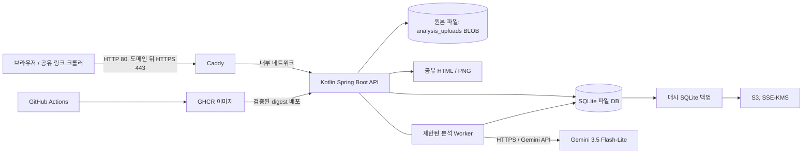

# SantaCut 시스템 아키텍처

작성: 2026-11-15 · 상태: 구현을 위한 설계 기준

## 구현 현황

- 런타임은 Java 25, Kotlin, Spring Boot 4, SQLite 파일 DB, Hibernate `ddl-auto: update`와 `schema.sql` 초기화를 사용한다. Flyway는 사용하지 않는다.
- 저장소 코드는 Spring Data JPA Repository만 사용한다. 분석 큐, 점수, 순위 스냅샷, 공유도 JPA 엔티티로 관리한다.
- Swagger UI와 OpenAPI 3 명세는 `/swagger-ui.html`과 `/v3/api-docs`에서 제공한다. 각 API의 설명은 endpoint 전용 `@Operation` 메타 애노테이션에 두고, 요청·응답 모델에는 필드별 스키마 설명을 둔다.
- 저장소는 `backend/`와 `frontend/`를 나누는 모노레포다. `frontend/`는 프론트엔드 팀이 직접 구성하는 영역이며, 백엔드는 프론트엔드 소스나 빌드 도구에 의존하지 않는다. 두 앱의 계약은 OpenAPI 명세 하나다.
- AI 호출은 Spring AI Google GenAI로 Gemini 3.5 Flash-Lite(Gemini Developer API)를 부른다. API 키는 환경 변수 `GEMINI_API_KEY`에서 읽는다. 보내는 것은 본인 메시지로 만든 항목별 신호와 표본(최대 120줄, 본문 6,000자)뿐이다.
- 분석 API는 원본 파일 업로드(`POST /v1/analyses/files`)와 정규화된 이벤트 JSON(`POST /v1/analyses`)을 둘 다 받는다. 카카오톡 TXT(PC·모바일)와 인스타그램 `message_1.json` 파서가 있다. 다만 공개 내보내기 예시로 만든 것이라 실제 샘플 검증은 출시 전에 해야 한다.
- 지역은 전국 시·도 16개와 시·군·구 255개(모두 271개)다. 서울은 `schema.sql`이, 나머지는 `regions.sql`이 앱 시작 때마다 넣는다(`INSERT OR IGNORE`).
- 분석 진행 상태는 진행 상황 스트림(`GET /v1/analyses/{id}/events`, SSE)으로 받거나 폴링(`GET /v1/analyses/{id}`, `GET /v1/me/analysis`)으로 읽는다. 스트림 상한에 걸리면 폴링으로 바꾼다. 결과는 `GET /v1/me/result`로 따로 읽는다.
- 내보내기 안내 UI, 실제 도메인과 서버는 아직 출시 전 작업이다.
- 백엔드 코드는 `presentation → application → domain → infrastructure` 4계층 레이어드 아키텍처를 따른다. 의존은 위에서 아래로만 흐르고 포트·어댑터는 쓰지 않는다. 규칙은 [백엔드 코드 컨벤션](backend-conventions.md)에 정의한다.

## 1. 결정 요약

Kotlin + Spring Boot 모듈형 모놀리스 한 개와 SQLite 파일 DB를 단일 저가 Linux VPS에서 운영한다. Caddy가 TLS와 reverse proxy를 담당한다. AI 분석 작업은 SQLite에 저장하고 같은 애플리케이션의 제한된 worker가 처리한다. Redis, Kafka, Kubernetes, 별도 API gateway, 관리형 DB는 첫 출시에서 도입하지 않는다.

단일 서버 장애 시 전체 서비스가 중단되는 구조를 선택하는 대신 비용과 운영 난이도를 낮춘다. 자동 재시작·외부 백업·복구 절차로 대응하며 무중단·고가용성을 약속하지 않는다. 원본 JSON을 받는 기능부터 점수·랭킹·배송 ETA·공개 공유 페이지와 이미지까지 같은 도메인에서 제공한다.

아래 문서의 구현 목표와 현재 코드의 지원 범위는 구분한다. 출시 전 실제 카카오톡·인스타그램 내보내기 샘플, AI 공급자 키, 전국 지역 좌표, 구매한 도메인·서버가 필요하다. 예제 JSON 또는 mock 결과로 정상 동작한 것을 실제 플랫폼의 모든 내보내기 지원으로 표기하지 않는다.

## 2. 배포 구조

앱·worker는 처음에는 같은 JVM이다. worker만 분리할 때는 동일 이미지의 실행 모드와 큐 소비자 수를 변경한다. SQLite 파일(원본 파일을 담는 `analysis_uploads` 포함), 내부 actuator는 인터넷에 publish하지 않는다. 공개 포트는 80/443, 관리용 SSH는 운영자 IP 또는 안전한 관리 경로로 제한한다.

## 3. 기술 구성과 모듈 경계

- JVM: Java 25를 기준으로 Gradle toolchain과 CI를 일치시킨다.
- Kotlin/Spring Boot/Gradle: 선택한 Boot BOM과 호환되는 패치 버전을 build 파일·Wrapper에 고정한다. 업그레이드는 테스트·취약점 검증 후 PR로 수행한다.
- Spring MVC + Spring Data JPA: 데이터 접근은 infrastructure 계층의 리포지토리에 모은다. SQLite 작업 큐의 단일 worker는 짧은 트랜잭션과 DB 호환 쿼리만 사용한다.
- SQLite: 한 파일에 사용자·세션·작업·분석·랭킹·공유를 저장하고 파일 백업을 외부로 전송한다. 현재 구현은 `schema.sql` 초기화와 Hibernate `ddl-auto: update`를 사용하며, 프로덕션 데이터 변경 전 백업과 복원 검증이 필요하다.
- HTML 공유 페이지: 서버 렌더링으로 Open Graph 메타 태그를 첫 응답에 포함한다. JavaScript를 실행하지 않는 카카오톡·SNS 크롤러도 읽을 수 있어야 한다.
- PNG: Java2D/ImageIO 등 JVM 안에서 그리는 1200×630 이미지. headless 브라우저는 메모리 때문에 기본 배제한다. 한글 폰트를 이미지에 포함하고 라이선스를 보관한다.

권장 패키지 경계:

| 모듈 | 소유 데이터·책임 |
| --- | --- |
| identity | 닉네임 정규화, 참가자, 세션 소유권 |
| ingestion | 업로드 제한, 출처별 parser, 본인 화자 선택, 보관 기한 |
| assessment | AI 호출(DB의 최신 채점 프롬프트 판), 구조화 응답 검증, 점수 계산 |
| ranking | 시즌, 동점 처리, 안정적인 배송 순번, 스냅샷 |
| delivery | 지역 거리, 근무 달력, 누적 작업량, ETA |
| sharing | 공개 토큰, 고정 결과, HTML/PNG, 폐기 |
| operations | 작업 claim, 복구, cleanup, 상태 점검 |

도메인 계산은 Spring 의존성 없는 Kotlin 함수로 작성한다. Clock과 설정을 주입하고 UTC Instant를 저장하며 사용자에게 Asia/Seoul로 표시한다. 돈·점수는 Double로 저장하지 않는다. 점수는 0~10000 정수, AI 비용은 정수 최소 단위 또는 BigDecimal로 관리한다. 외부 DTO를 DB 모델로 바로 사용하지 않는다.

## 4. 실제 사용자 요청 처리

1. 같은 origin에서 참가자 세션을 발급하고 CSRF 토큰을 받는다.
2. 닉네임과 지역 코드를 등록한다. 닉네임 가용성 조회 후에도 DB UNIQUE 충돌을 처리한다.
3. 데이터 받기 화면에서 출처를 고르고 내보내기 절차를 안내한다.
4. 원본 파일(multipart)이나 정규화한 이벤트 JSON을 서버에 제출하고 작업 ID를 202로 받는다. HTTP 요청은 검증이나 AI 완료를 기다리지 않는다. 화면은 진행 상황 스트림(`GET /v1/analyses/{id}/events`)으로 바뀐 상태를 받고, 스트림을 쓸 수 없으면 몇 초마다 폴링한다.
5. worker가 유효한 데이터를 확인해 AI를 호출한다.
6. schema와 근거를 검증하고 점수를 서버에서 계산한다. 최신 요청만 활성 결과로 게시한다.
7. 랭킹·ETA 스냅샷을 재계산한다. 완료 스냅샷을 한 번에 바꾼다.
8. 결과를 조회하고 공유 링크를 생성한다. 공유는 서버가 저장한 결과만 받아들이며 클라이언트가 점수·순위·ETA를 지정하지 못한다.

첫 버전에서는 앱이 `POST /v1/analyses/files`로 원본을 직접 받아 `analysis_uploads` 테이블(BLOB)에 둔다. 기존 기획의 서명 업로드 URL은 나중에 객체 저장소를 들일 때 쓴다. 크기 제한은 여러 겹으로 건다.

| 위치 | 설정 | 값 |
| --- | --- | --- |
| Caddy | `request_body max_size` | 21MB |
| Spring multipart | `max-file-size` / `max-request-size` | 20MB / 21MB |
| Tomcat | `server.tomcat.max-swallow-size` | 21MB(거절한 뒤에도 남은 본문을 읽고 413을 보낸다) |

서버가 막으면 `413 FILE_TOO_LARGE`, Caddy가 막으면 `code` 없는 `413`이 간다. 검증 작업자는 원본을 한 번에 하나만 꺼내 파싱하고, 파싱하는 동안 DB 커넥션을 쥐지 않는다. 출처별 형식 확인과 이벤트 수·글자 수 제한을 적용한다.

프론트엔드는 같은 도메인에서 API를 호출해 세션 쿠키와 CSRF 쿠키를 그대로 사용한다. Caddy는 모든 요청을 앱으로 proxy하고 `/actuator`만 외부에 404로 막는다. 별도 API 서브도메인과 CORS 설정은 초기에는 필요하지 않다. 프론트엔드 배포 방식(같은 Caddy 아래 정적 파일 또는 별도 호스팅)은 프론트엔드 팀이 `frontend/`를 구성할 때 정한다.

### 백엔드 개발 명령

| 작업 | 디렉터리 | 명령 |
| --- | --- | --- |
| 실행 | `backend/` | `./gradlew bootRun` 또는 Windows `./gradlew.bat bootRun` |
| 검증 | `backend/` | `./gradlew check` |

API 계약을 바꿀 때는 해당 엔드포인트의 전용 Swagger 애노테이션과 DTO 스키마 설명을 같은 변경에 포함한다.

## 5. 지속성 있는 분석 작업과 비용 제어

작업 상태(설계안)는 QUEUED → RUNNING → SUCCEEDED / INSUFFICIENT_DATA / FAILED이고 retry 가능 실패는 next_attempt_at을 둔다. DB row에는 attempts, lease_owner, lease_until, fencing_token, request_sequence, versions를 둔다.

현재 구현: 원본 파일 작업은 `VALIDATING`에서 시작하고, 검증 작업자(기본 1초 간격)를 거쳐 `QUEUED`가 된다. 분석 작업자(기본 3초 간격)가 `RUNNING`으로 임대(3분)하고 최대 3번 시도한다. 응답 진행 단계는 `VALIDATING`, `QUEUED`, `ANALYZING`, `RANKING_PENDING`, `SUCCEEDED`, `FAILED`다. DB row에는 `attempts`, `lease_token`, `lease_until`, `error_code`가 있고 next_attempt_at, fencing_token, request_sequence, versions는 두지 않았다. 24시간 넘게 기다린 `VALIDATING`·`QUEUED` 작업은 AI가 꺼져 있어도 `EXPIRED`로 끝낸다. 전체 상태 전이는 [백엔드 설계 §10.1](backend-design.md)에 있다.

- 짧은 트랜잭션에서 `FOR UPDATE SKIP LOCKED`로 하나를 claim하고 lease와 fencing token을 갱신한다. SQLite 구현은 커넥션 1개에 작업자도 하나라서, 가장 오래된 `QUEUED` 행을 읽고 리스 토큰을 쓴다.
- 트랜잭션을 커밋한 뒤 AI HTTP 호출을 한다. 외부 호출 동안 DB connection/row lock을 잡지 않는다.
- 초기 worker 동시성 1, 호출 timeout 60초, lease 120초를 기본안으로 하되 타임아웃·재시도 정책과 함께 조정한다.
- 종료 직전 결과 저장에는 job ID + fencing token을 조건으로 사용해 기한 지난 worker가 최신 결과를 덮어쓰지 못한다.
- 프로세스가 죽으면 lease가 만료된 작업만 회수한다. 모든 재시도는 같은 캐시·idempotency 문맥을 유지한다.
- AI 공급자가 요청 멱등성을 제공하지 않으면 네트워크 실패 시 중복 과금 가능성이 남는다. exactly-once 과금을 보장하지 않는다.
- 사용자·시즌의 최신 request_sequence와 일치하는 정상 결과만 활성화한다. 이전 작업은 기록으로 남아도 활성 점수를 바꾸지 않는다.
- 성공 결과 캐시 키에는 사용자, 파일 hash, source, 본인 화자, 정규화·표본 기간, parser/prompt/model/score 버전을 모두 포함한다.

**[대체됨]** 처음에는 DB에 일별 예산 ledger를 두고 최악 토큰 비용을 먼저 reserve하는 방식을 계획했다. 지금 앱에는 AI 호출 수 한도가 없다. 대신 날짜별 토큰 합계로 한 달 9달러를 넘지 않게 막고, 호출 전에 그 호출의 어림 비용을 더해 확인하는 비용 가드가 있다. 하루 한도는 설정으로만 켠다. Gemini는 선불 크레딧으로 쓴다. 앱에는 참가자별 24시간 3회 제출 한도와 이벤트 수·글자 수 제한만 남아 있다.

입력은 90일 이내 대화 전체(최대 이벤트 2,000개)를 정규화한 대화문이고, 약 4만 5천 토큰 상한을 넘으면 최근 줄만 남긴다. 모델 이름을 바꾸면서 동일 버전 캐시를 재사용하지 않는다. provider URL은 운영 설정 allowlist만 허용하며 사용자 입력 URL로 데이터를 전송하지 않는다.

## 6. 점수·랭킹·배송 원자성

100점 만점 소수점 둘째 자리와 단일 통합 랭킹을 유지한다. 데이터 출처별 별도 리그를 만들지 않는다. 서로 다른 출처의 형식이 공통 척도에 필요한 근거를 주는지는 실제 샘플로 검증하며, 빈 근거를 랜덤 점수로 보충하지 않는다.

순위: 총점 → 배려 → 존중 → 긍정 → 협력 내림차순. 완전히 같은 항목이면 공개 공동 순위, 배송 순번은 최초 성공 시각 → UUID로 안정화한다. 최초 성공 시각은 재업로드로 바꾸지 않는다.

랭킹 snapshot은 점수·지역 좌표 버전·순위·배송 순번·ETA를 묶는다. 전체 재계산은 최초 O(N log N) 정렬 + O(N) 거리 누적으로 충분하다. 변경 폭주 시 dirty 플래그와 debounce로 계산을 합치며, 한 시즌에 하나의 builder만 advisory lock으로 실행한다. 계산 도중 새 변경이 오면 추가 dirty 버전을 남겨 최신 상태까지 재실행한다.

season current_snapshot_id는 계산 완료 후 짧은 트랜잭션으로 교체한다. pagination cursor에 snapshot ID를 넣어 순위가 변할 때 중복/누락되지 않게 한다. 새 snapshot에 기존 cursor를 그대로 적용하지 않는다.

**[대체됨]** 지금 cursor에는 snapshot ID가 없고 직전 페이지 마지막 줄의 `delivery_sequence`만 들어 있다. 페이지를 넘기는 사이에 재계산이 일어나면 줄이 겹치거나 빠질 수 있다. 대신 응답의 `computed_at`으로 계산 시각을 보여 준다. 순위표 응답은 `{ stage, rows, season_year, participant_count, computed_at, next_cursor }` 봉투이고, 동점 행에는 `tied`가 붙는다.

출발지는 문서상 여의도 IFC몰이며 실제 좌표는 서버 설정으로 주입한다. 사용자 응답에는 포함하지 않는다. 배송 규칙은 100km/h, 180초/명, 00:00~06:00 KST, 12/25 00:00 최초 출발이다. 대권거리와 누적 작업량으로 계산하고 06:00 정확한 완료·다음 날 재개·연도 이월을 단위 테스트한다. 전체 계산식은 [백엔드 기획](backend-design.md)을 따른다.

시즌 동결은 스케줄러가 제시간에 실행됐다는 가정에 의존하지 않는다. 쓰기 트랜잭션이 DB 기준 cutoff를 확인한다. 동결 시 snapshot을 영구 고정하고 이후 가입자는 다음 시즌 대기/체험으로 분리한다. 삭제는 공개 결과를 지우되 다른 사용자 확정 ETA를 재작성하지 않는다.

## 7. JSON 결과 공유의 완성 조건

`POST /v1/shares`는 로그인한 세션의 완료 결과만 가져와 불변 공유 스냅샷을 만든다. 공개 token은 충분한 entropy의 난수이고 닉네임 또는 순번으로 추측할 수 없어야 한다.

공유 payload에는 닉네임, 점수 문자열, rank, ETA, 판정문, 계산 시각, 시즌, snapshot version만 포함한다. 지금 `shares` 행에는 닉네임, 점수, 순위, 공동 순위(`tied`), 확정 상태(`stage`), ETA, 판정·한마디, 계산 시각, 공유 시각(`created_at`)을 복사해 둔다. 원본 JSON, 대화 내용, AI 프롬프트, region의 상세 좌표, 산타 출발지, 세션 ID는 제외한다.

- `GET /s/{token}`: 서버 HTML과 `og:title`, `og:description`, 절대 HTTPS `og:url`, `og:image`, 이미지 크기, twitter card를 반환한다.
- `GET /s/{token}/image.png`: 같은 스냅샷으로 실제 PNG 반환. Content-Type=image/png이며 한글 폰트 누락을 테스트한다.
- 이미지가 별도 캐시라면 정해진 최대 크기와 생성 동시성 1을 둔다. 임의 문자열 길이를 제한하고 줄바꿈·HTML escaping을 적용한다.
- 원본 데이터가 삭제돼도 저장된 비민감 공유 payload로 이미지를 재생성할 수 있어야 한다.
- 소유자는 토큰을 폐기할 수 있고 폐기 후 HTML·이미지 모두 404다. `Accept`에 `text/html`이 있으면 시작 링크가 있는 안내 HTML을, 없으면 JSON(`SHARE_NOT_FOUND`)을 준다. 브라우저·SNS가 이미 저장한 복사본까지 회수할 수는 없다.
- 즉시 폐기를 우선하면 공개 응답도 `Cache-Control: no-store`로 시작한다. CDN 장기 cache를 켜려면 purge와 짧은 TTL 운영을 먼저 마련한다.
- 공유 카드 생성 시각을 표시한다. 순위 변화 후 같은 토큰의 점수·ETA를 몰래 바꾸지 않는다.

브라우저 공유는 Web Share API가 가능하면 사용하고 링크 복사·PNG 다운로드를 기본 대안으로 제공한다. 카카오 SDK 전용 공유는 개발자 앱·도메인 등록 후 추가 가능하다. 링크 공유와 실제 PNG 다운로드만으로도 MVP 공유 기능은 완성할 수 있다.

## 8. 보안·개인 데이터 경계

세션은 추측 불가능한 난수 token과 서버 hash 저장 방식으로 관리한다. 쿠키는 HttpOnly, Secure(운영), SameSite=Lax이며 전체 상태 변경 API에 CSRF를 적용한다. JSON content type 검증과 Origin 확인을 보조적으로 사용한다. CORS wildcard+credentials를 허용하지 않는다.

원본 파일은 디스크 디렉터리가 아니라 SQLite `analysis_uploads` 테이블의 BLOB 컬럼에 작업 ID를 키로 둔다. 사용자 파일명은 저장하지 않는다. 검증이 끝나는 트랜잭션에서 지우고, 남은 원본도 24시간 TTL이 지나면 지운다. 원문은 access log·exception·AI 에러 응답에 남기지 않는다. 처리 전에 외부 AI 전송에 대한 사용자 안내·동의와 삭제 정책을 제공한다.

공유 페이지·PNG 문구에는 서버 측 escaping과 길이 제한을 적용한다. 브라우저가 보내는 Host 헤더로 og:url을 만들지 않고 운영 PUBLIC_BASE_URL만 사용한다. forwarded 헤더는 신뢰하는 reverse proxy 경로에서만 해석한다.

Gemini API 키·AWS 키·SSH 키 같은 비밀값은 저장소·Docker image·workflow 로그에 넣지 않는다. 앱 설정은 서버 디스크에 두지 않는다. 서버가 부팅 때 KMS로 풀어 tmpfs `/run/santacut/app.env`(600)에 둔다. 앱 container는 non-root이고, Docker socket은 앱에 mount하지 않는다. Docker 권한이 있는 배포 계정은 사실상 root 권한이므로 전용 키·관리 경로로 제한한다.

## 9. 초저예산 서버·도메인 예산

사용자 제약: 서버 월 20,000원 이하, 도메인은 가비아에서 신규 구매. 도메인 이름은 미정이다. 가격 확인일 2026-11-15. 세금·환율·프로모션·초과 트래픽은 주문 화면에서 다시 확인하고 서버 예산에 백업비 여유도 포함한다. AI와 연간 도메인 비용은 별도 산정한다.

| 선택 | 월 서버 비용 | 결정 |
| --- | ---: | --- |
| AWS Lightsail `nano_3_0` / public IPv4 / 512MB / 2vCPU / 20GB | USD 5 | 현재 선택. worker 1개, 단일 JVM, 스왑 1GB, 부하 검증 필수 |
| AWS Lightsail Linux / public IPv4 / 2GB / 2vCPU / 60GB | USD 12 | 메모리가 모자랄 때 먼저 올릴 번들 |
| AWS Lightsail Linux / public IPv4 / 4GB / 2vCPU / 80GB | USD 24 | 예산 증액 시 확장안. 현재 월 2만원 제약의 기본 선택이 아님 |
| Hetzner CX23 / 4GB / 2vCPU | EUR 5.49 기준, IPv4·VAT 별도 | 초저예산 대안. 유럽 지연과 현재 재고·최종 견적 확인 필요 |

Lightsail 가격은 [공식 요금표](https://aws.amazon.com/lightsail/pricing/)의 public IPv4 Linux 번들 기준이다. 서버 지역은 한국 사용자 지연을 고려해 서울을 우선 확인한다. 무상 체험 기간을 영구 운영 예산으로 잡지 않는다. [Hetzner 공식 제품 페이지](https://www.hetzner.com/cloud/)도 지역·IP·세금 포함 최종 견적으로 비교한다.

도메인은 사용자 선택에 따라 [가비아](https://domain.gabia.com/)에서 구매한다. `.com` 우선 검색 후 실제 구매 가능 이름을 정한다. 연간 등록비와 갱신가·VAT는 결제 화면에서 확인하며 현재 확정 견적은 없다. 첫해 할인보다 갱신가·등록 소유자·MFA·자동갱신을 확인한다. DNS는 가비아에서 직접 관리할 수 있고, 향후 Cloudflare DNS를 쓰더라도 등록기관은 가비아로 유지할 수 있다.

서울 지연을 우선해 Lightsail 서울 `nano_3_0`($5)으로 시작한다. 큰 번들로 올릴 때 환율·VAT·백업을 더해 20,000원을 넘으면 이 예산을 충족한다고 표시하지 않는다. [Hetzner 공식 2026-06 가격 조정 안내](https://docs.hetzner.com/general/infrastructure-and-availability/price-adjustment/) 검색 결과는 CX23 EUR 5.49를 제시한다. 직접 페이지 fetch가 404여서 주문 시 재확인하며 현재 제품 페이지에는 가용성 제한도 보인다. 서버 월 예산 산식은 VM + public IPv4 + 세금/환율 + 외부 백업 저장·요청·전송료다. 도메인 연납은 별도로 계산한다. AI 비용은 `분석 수 × (입력 토큰 × 입력 단가 + 출력 토큰 × 출력 단가)`로 따로 계산한다. 앱에는 AI 호출 한도가 없고, 토큰 비용 가드(하루 0.5달러, 한 달 9달러)가 막는다. 사용량을 정하기 전 총비용을 월 몇천 원으로 약속하지 않는다.

[GitHub Actions 공식 안내](https://docs.github.com/en/actions/concepts/billing-and-usage)에 따라 공개 저장소의 standard hosted runner 사용은 무료다. 비공개 저장소·larger runner·artifact/package 저장 비용은 계정 조건을 확인한다. artifact 보관 기간을 짧게 하고 오래된 container image는 롤백 후보를 남긴 뒤 정리한다.

512MB 메모리 예산: 앱 컨테이너 `mem_limit: 400m`, JVM `-Xms128m -Xmx256m`(metaspace 최대 128MB, SerialGC), Caddy `mem_limit: 64m`, 나머지는 OS와 페이지캐시다. 자세한 값은 [배포 운영서](deployment.md)에 있다. 숫자는 부하 테스트로 검증한다. 스왑 1GB는 OOM 완화용이지 처리량 확장 수단이 아니다. 운영 서버에서 Gradle·Docker build를 실행하지 않고 CI에서 만든 이미지를 pull한다.

## 10. CI/CD와 배포 계약

PR CI: Wrapper checksum 확인 → Java toolchain → compile/test → SQLite 통합 테스트 → bootJar → container build → 비밀·의존성 검사. main의 같은 커밋으로 검증된 image를 GHCR에 게시한다. 배포는 image tag가 아니라 digest를 기록한다.

GitHub Actions 권한은 기본 contents:read, 이미지 게시 job만 packages:write. 외부 PR에 배포 secrets를 전달하지 않는다. production environment에 서버 키·known_hosts를 저장하고 SSH host key를 대역 외 확인한다. 실행 때 `ssh-keyscan`만으로 처음 본 키를 무조건 신뢰하지 않는다.

초기 CD는 수동 workflow_dispatch로 검증된 digest를 선택한다. 도메인·서버가 마련된 후 운영 정책에 맞춰 main 자동 배포를 켠다. 배포 concurrency group은 한 서버당 하나이며 배포 중 취소하지 않는다. GitHub concurrency와 별도로 서버 파일 lock으로 겹치는 실행을 막는다.

배포 순서:

1. compose 구문·필수 환경변수·디스크 여유·최근 백업을 확인한다.
2. 새 이미지를 pull하고 이전 image digest를 기록한다.
3. 새 worker claim을 중지하고 진행 중 작업을 timeout 이내 drain한다.
4. Hibernate `ddl-auto: update`가 예상한 SQLite 스키마 변경을 만드는지 검토하고, 이전 앱 버전으로 복구할 수 있도록 사전 DB 백업을 검증한다.
5. 앱을 교체한다. 단일 서버 메모리 예산 때문에 짧은 중단을 허용하며 blue/green으로 두 JVM을 동시에 띄우지 않는다.
6. 내부 readiness와 HTTPS 공개 health를 확인한다. 핵심 read-only smoke check를 통과하면 배포 성공으로 기록한다.
7. 실패하면 이전 digest로 앱을 복구하고 다시 health를 확인한다. DB migration을 자동 역실행하지 않는다.

파괴적 스키마 변경은 expand → 새 버전 전환 → 별도 릴리스에서 contract 순으로 수행한다. DB를 과거 백업으로 복원하는 것은 최근 사용자 쓰기를 잃을 수 있으므로 자동 앱 rollback과 혼동하지 않는다.

## 11. 도메인 구매 후 실제 서버 시작 순서

1. 도메인과 서버 계정을 사용자 소유로 마련하고 MFA·결제 한도를 설정한다.
2. Linux LTS VPS와 고정 public IPv4, 비root 관리자 키를 준비한다.
3. OS 업데이트·시간 동기화·Docker/Compose 설치, 방화벽과 SSH 설정을 완료한다.
4. DNS A 레코드를 고정 IP로 연결한다. IPv6를 실제 설정하지 않았다면 AAAA를 추가하지 않는다.
5. 앱 설정(도메인·AI 설정·시즌·출발 좌표)을 인프라 레포 `scripts/put-secrets.sh`로 KMS 암호화해 S3에 올린다. 서버는 부팅 때 tmpfs `/run/santacut/app.env`로 받는다.
6. compose로 Caddy/app을 시작하고 Caddy가 80/443을 통해 TLS 인증서를 발급받게 한다. `www`를 쓴다면 canonical host로 redirect한다.
7. 외부에서 HTTPS·인증서·세션 쿠키·CSRF·업로드 제한·공유 HTML/PNG를 확인한다.
8. 오프호스트 백업 업로드와 복원 리허설을 완료한다.
9. GitHub production secrets를 연결하고 배포 dry run 및 실제 첫 배포를 확인한다.

서버 IP·도메인·SSH 자격 증명이 없으면 repository에 워크플로가 존재해도 실제 배포가 완료된 것은 아니다. 사용자 동의 없는 도메인 구매나 유료 리소스 생성은 이 설계 작업에 포함하지 않는다.

## 12. 백업·복원·관측

초기 목표는 RPO 24시간, RTO 2시간이며 실제 복원 리허설로 검증하기 전에는 보장하지 않는다. 매일 SQLite 온라인 백업을 생성하고 checksum과 함께 암호화해 서버 밖 저장소에 전송한다. 같은 서버 디스크의 backup 폴더만으로 완료 처리하지 않는다. 7일 일간·4주 주간 보존을 기본안으로 하고 비용을 확인한다.

원본 업로드는 24시간 이내 삭제 대상이므로 장기 backup에 넣지 않는다. 공개 이미지도 DB의 안전한 share payload로 다시 생성할 수 있다면 별도 장기 백업을 생략한다. 운영 설정은 비밀 관리 경로에서 별도로 복구할 수 있어야 한다.

복원 리허설: 격리된 디렉터리에 SQLite 백업 복원 → checksum 확인 → 스키마/사용자 수/샘플 공유/순위 검증 → 임시 환경 폐기. 운영 DB에 바로 덮어쓰기하지 않는다. 삭제된 사용자 정보가 과거 backup에 남는 보존 기간과 복원 후 삭제 재적용 절차를 운영 정책에 포함한다.

컨테이너 log rotation, 디스크 80% 경고, DB connection 수, queue oldest age, AI 실패율·비용, snapshot age, 최근 backup 성공 시각을 관측한다. 원문·토큰·IP 전체값을 로그에 남기지 않는다. 시작은 외부 HTTP uptime check와 제한된 로그로 충분하며 Prometheus/Grafana 상주 stack은 생략한다.

## 13. 출시 검증과 확장 조건

출시 차단 조건: 실제 플랫폼 샘플 parser 미검증, mock AI 운영 활성화, 세션/CSRF 우회, 사용자 간 데이터 접근, 미검증 점수 저장, 무한 retry·무제한 비용, 공유 XSS/원문 노출, backup 복원 실패, readiness 실패.

부하 목표는 최초 기준으로 조회 20 RPS·분석 동시성 1·1만 참가자 전체 재계산을 측정한다. 이는 보장 성능이 아니며 p95 응답·heap·DB lock·계산 시간을 기록해 예산과 맞춘다. 512MB에서 OOM 또는 빈번한 swap이 생기면 먼저 2GB 번들로 올린다.

이후 확장은 원본/공유 파일을 S3 호환 저장소로 분리 → 분석 worker를 별도 프로세스로 분리 → DB를 별도 서버로 분리 순이다. 지속적인 큐 지연과 비용 근거가 생기기 전 Kafka·Kubernetes를 도입하지 않는다.

## 14. 검토 이력

[패널 A 검토](review-panel-a.md) 및 다른 패널 검토에서 설계와 실제 구현을 구분해 기록한다. 전문가 역할별 셀프리뷰는 오류를 줄이는 과정이며 무결점이나 실제 운영 검증을 의미하지 않는다.

## 15. ADR: Vercel을 함께 쓰는 선택

결정: 월 서버 2만원 제약과 현재 Kotlin Spring 중심 구현에서는 단일 VPS 전체 호스팅을 기본으로 두되, 프론트엔드 개발·preview 필요가 생기면 Vercel 프론트 + VPS 백엔드를 선택할 수 있게 경계를 유지한다.

| 구성 | 장점 | 비용·운영 고려 |
| --- | --- | --- |
| VPS에서 프론트·Spring·DB | 같은 origin, 한 배포 경로, 추가 호스팅 비용 없음 | 프론트 preview/CDN 기능을 직접 마련 |
| Vercel 프론트 + VPS Spring·DB | 프론트 preview와 배포 분리 | VPS 비용은 그대로, 플랜 조건·proxy·세션·업로드 검증 추가 |

[Vercel Functions 공식 runtime 목록](https://vercel.com/docs/functions/runtimes)에 일반적인 JVM Spring Boot 상주 프로세스가 기본 runtime으로 제공된다고 안내되어 있지 않다. 따라서 Kotlin Spring 서버와 SQLite·분석 worker를 Vercel frontend 배포로 대체하지 않는다.

Vercel을 쓸 경우 `/api/*`, `/s/*`를 VPS의 HTTPS origin으로 [external rewrite](https://vercel.com/docs/routing/rewrites)할 수 있다. PUBLIC_BASE_URL은 사용자가 방문하는 가비아 도메인으로 고정하고 host-only 세션·CSRF Origin·multipart 크기·proxy timeout을 실제 환경에서 검증한다. 브라우저가 API subdomain을 직접 부르면 별도 CORS/쿠키 설계가 필요하므로 기본안은 same-origin rewrite다.

공유 HTML과 PNG는 Spring이 계속 소유한다. 외부 origin의 cache-control을 확인하고 원본·사용자 응답·폐기 가능한 공유에는 no-store를 유지한다. Vercel CDN을 쓴다고 폐기된 이미지가 자동 회수된다고 가정하지 않는다.

[Hobby 안내](https://vercel.com/docs/plans/hobby)와 [공정 사용 정책](https://vercel.com/docs/limits/fair-use-guidelines)은 개인 비상업적 사용 조건을 설명한다. 또한 [협업 안내](https://vercel.com/docs/deployments/troubleshoot-project-collaboration)는 Hobby에서 private repository 협업 제한과 commit author 조건을 명시한다. 두 명이 함께 개발하므로 저장소 공개 여부·배포 소유자·상업적 사용 계획을 확인한 뒤 채택한다. 제한을 git 이력 삭제 등으로 우회하지 않는다. Pro가 필요하면 월 2만원 예산과 별도로 비용을 다시 검토한다.

가비아 도메인을 Vercel로 연결하는 경우 Vercel 프로젝트가 요구하는 DNS 레코드를 가비아 DNS에 입력한다. 하드코딩한 예전 A/CNAME 값을 사용하지 않는다. API origin 도메인은 별도 VPS TLS 인증서를 유지하며 내부 출발 좌표는 어느 배포 방식에서도 공개하지 않는다.

